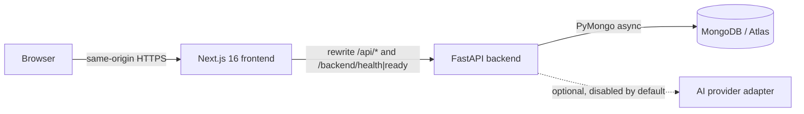

# Architecture

## Request path
1. The browser only talks to the Next.js origin. `next.config.ts` rewrites `/api/:path*` to `${BACKEND_URL}/api/:path*`, so the session cookie is first-party and no browser CORS is involved.
2. `src/proxy.ts` (Next 16's name for middleware) redirects visitors without a `saige_session` cookie to `/login?next=…`. This check is **optimistic only**.
3. FastAPI authenticates every protected endpoint (`CurrentUser` dependency), enforces admin rights (`AdminUser`) and checks CSRF on unsafe methods (`verify_csrf`).

## Frontend
- **Rendering:** route shells are static (prerendered). Data is fetched on the client with TanStack Query against the backend. This fits a private, authenticated app and avoids request-time server rendering. Cache Components rules apply: anything that reads the request goes behind `<Suspense>`.
- **Structure:** `app/(app)/…` holds the authenticated routes wrapped in `AppShell` (sidebar, mobile drawer, top bar, breadcrumbs, Ctrl+K search). `app/login` and `app/page.tsx` are public.
- **Modules:** `components/ui` (design system), `components/navigation`, `components/layout`, `features/<domain>` (auth, dashboard, settings, system), `lib/` (api client, navigation registry), `types/`.

## Backend
- `app/main.py`: `create_app(settings)` factory. The lifespan opens one `AsyncMongoClient` and creates indexes. The app still starts if MongoDB is down; `/ready` then reports 503.
- `app/config.py`: pydantic-settings. Secrets are `SecretStr`. Unsafe production configs are rejected at startup.
- `app/security/`: Argon2id passwords, opaque sessions (HMAC-SHA256 of the token stored, with a TTL index), in-memory rate limiter.
- `app/middleware/`: security headers and request IDs.
- `app/api/`: routers (`health`, `auth`). Later phases add `content`, `progress`, `assessments`, `interviews`, `admin`.
- Planned layering for domain features: `api` (HTTP) → `services` (rules, scoring) → `repositories` (MongoDB access) with `schemas` (Pydantic I/O models).

## Authentication and session design
| Concern | Decision |
|---|---|
| Account creation | `python -m scripts.create_owner` only. No registration endpoint, no default password. |
| Password storage | Argon2id (argon2-cffi defaults), rehash-on-login when parameters change. |
| Session | 256-bit random token in an HttpOnly, SameSite=Lax cookie (Secure in production). The DB stores only HMAC(token, SESSION_SECRET). Expiry is enforced both in code and by a TTL index. |
| CSRF | Double-submit: a readable `saige_csrf` cookie is echoed in the `X-CSRF-Token` header on POST/PUT/PATCH/DELETE. SameSite=Lax is the second layer. |
| Brute force | Sliding window per account (default 5 per 5 min) → 429 with Retry-After. Unknown emails and wrong passwords get identical responses and similar timing. |
| Errors | Validation errors never echo submitted input. Unhandled errors return a request ID, not a stack trace. |

**Trade-off noted:** the rate limiter is in-process memory. That is fine for one backend instance; scaling to several would need a shared store.

## Optional AI
`AI_PROVIDER=none` by default and `ai_enabled` is false without a key. A provider interface lands with Phase 5. No core feature depends on it.
