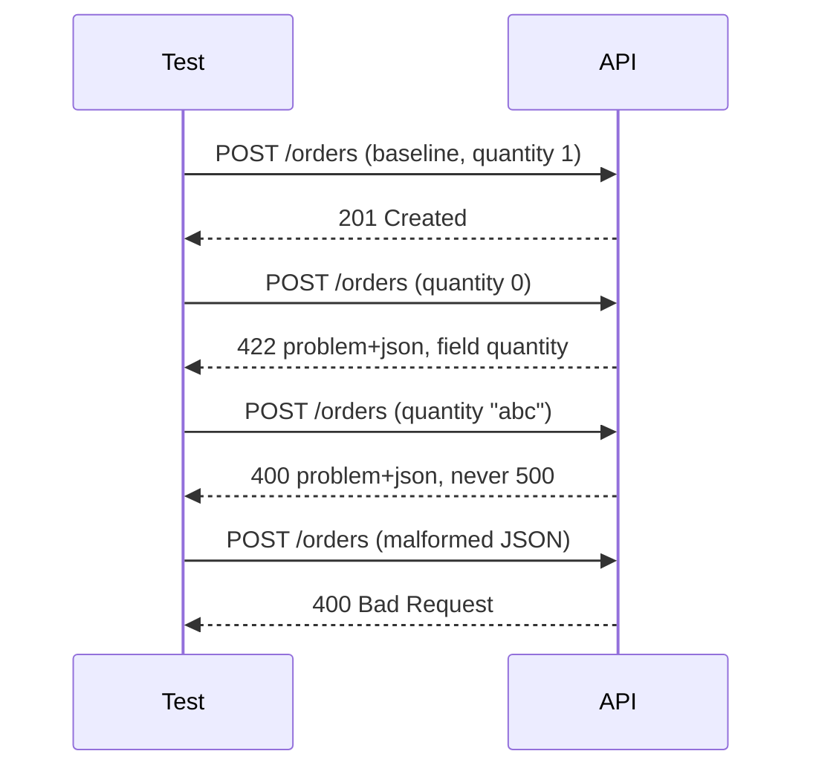

## Beginner-friendly explanation

A shop's front door has a sign: "maximum 10 people inside". The doorman counts. But the shop also has a loading bay round the back. If only the front door checks, anyone can walk in through the back.

The UI is the front door; the **API is the loading bay**. Scripts, partner systems, mobile apps and attackers all call the API directly. **Negative testing** checks what happens when someone sends something wrong; **boundary testing** checks the edges of what is allowed. Together they make sure the API itself refuses bad input politely, clearly and safely, whoever sends it.

## Technical explanation

An API's inputs are its **path parameters**, **query parameters**, **headers** and **body**. Each has a valid domain; anything else should be rejected with a **4xx** status and a consistent error body. [Boundary value analysis](/learn/manual-testing/boundary-value-analysis) and [equivalence partitioning](/learn/manual-testing/equivalence-partitioning) apply directly to API fields.

### Negative test categories

| Category | Examples for `"quantity": 1..100` | Typical expected status |
|---|---|---|
| Boundaries | 0, 1, 100, 101 | 422/400 outside, 201 inside |
| Missing | field omitted | 400/422 |
| Null / empty | `null`, `""` | 400/422 |
| Wrong type | `"5"`, `5.5`, `true`, `[]` | 400/422 (unless coercion is documented) |
| Extreme | `-1`, `2147483648`, `1e309` | 400/422, never 500 |
| Format and length | invalid email, 10,000-char name | 400/422 |
| Extra fields | unknown `foo`, protected `role` | ignored or 400, never applied |
| Structure | malformed JSON, empty body, array instead of object | 400 |
| Headers | missing/wrong `Content-Type`, unsupported `Accept` | 415 / 406 |
| Path/query | non-numeric id, unknown id, negative `limit` | 400 / 404 |

Status choices between 400 and 422 vary by API; what matters is that they are documented and consistent.

### Good error responses

RFC 9457 (Problem Details for HTTP APIs, which obsoletes RFC 7807) defines `application/problem+json` with members `type`, `title`, `status`, `detail` and `instance`, plus extensions such as a list of field errors. Whatever format is used, check that errors:

- name the field and the rule broken,
- are identical in shape across endpoints,
- contain no stack traces, SQL, file paths or library versions,
- don't reflect submitted values unescaped.



## Real-world example

A booking API accepted `"nights": 2147483647` because validation only checked `nights > 0`. Pricing multiplied nights by a nightly rate in a 32-bit integer, overflowed, and produced a negative total, which the payment step treated as a refund. The UI dropdown only allowed 1–30 nights, so no UI test could have found it.

A boundary test at the API level with the maximum documented value (30), its neighbour (31) and the data type's extreme value would have exposed both the missing upper bound and the overflow.

## Step-by-step walkthrough

1. **Collect the contract** for every input: type, required, range, length, format, allowed values.
2. **Create a valid baseline request** that returns success.
3. **For each input, list partitions and boundaries.**
4. **Add structural and header cases** for the endpoint as a whole.
5. **Write the expected status and error content** for each case before running.
6. **Change one thing per test** from the baseline.
7. **Run and triage**: any 5xx, any 2xx for invalid data, any leaked internals, any inconsistency.
8. **Automate** the table as a parameterised test.

## Code examples

A data-driven negative test in RestAssured (JUnit 5):

```java
static Stream<Arguments> invalidQuantities() {
    return Stream.of(
        Arguments.of("below minimum", 0, 422),
        Arguments.of("above maximum", 101, 422),
        Arguments.of("negative", -1, 422),
        Arguments.of("string", "abc", 400),
        Arguments.of("decimal", 5.5, 422),
        Arguments.of("null", null, 422)
    );
}

@ParameterizedTest(name = "{0}")
@MethodSource("invalidQuantities")
void rejectsInvalidQuantity(String name, Object quantity, int expected) {
    Map<String, Object> body = new HashMap<>(Map.of("sku", "BOOK-001"));
    body.put("quantity", quantity);

    given().spec(req).body(body)
    .when().post("/orders")
    .then().statusCode(expected)
           .contentType("application/problem+json")
           .body("errors.field", hasItem("quantity"))
           .body(not(containsString("Exception")));
}
```

Malformed JSON cannot be produced from a map, so send it as a raw string:

```java
given().spec(req).body("{\"sku\": \"BOOK-001\", ")
.when().post("/orders")
.then().statusCode(400);
```

## Expected output

A well-behaved API answers the "above maximum" case with something like:

```text
HTTP/1.1 422 Unprocessable Content
Content-Type: application/problem+json

{"type":"https://api.example.test/problems/validation","title":"Validation failed","status":422,
 "errors":[{"field":"quantity","message":"must be between 1 and 100"}]}
```

The `type` URI here is a placeholder for the API's own problem-type identifier.

## Common mistakes

- **Testing negatives only through the UI.**
- **Changing several fields at once**, so you can't tell which caused the rejection.
- **Accepting any 4xx** without checking the specific code and the field reported.
- **Ignoring 5xx because "it was rejected anyway".**
- **Forgetting type coercion**: some frameworks quietly turn `"5"` into `5`; make sure that matches the contract.
- **Skipping protected fields** like `role` or `price`, which hides mass-assignment flaws.

## Troubleshooting

- **All negatives return the same generic 400**: check whether validation happens at all, or whether a gateway rejects everything before the service; ask for field-level errors.
- **Different endpoints return different error shapes**: log it as a consistency defect; clients have to handle each shape.
- **Can't send a wrong type through your client**: build the body as a raw string or a `Map<String, Object>`.

## Key takeaways summary

The API is the real boundary. From a valid baseline, change one input at a time across missing, null, type, boundary, format, length, extra and structural cases, and expect a specific 4xx with a clean, consistent error body. Any 5xx or silently accepted invalid value is a defect worth reporting.
