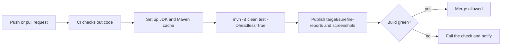

## Beginner-friendly explanation

Imagine baking from a recipe card. The card lists the ingredients (flour, eggs, sugar) and the steps (mix, bake, cool). You do not grow the wheat yourself; you buy it from the shop.

**Maven** is the recipe card for a Java project. The `pom.xml` file lists the ingredients — libraries like Selenium and TestNG — and Maven fetches them from an online store called a **repository**. Maven also knows the standard steps: compile the code, run the tests, package the result. Anyone, including a CI server, can type `mvn test` and get exactly the same build you get on your laptop.

## Technical explanation

### Project layout and the POM

```text
my-tests/
  pom.xml
  src/test/java/com/shop/tests/LoginTests.java
  src/test/resources/testng.xml
  src/test/resources/testdata/users.csv
  target/                  (generated: classes, reports)
```

A project is identified by **coordinates**: `groupId`, `artifactId`, `version`. Dependencies are declared with the same coordinates and a **scope** (`compile`, `test`, `provided`, `runtime`). Transitive dependencies are pulled in automatically; `mvn dependency:tree` shows the result.

### The lifecycle

The default lifecycle includes, in order: `validate`, `compile`, `test-compile`, `test`, `package`, `verify`, `install`, `deploy` (with smaller phases between). Running a phase runs all earlier phases. `clean` is a separate lifecycle that deletes `target/`.

### Surefire and Failsafe

The **Surefire** plugin runs tests in the `test` phase and writes XML and text reports to `target/surefire-reports`, which CI tools read. The **Failsafe** plugin runs integration tests (by default `*IT` classes) in `integration-test` and `verify`, which lets the build stop servers cleanly before failing. Many UI suites simply use Surefire.

| Command | Effect |
|---|---|
| `mvn clean test` | Fresh build and run all configured tests |
| `mvn test -Dtest=LoginTests` | One class |
| `mvn test -Dtest=LoginTests#validLogin` | One method |
| `mvn test -Dgroups=smoke` | TestNG groups or JUnit tags |
| `mvn test -DbaseUrl=https://staging.example.test` | Pass a system property |
| `mvn test -Pci` | Activate the `ci` profile |

### Maven in CI



`-B` (batch mode) gives non-interactive, CI-friendly logs.

## Real-world example

A test team's suite passed on one engineer's laptop and failed for everyone else. The cause was a JAR she had added to the IDE classpath by hand years earlier, which was never in the pom. Moving to dependency declarations in `pom.xml` only, with versions pinned in `properties`, made every machine — and the CI agent — build the same way. Running `mvn dependency:tree` later revealed two different Guava versions pulled in transitively, which they fixed with an explicit version.

## Step-by-step walkthrough

1. **Generate or create** a project with the standard layout.
2. **Declare versions as properties** and add `selenium-java` and `testng` dependencies.
3. **Configure Surefire** with your suite file.
4. **Read configuration** (`baseUrl`, `browser`, `headless`) from system properties with defaults.
5. **Run `mvn clean test`** locally, then the same command in CI.
6. **Publish reports** from `target/surefire-reports` as CI artifacts.

## Code examples

A minimal `pom.xml` for a Selenium + TestNG project. Versions shown are examples; check Maven Central for current releases.

```xml
<project xmlns="http://maven.apache.org/POM/4.0.0">
  <modelVersion>4.0.0</modelVersion>
  <groupId>com.shop</groupId>
  <artifactId>ui-tests</artifactId>
  <version>1.0.0</version>

  <properties>
    <maven.compiler.release>17</maven.compiler.release>
    <selenium.version>4.25.0</selenium.version>
    <testng.version>7.10.2</testng.version>
    <suiteXmlFile>src/test/resources/testng.xml</suiteXmlFile>
  </properties>

  <dependencies>
    <dependency>
      <groupId>org.seleniumhq.selenium</groupId>
      <artifactId>selenium-java</artifactId>
      <version>${selenium.version}</version>
      <scope>test</scope>
    </dependency>
    <dependency>
      <groupId>org.testng</groupId>
      <artifactId>testng</artifactId>
      <version>${testng.version}</version>
      <scope>test</scope>
    </dependency>
  </dependencies>

  <build>
    <plugins>
      <plugin>
        <groupId>org.apache.maven.plugins</groupId>
        <artifactId>maven-surefire-plugin</artifactId>
        <version>3.2.5</version>
        <configuration>
          <suiteXmlFiles>
            <suiteXmlFile>${suiteXmlFile}</suiteXmlFile>
          </suiteXmlFiles>
        </configuration>
      </plugin>
    </plugins>
  </build>
</project>
```

Reading configuration in Java, with defaults for local runs:

```java
public final class Config {
    public static final String BASE_URL = System.getProperty("baseUrl", "http://localhost:8080");
    public static final String BROWSER  = System.getProperty("browser", "chrome");
    public static final boolean HEADLESS = Boolean.parseBoolean(System.getProperty("headless", "false"));
    public static final String API_TOKEN = System.getenv("API_TOKEN"); // secret from CI, never committed
    private Config() {}
}
```

Run a different suite file with `mvn test -DsuiteXmlFile=src/test/resources/smoke.xml`.

## Expected output

Illustrative tail of a successful `mvn -B clean test`:

```text
[INFO] -------------------------------------------------------
[INFO]  T E S T S
[INFO] -------------------------------------------------------
[INFO] Running TestSuite
[INFO] Tests run: 12, Failures: 0, Errors: 0, Skipped: 0, Time elapsed: 48.31 s -- in TestSuite
[INFO]
[INFO] Results:
[INFO]
[INFO] Tests run: 12, Failures: 0, Errors: 0, Skipped: 0
[INFO]
[INFO] BUILD SUCCESS
```

## Common mistakes

- **Adding JARs manually** to the IDE instead of declaring dependencies.
- **Committing the `target/` folder.** Add it to `.gitignore`.
- **Unpinned or wildcard versions**, making builds non-reproducible.
- **Secrets in `pom.xml`** or `testng.xml`.
- **Using `-DskipTests` or `testFailureIgnore`** in CI and then wondering why failures go unnoticed.
- **An old Surefire version** that does not discover JUnit 5 tests.

## Troubleshooting

- **"Tests run: 0"**: check the suite file contents, the class naming pattern, or JUnit 5 provider compatibility.
- **`Could not resolve dependencies`**: check network or proxy settings in `~/.m2/settings.xml` and that coordinates are spelled correctly.
- **Different results in CI and locally**: compare JDK versions (`mvn -v`), properties passed, and headless window size.
- **Dependency conflicts** (`NoSuchMethodError` at run time): inspect `mvn dependency:tree` and pin the conflicting version.

## Key takeaways summary

Maven makes a test project reproducible: the pom defines what the project needs, the lifecycle defines how it is built, and Surefire runs and reports tests. Drive everything from the command line with properties, and the same command will work on your laptop and in [CI](/learn/sdet/ci-cd-for-test-engineers).
