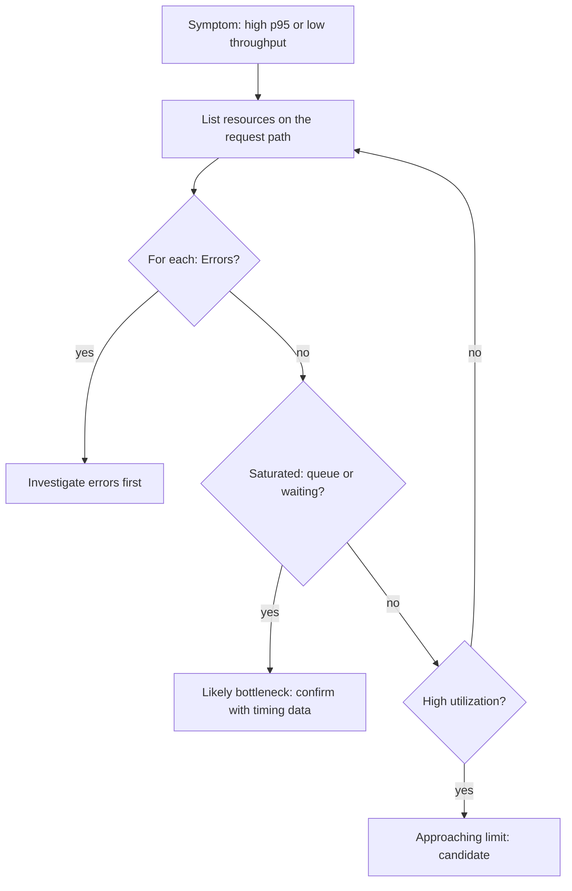

## Beginner-friendly explanation

Think of a motorway. Traffic flows smoothly until one point where three lanes merge into one. However wide the rest of the road is, the merge decides how many cars per hour get through, and the queue forms just before it. That merge is the **bottleneck**.

Every computer system has a merge point too: a busy CPU, a slow disk, a full network link, or a small pool of database connections. Performance analysis is the search for that merge point. The **USE method** is a simple checklist that stops you guessing: for every resource, ask how busy it is, whether work is queueing for it, and whether it is reporting errors.

## Technical explanation

### The USE method

Defined by Brendan Gregg, the method says: **for every resource, check Utilization, Saturation and Errors.**

- **Utilization:** the share of time the resource was busy (or the share of its capacity in use).
- **Saturation:** the amount of work waiting because the resource cannot serve it yet, usually a queue.
- **Errors:** the count of error events.

| Resource | Utilization | Saturation | Errors |
|---|---|---|---|
| CPU | % busy per core and overall | Run-queue length above core count; throttling in containers | Machine-check errors (rare) |
| Memory | Used versus available | Paging or swapping; out-of-memory kills; GC pressure in a JVM | Allocation failures |
| Disk | Device busy %, throughput | Average queue size, await time | Device I/O errors |
| Network | Throughput versus link bandwidth | Drops, retransmits, socket backlog overflows | Interface errors |
| Thread pool | Busy threads / max | Tasks waiting in the queue | Rejected tasks |
| Connection pool | Active / max connections | Threads waiting for a connection | Acquisition timeouts |

On Linux, common sources include `vmstat` (run queue, swap), `mpstat` (per-CPU), `iostat -x` (device utilization, queue, await), `sar -n DEV` (network), and `dmesg` (errors). Note that disk "% utilization" can understate capacity for devices that serve many requests in parallel, such as SSDs and arrays; queue size and latency are more telling there.

### Utilization law

**U = X × S**: utilization equals throughput times the service demand per request at that resource. With 20 ms of CPU per request on 4 cores:

| Throughput | CPU demand | Utilization |
|---|---|---|
| 50/s | 1.0 core | 25% |
| 100/s | 2.0 cores | 50% |
| 150/s | 3.0 cores | 75% |
| 200/s | 4.0 cores | 100% (theoretical maximum) |

### Why response time rises before 100%

Requests arrive unevenly, so they sometimes collide and wait. In the simplest single-server queueing model (M/M/1), response time R = S / (1 − U). For S = 20 ms:

| Utilization | Response time |
|---|---|
| 50% | 40 ms |
| 80% | 100 ms |
| 90% | 200 ms |
| 95% | 400 ms |

Real systems differ from this idealised model, but the shape holds: the curve bends sharply upward as utilization approaches 100%. That is why capacity plans target headroom.



## Real-world example

A team's search API missed its p95 objective at the target load, and CPU on the application servers averaged only around 50%. Applying USE methodically: CPU run queue was low and memory showed no paging, but the application's HTTP client pool to a downstream pricing service was fully used with a growing wait queue. The downstream service itself was healthy. Requests were not computing; they were *waiting* for one of a handful of outbound connections. Raising the client pool size, after confirming the pricing service had capacity, brought p95 within the objective. Looking only at CPU would never have found it.

## Step-by-step walkthrough

1. **Draw the request path**: load balancer, app servers, pools, caches, database, downstream services.
2. **List resources** at each hop, including software resources.
3. **Collect U, S, E metrics** at fine granularity (10 seconds or less) during the test.
4. **Correlate with load steps**: which saturation metric rises first as load increases?
5. **Confirm with timing data**: traces, slow-query logs or thread dumps showing where time goes.
6. **Change one thing**, re-run the same test and compare.

## Code examples

A quick USE snapshot on a Linux host during a test:

```bash
vmstat 5 3          # r = run queue, si/so = swap in/out
mpstat -P ALL 5 1   # per-CPU utilization
iostat -x 5 2       # %util, aqu-sz (queue), r_await/w_await
sar -n DEV 5 1      # network throughput per interface
sar -n EDEV 5 1     # network errors and drops
```

Utilization-law helper:

```python
def utilization(throughput_per_s, service_demand_s, servers):
    return throughput_per_s * service_demand_s / servers

print(f"{utilization(150, 0.020, 4):.0%}")
print(f"max throughput = {4 / 0.020:.0f}/s")
```

## Expected output

```text
75%
max throughput = 200/s
```

For `vmstat`, a run-queue column `r` consistently larger than the number of CPUs indicates CPU saturation; non-zero `si`/`so` columns indicate memory pressure.

## Common mistakes

- **Only looking at CPU and memory** and missing pools, locks and downstream dependencies.
- **Averages over long intervals**, which hide short saturation bursts.
- **Treating high utilization as a defect.** 85% CPU with no queueing and met objectives is efficient, not broken.
- **Ignoring the load generator**, which is also a resource that can saturate.
- **Changing several things at once**, so you cannot tell which change helped.

## Troubleshooting

- **No resource looks saturated but response time is high.** Look for waiting: locks, pool waits, synchronous calls to slow dependencies, or garbage-collection pauses.
- **Container shows low CPU but the app is slow.** Check CPU throttling against the container's CPU limit.
- **Metrics disagree with the load test.** Align clocks and time ranges, and check sampling intervals.

## Key takeaways summary

The bottleneck is wherever work queues. Use the USE method on every hardware and software resource, use U = X × S to estimate limits, and remember that response time climbs steeply well before 100% utilization. See [thread and connection pools](/learn/performance/thread-and-connection-pools) for the most common software bottleneck.
