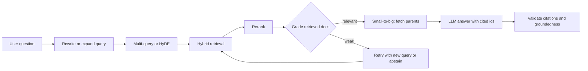

## Beginner-friendly explanation

A basic RAG system is like a librarian who takes your question literally, fetches the three books whose titles best match your exact words, and hands them over. Often that is enough. But sometimes:

- You phrase the question badly ("that thing where payments hang"), so the wrong books come back.
- The answer is in one sentence, but you need the surrounding chapter to understand it.
- The answer needs two lookups ("who manages the team that owns the checkout service?").
- You ask about the big picture ("what themes run through all our incident reports?"), and no three books contain that.
- The fetched books are wrong, and the librarian should notice and try again.

**Advanced RAG patterns** are the habits of a great librarian: rephrasing your question, asking it several ways, reading around the passage, following a trail of references, building a map of the collection, and double-checking before answering. Each habit costs time, so a great librarian only uses them when needed.

## Technical explanation

First, map patterns to the stage they fix. If you have not yet classified your failures (see [Building RAG pipelines](/learn/ai-engineering/building-rag-pipelines)), do that before adding anything.

| Failure observed | Stage | Candidate patterns |
|---|---|---|
| Query words differ from document words | Query | Rewriting, multi-query, HyDE, hybrid search |
| Right passage found but lacks context | Chunk/context | Small-to-big, contextual chunk headers |
| Right passage ranked too low | Ranking | Reranking, fusion |
| Answer needs facts from several documents in sequence | Reasoning over retrieval | Multi-hop, agentic RAG |
| Question is about the whole corpus | Corpus structure | GraphRAG, map-reduce summarisation |
| Retrieved junk is used anyway | Generation | Corrective RAG, Self-RAG, abstention |
| Claims not supported by sources | Generation | Citations plus groundedness checks |



### Query rewriting and expansion

Conversational questions ("and what about for annual plans?") depend on history; a rewriter turns them into standalone queries. Rewriting can also fix spelling, expand acronyms and add synonyms. Ma et al. (arXiv 2305.14283, 2023) framed this as a "rewrite-retrieve-read" pipeline, including training a small rewriter. In practice an LLM call with a clear prompt is the common starting point.

### Multi-query retrieval

Ask an LLM for three to five differently worded versions of the question, retrieve for each, and merge with reciprocal rank fusion (see [Hybrid search and BM25](/learn/ai-engineering/hybrid-search-and-bm25)). It raises recall when vocabulary varies. Cost: one generation call plus N retrievals.

### HyDE

**Hypothetical Document Embeddings** (Gao, Ma, Lin and Callan, arXiv 2212.10496, 2022) has an LLM write a hypothetical answer passage, embeds it, and retrieves real documents near it. The hypothetical text may contain wrong details, but its overall shape and vocabulary resemble real answers. Only real retrieved documents may be used as evidence, never the hypothetical one.

### Parent-document or small-to-big retrieval

Index small units (sentences or short chunks) for precise matching, store a pointer to the parent section, and send deduplicated parents to the LLM. Variants include sentence-window retrieval (send neighbours of the matched sentence). Watch the token budget: several hits in different parents can explode context size.

### Multi-hop and agentic RAG

Some questions need one retrieval's result to form the next query. IRCoT (Trivedi et al., arXiv 2212.10509, 2022) interleaves retrieval with chain-of-thought steps. **Agentic RAG** generalises this by giving an LLM a search tool (or several: vector search, SQL, web) and letting it decide when and what to search in a loop, as in [Tool use and AI agents](/learn/ai-engineering/tool-use-and-ai-agents). It is powerful for investigative questions, but adds latency, cost and nondeterminism; set a step budget, log every search and evaluate the trajectories as well as answers.

### GraphRAG

Edge et al. at Microsoft (arXiv 2404.16130, 2024) use an LLM to extract entities and relationships from the corpus into a knowledge graph, detect communities of related entities, and pre-generate summaries for each community. Global questions are answered by combining community summaries (map-reduce), which suits "what are the main themes" questions that top-k retrieval cannot answer. Indexing is expensive (many LLM calls over the whole corpus) and must be refreshed as data changes; for simple fact lookups standard RAG is usually enough.

### Self-correction: CRAG and Self-RAG

- **Corrective RAG (CRAG)** (Yan et al., arXiv 2401.15884, 2024) adds a retrieval evaluator that classifies retrieved documents as correct, incorrect or ambiguous, then uses them, refines them into key strips, or falls back to web search.
- **Self-RAG** (Asai et al., arXiv 2310.11511, 2023) trains the model to emit reflection tokens deciding when to retrieve, whether each passage is relevant and whether its output is supported.

A practical, provider-agnostic version: grade the retrieved chunks with an LLM or reranker score threshold, retry with a rewritten query if they are weak, and abstain if they are still weak.

### Citations and grounding

Require structured output with claims and the chunk ids that support them, validate that cited ids were retrieved, and check support with an LLM-as-judge or entailment model ([LLM-as-judge and human review](/learn/ai-engineering/llm-as-judge-and-human-review)). Anthropic's Citations feature can return cited spans from supplied documents. Treat retrieved text as untrusted data: prompt-injection in documents is a real risk ([Red teaming and prompt injection](/learn/ai-engineering/red-teaming-and-prompt-injection)).

### When NOT to use them

- The baseline already meets targets: every pattern adds cost and failure modes.
- Latency-critical paths (autocomplete, voice) where extra LLM calls are unacceptable.
- Small, stable corpora that fit in the context window with caching.
- No evaluation set: you cannot tell whether the pattern helped.

## Real-world example

A QA team's assistant over test plans, defect reports and release notes handled lookups well but failed two kinds of question: follow-ups ("and for the mobile app?") and investigative ones ("which defects reopened after the last two releases, and which test plans cover them?"). Failure analysis on 60 labelled questions showed follow-ups failed at the query stage, while investigative ones needed several lookups. They added a history-aware rewriter for every turn (cheap, one short call) and routed only questions classified as multi-step to an agentic loop with a five-search budget. They tried HyDE too, but it did not improve their metrics and added latency, so they removed it. Every answer kept the citation validator, and the abstention rate on 10 unanswerable questions remained a release gate.

## Step-by-step walkthrough

1. **Build a labelled set** with question types: lookup, follow-up, multi-hop, global, unanswerable.
2. **Run the baseline** and record per-stage results: retrieved ids, rank of the correct chunk, answer, citations.
3. **Classify failures** using the table above.
4. **Pick one pattern** that targets the biggest failure group.
5. **Implement it behind a flag** and log extra calls, tokens and latency.
6. **Compare** retrieval metrics (hit rate, MRR), faithfulness and abstention against the baseline, per question type.
7. **Keep, route or remove** the pattern; routing by question type often beats applying it to everything.
8. **Repeat** for the next failure group.

## Code examples

Multi-query fusion and small-to-big retrieval, standard library only, with a toy keyword retriever standing in for your real one:

```python
import re

# Parent sections (what the LLM will read) and small child chunks (what we search)
PARENTS = {
    "refunds": "Refunds. Customers may request a refund within 30 days of purchase. "
               "Refunds for annual plans are pro-rated. Refunds go back to the original payment method "
               "within 5 to 10 business days.",
    "cancellations": "Cancellations. You can cancel a subscription at any time from the billing page. "
                     "Cancelling stops renewal but does not trigger a refund automatically.",
}

def sentences(text):
    return [s.strip() for s in re.split(r"(?<=\.)\s+", text) if s.strip()]

CHILDREN = [{"id": f"{p}:{i}", "parent": p, "text": s}
            for p, body in PARENTS.items() for i, s in enumerate(sentences(body))]

def words(t):
    return set(re.findall(r"[a-z0-9]+", t.lower()))

def search_children(query, k=3):
    q = words(query)
    scored = sorted(CHILDREN, key=lambda c: -len(q & words(c["text"])))
    return [c for c in scored[:k] if q & words(c["text"])]

def rrf(rankings, k=60):
    fused = {}
    for ranking in rankings:
        for rank, doc in enumerate(ranking, start=1):
            fused[doc] = fused.get(doc, 0) + 1 / (k + rank)
    return sorted(fused, key=lambda d: -fused[d])

# Multi-query: in production an LLM writes these variants (see the Claude example below)
variants = [
    "how long does a refund take",
    "refund money back business days",
    "when is the original payment method credited",
]
rankings = [[c["id"] for c in search_children(v)] for v in variants]
fused = rrf(rankings)
print("fused child ranking:", fused[:3])

# Small-to-big: map the best children to their parents, de-duplicate, keep order
by_id = {c["id"]: c for c in CHILDREN}
parents = list(dict.fromkeys(by_id[cid]["parent"] for cid in fused[:3]))
print("parents sent to the LLM:", parents)
print(PARENTS[parents[0]][:60] + "...")
```

Generating query variants and a HyDE passage with Claude (`pip install anthropic`), using structured output:

```python
import json
from anthropic import Anthropic

client = Anthropic()
MODEL = "claude-sonnet-5-5"

def query_variants(question: str, history: str = "", n: int = 3) -> list[str]:
    resp = client.messages.create(
        model=MODEL,
        max_tokens=500,
        output_config={"format": {"type": "json_schema", "schema": {
            "type": "object",
            "properties": {"queries": {"type": "array", "items": {"type": "string"}}},
            "required": ["queries"],
            "additionalProperties": False,
        }}},
        messages=[{"role": "user", "content":
            f"Conversation so far:\n{history or '(none)'}\n\nLatest question: {question}\n\n"
            f"Write {n} standalone search queries that use different wording for the same need."}],
    )
    return json.loads(next(b.text for b in resp.content if b.type == "text"))["queries"][:n]

def hyde_passage(question: str) -> str:
    resp = client.messages.create(
        model=MODEL,
        max_tokens=200,
        messages=[{"role": "user", "content":
            f"Write a short passage from a help-centre article that would answer: {question}\n"
            "Answer with the passage only."}],
    )
    return next(b.text for b in resp.content if b.type == "text")

print(query_variants("and for annual plans?", history="User: how do refunds work?"))
# Embed hyde_passage(...) and search with that vector; never cite the hypothetical passage itself.
```

A citation validator, the cheapest grounding check:

```python
def validate_citations(answer: dict, retrieved_ids: set[str]) -> list[str]:
    problems = []
    for claim in answer["claims"]:
        if not claim["citations"]:
            problems.append(f"uncited claim: {claim['text'][:40]}")
        for cid in claim["citations"]:
            if cid not in retrieved_ids:
                problems.append(f"cites unretrieved chunk {cid}")
    return problems
```

## Expected output

The standard-library example prints:

```text
fused child ranking: ['refunds:3', 'cancellations:2', 'refunds:1']
parents sent to the LLM: ['refunds', 'cancellations']
Refunds. Customers may request a refund within 30 days of pu...
```

The best child is the "5 to 10 business days" sentence, and its whole Refunds section is sent. Note that "cancellations" also came along because the word "refund" appears there: small-to-big can pull in extra parents, which a reranker or a cap on parents controls. The Claude example returns three standalone queries such as "refund policy for annual plans"; wording varies between runs.

## Common mistakes

- **Adding patterns without failure analysis**, so complexity rises and quality does not.
- **Citing HyDE's hypothetical passage** or letting it leak into the answer as evidence.
- **Unbounded agent loops** without step or cost budgets.
- **Context explosion** from small-to-big returning many large parents.
- **Evaluating only on easy lookups**, hiding whether multi-hop patterns help.
- **Ignoring latency and cost**: three extra LLM calls per query multiply both.
- **Validating citations by id only** without checking the cited text supports the claim.

## Troubleshooting

- **Multi-query returns the same documents:** variants are too similar; ask for different vocabulary and aspects, or use HyDE.
- **Agent searches repeatedly for the same thing:** show prior queries and results in the loop, cap steps, and stop when no new ids appear.
- **GraphRAG answers outdated:** the graph and summaries were not rebuilt after data changed; schedule incremental updates.
- **Self-correction always falls back:** the relevance grader is too strict; calibrate its threshold on labelled data.

## Hands-on exercise

Using the standard-library example, add a third parent section about "plan upgrades" and two follow-up questions that only make sense with history. Write a simple rule-based rewriter (prefix the previous question's topic) and measure, for six questions, whether the correct parent is first with and without rewriting and multi-query. Then write three sentences: which pattern helped, what it cost in extra calls, and when you would not use it.

## Key takeaways summary

Advanced RAG patterns are targeted fixes: rewriting, multi-query and HyDE for query mismatch; small-to-big for context; multi-hop, agentic RAG and GraphRAG for questions one retrieval cannot answer; CRAG, Self-RAG style grading and citation checks for unreliable retrieval and unsupported claims. Diagnose the failing stage first, implement one pattern at a time, compare against a baseline on metrics, latency and cost, and keep only what earns its place.
