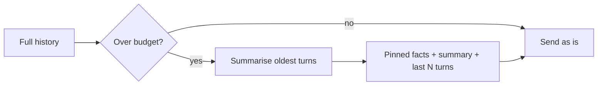

## Beginner-friendly explanation

Think of an agent as a detective working a case.

- The **notebook open on the desk** is short-term memory: the clues in front of them right now. It has limited pages, and when the case file is closed it goes back in the drawer.
- The **filing cabinet** is long-term memory: old cases, facts about people, lessons learned. The detective does not read the whole cabinet each morning; they look up what seems relevant.
- When the notebook fills up, the detective writes a **summary page** ("Suspect A has an alibi; the car was blue") and throws away the scribbles. That is **summarisation** or **compaction**. If the summary misses a clue, it is gone.
- **Planning** is how the detective decides what to do: act and react one clue at a time (ReAct), write a plan on the whiteboard first (plan-and-execute), or look back at a failed theory and write down what went wrong (reflection).

An LLM itself remembers nothing between calls. Every bit of "memory" an agent has is text your application chooses to put back into the prompt.

## Technical explanation

### Short-term memory: the context

Each API call is stateless. The agent loop sends the system prompt, the message history and the tool results every time. That history is short-term memory. Its limits:

- **Size**: context windows are large but finite, and very long contexts can degrade attention to details in the middle (see [Context engineering and long context](/learn/ai-engineering/context-engineering-and-long-context)).
- **Cost and latency**: you pay for every input token on every step.

### Compaction and summarisation

When history passes a threshold, replace older turns with a summary and keep the most recent turns verbatim:



Design choices: the **trigger** (token count, number of turns), **what to keep verbatim** (the last few turns, the original task, pinned facts), and **how to summarise** (an LLM call with instructions to keep decisions, open questions and identifiers). Some providers also offer server-side context management features; check your provider's current docs, as these change quickly.

### Long-term memory

| Store | Holds | Retrieval | Example |
|---|---|---|---|
| Vector store | Free-text notes, past conversations | Similarity search on embeddings | "Have we seen this stack trace before?" |
| Key-value facts | Stable facts, preferences | Exact key lookup | `user.timezone = "Europe/London"` |
| Episodic log | Records of past runs: task, steps, outcome | Filter by task type, time, recency | "Last time, the staging DB was down" |

*Generative Agents* (Park et al., 2023) combined a memory stream with retrieval scored by **recency, importance and relevance**, plus periodic reflection that writes higher-level memories. *MemGPT* (Packer et al., 2023) treated the context like an operating system's main memory, with the agent paging information in and out of external storage through function calls. Both ideas show up in today's frameworks.

Memory brings its own risks: **stale facts** (the user moved), **contradictions**, **leakage** across users, and **memory poisoning**, where injected text is saved and replayed later. Treat memory writes like database writes: validate, scope by user, and allow deletion.

### Planning strategies

**ReAct** (Yao et al., 2022, arXiv 2210.03629) interleaves *Thought → Action → Observation*. It adapts to each new observation, and modern tool-use APIs make it the default loop.

**Plan-and-execute** writes a plan first, then executes steps, optionally with **replanning** when a step fails. Related prompting work, *Plan-and-Solve* (Wang et al., 2023), showed that asking the model to devise a plan before solving helped on reasoning tasks. Benefits: the plan can be reviewed by a human or checked by code, and execution can use cheaper calls.

**Reflection**: *Reflexion* (Shinn et al., 2023, arXiv 2303.11366) has the agent, after a failed attempt, write a short self-critique stored in memory and used on the next attempt. It worked best with clear feedback, such as unit test results on coding tasks.

**Task decomposition** splits a goal into subtasks, either in your code (a workflow) or by the model (orchestrator-workers or planning).

| Strategy | Strength | Weakness | Test focus |
|---|---|---|---|
| ReAct | Adapts quickly | Loops, drift, hard to predict | Trajectory, step count |
| Plan-and-execute | Inspectable, cheaper execution | Bad plan is costly without replanning | Plan coverage and order |
| Reflection | Learns from failures within a task | Needs a reliable signal | Improvement across attempts |

### Failure modes

- **Loops**: the same tool with the same arguments again and again.
- **Drift**: the agent pursues a sub-goal and forgets the original task.
- **Premature completion**: it declares success before checking.
- **Over-planning**: a 20-step plan for a 2-step task.
- **Memory errors**: forgotten, stale, contradictory or leaked facts.

Mitigations: loop detection in code, restating the original goal in the system prompt or after compaction, explicit definitions of done, verification steps (run the tests), and step limits.

## Real-world example

A support team's agent kept asking returning customers for their account plan, even though it had been told the previous week. The team added a key-value memory written only by a `save_fact` tool with validated keys (`plan`, `timezone`, `preferred_language`), scoped by customer ID, and included those facts at the start of each session. Tests then caught two bugs before release: facts were duplicated instead of updated when a customer upgraded, and a test with two customers showed one customer's timezone appearing in another's session because of a caching key that ignored the customer ID.

## Step-by-step walkthrough

1. Decide what must be remembered **within** a run and **across** runs.
2. Set a context budget and a compaction trigger; pin the task and critical facts.
3. Choose a long-term store per kind of memory: key-value for facts, vector search for fuzzy recall, logs for episodes.
4. Choose a planning strategy; start with ReAct and add an explicit plan when you need inspection or cheaper execution.
5. Add loop detection and a definition of done.
6. Write memory and planning tests, and run them over several repetitions.

## Code examples

A runnable memory buffer with a summarisation trigger and pinned facts (standard library only; the summariser is a stub you would replace with an LLM call):

```python
class MemoryBuffer:
    def __init__(self, max_chars=200, keep_last=2):
        self.max_chars = max_chars
        self.keep_last = keep_last
        self.pinned = {}          # critical facts, never summarised away
        self.summary = ""
        self.turns = []

    def add(self, role, text):
        self.turns.append((role, text))
        if self.size() > self.max_chars:
            self.compact()

    def size(self):
        return len(self.summary) + sum(len(t) for _, t in self.turns)

    def compact(self):
        old, self.turns = self.turns[:-self.keep_last], self.turns[-self.keep_last:]
        # Stub summariser: keep first 40 chars of each old turn
        self.summary = (self.summary + " | " if self.summary else "") + \
            "; ".join(t[:40] for _, t in old)

    def context(self):
        facts = ", ".join(f"{k}={v}" for k, v in self.pinned.items())
        return f"FACTS: {facts}\nSUMMARY: {self.summary}\nRECENT: {self.turns}"

mem = MemoryBuffer()
mem.pinned["deadline"] = "2026-11-20"
for i in range(6):
    mem.add("user", f"Message {i}: please check the export test results for build {100 + i}")
print(mem.context())
print("turns kept:", len(mem.turns))
```

A plan-and-execute agent with the Claude API, using structured output so the plan can be checked by code (`pip install anthropic`):

```python
import json
from anthropic import Anthropic

client = Anthropic()
MODEL = "claude-sonnet-5-5"

PLAN_SCHEMA = {
    "type": "object",
    "properties": {"steps": {"type": "array", "items": {"type": "string"}, "maxItems": 6}},
    "required": ["steps"],
    "additionalProperties": False,
}

def make_plan(goal: str) -> list[str]:
    resp = client.messages.create(
        model=MODEL, max_tokens=800,
        messages=[{"role": "user", "content": f"Write a short plan (max 6 steps) to: {goal}"}],
        output_config={"format": {"type": "json_schema", "schema": PLAN_SCHEMA}},
    )
    text = next(b.text for b in resp.content if b.type == "text")
    return json.loads(text)["steps"]

def execute(step: str, notes: list[str]) -> str:
    resp = client.messages.create(
        model=MODEL, max_tokens=600,
        messages=[{"role": "user", "content":
                   f"Notes so far: {notes}\nDo this step and reply in two sentences: {step}"}],
    )
    return next(b.text for b in resp.content if b.type == "text")

goal = "Design a test approach for a password reset link that expires after 30 minutes"
plan = make_plan(goal)
assert 1 <= len(plan) <= 6, "plan failed the code check"
notes = []
for i, step in enumerate(plan, 1):
    notes.append(execute(step, notes))
    print(f"{i}. {step}\n   -> {notes[-1][:120]}")
```

## Expected output

The memory example prints something like:

```
FACTS: deadline=2026-11-20
SUMMARY: Message 0: please check the export test re; Message 1: ... | ...
RECENT: [('user', 'Message 4: ...'), ('user', 'Message 5: ...')]
turns kept: 2
```

The deadline survives because it is pinned, not because the summary kept it. The planner prints 3 to 6 numbered steps with a short result each; wording varies by run.

## Testing memory and planning

Memory and planning are testable even though the model is not deterministic. Split the tests in two.

**Deterministic tests (no model):** the compaction trigger fires at the right size; pinned facts always appear in the context; `forget` really removes data; memory reads are filtered by user ID; loop detection fires on the third identical call; plan validators reject empty, over-long or out-of-order plans.

**Behavioural tests (with a model, repeated runs):**

| Test | Set-up | Pass condition |
|---|---|---|
| Cross-session recall | Session 1 states a fact; session 2 asks for it | Fact used correctly in most runs |
| Update | Fact changes between sessions | New value used, old value not mentioned |
| Isolation | Two users with conflicting facts | No run shows one user's fact to the other |
| Compaction survival | Long conversation pushes a key fact out | Agent still respects it |
| Plan coverage | Goal with known required steps | Plan contains each required step |
| Recovery | A tool fails mid-plan | Agent replans or reports, never claims success |

Record pass rates over several runs rather than a single pass or fail, and keep the cases in a fixed set so you can compare before and after every prompt, model or memory change.

## Common mistakes

- **Assuming the model remembers** previous sessions on its own.
- **Summarising away critical facts** such as IDs, deadlines and constraints.
- **One global memory** shared across users.
- **Storing everything** in a vector store, then retrieving irrelevant noise.
- **Reflection without a real signal**, which lets the agent rationalise errors.
- **No loop detection**, relying only on the step limit.

## Troubleshooting

- **Agent repeats itself after compaction**: the summary dropped what it already did; include completed actions in the summary.
- **Wrong memories retrieved**: add metadata filters (user, date, type) and a relevance threshold.
- **Plans are too long**: cap plan length in the schema and ask for the minimum steps.
- **Agent forgets the goal**: restate the original task after each compaction.

## Hands-on exercise

1. Add `forget(key)` and an `updated_at` timestamp to the pinned facts, and test that updating `deadline` replaces rather than duplicates it.
2. Add loop detection: keep the last five `(tool, args)` pairs and stop if the same pair appears three times.
3. Write a test harness that runs a plan-and-execute agent on five goals and checks that every plan mentions at least one boundary condition.

## Key takeaways summary

Agents remember only what you put back into context. Use compaction with pinned facts for long runs, and external stores (key-value, vector, episodic) for long-term memory, scoped per user. ReAct, plan-and-execute and reflection each trade adaptability against inspectability. Detect loops, guard against drift and premature completion, and test memory across sessions and users as seriously as any database.
