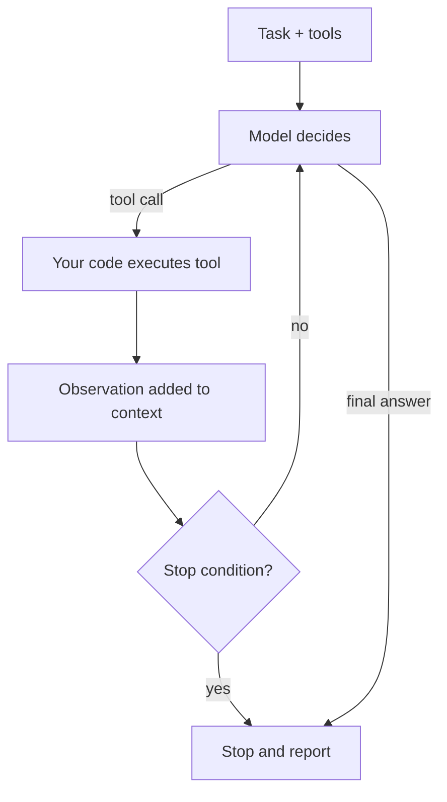

## Beginner-friendly explanation

Imagine three ways to get dinner.

1. **A vending machine.** You press B4 and get exactly one thing. That is a **single LLM call**: one input, one output.
2. **A recipe.** Someone wrote down the steps: chop, fry, season, taste, serve. You follow them in order. That is a **workflow**: your code decides the steps, and the LLM does the work inside each step.
3. **A chef.** You say "make something nice for six people, one is vegetarian". The chef checks the fridge, decides what to cook, tastes as they go, changes plan when the shop is out of basil, and tells you when dinner is ready. That is an **agent**: the model decides what to do next, uses tools (the fridge, the oven), looks at the results and keeps going until the job is done.

The chef is the most flexible, but also the slowest, most expensive and hardest to predict. You would not hire a chef to hand you a chocolate bar. A large part of becoming good at agentic AI is knowing **which of these three you actually need**.

An **agentic** system, then, is one where the model has some control over the flow: which tools to use, in what order and when to stop. The more of that control it has, the more agentic the system is.

## Technical explanation

### The building block: an augmented LLM

Anthropic's engineering post *Building effective agents* (December 2024) describes the basic unit as an **augmented LLM**: a model that can use **tools**, **retrieval** and **memory**. You met tools in [Tool use and AI agents](/learn/ai-engineering/tool-use-and-ai-agents): the model emits a `tool_use` request, your code runs it and returns a `tool_result`. Everything in this module builds on that.

### Workflows versus agents

The same post draws the line clearly:

- **Workflows**: LLMs and tools orchestrated through **predefined code paths**.
- **Agents**: LLMs that **dynamically direct their own processes and tool usage**, keeping control over how they accomplish the task.

### The five workflow patterns

| Pattern | How it works | Good for | Example in QA |
|---|---|---|---|
| Prompt chaining | Output of step 1 feeds step 2; code "gates" can check between steps | Tasks that split cleanly into fixed steps | Draft test cases, then check format in code, then rewrite in team style |
| Routing | Classify the input, send it to a specialised prompt or model | Distinct categories that need different handling | Bug report vs feature request vs question, each with its own prompt |
| Parallelisation | **Sectioning**: independent subtasks at once. **Voting**: same task several times, combine | Speed, or more confidence via several views | Review a PR for security, performance and readability in parallel |
| Orchestrator-workers | A central LLM breaks the task into subtasks it decides at runtime, delegates, then combines | Tasks whose subtasks cannot be predicted | Update tests across an unknown set of files affected by an API change |
| Evaluator-optimizer | One call generates, another evaluates against criteria, loop until good enough | Clear evaluation criteria, iterative refinement helps | Generate a bug report, critique it against a checklist, revise |

Note the difference between parallelisation and orchestrator-workers: in parallelisation **you** decide the subtasks in code; in orchestrator-workers the **model** decides them.

### The agent loop

An agent is, at heart, a loop:



Stop conditions you should always have:

1. The model gives a final answer (`stop_reason: "end_turn"`).
2. A **step limit** is reached.
3. A **budget** (tokens, money or wall-clock time) is exhausted.
4. An **unrecoverable error** or a **human rejection** occurs.

"The model says it is done" is only one of them. Without the others an agent can loop forever.

### Levels of autonomy

Agency is a dial, not a switch. A practical scale (an informal teaching scale, not a standard):

| Level | Who decides the next step | Who approves actions | Example |
|---|---|---|---|
| 0 | Code | n/a | Single call: summarise this log |
| 1 | Code, model fills in steps | n/a | Prompt chain |
| 2 | Model picks among fixed branches | n/a | Router |
| 3 | Model plans and calls tools | Human approves risky actions | Triage agent that proposes bugs |
| 4 | Model plans and acts | Human reviews afterwards | Agent that fixes flaky tests and opens a PR |

Move up only when the lower level demonstrably fails your quality bar. Higher autonomy expands what can go wrong, which OWASP calls **Excessive Agency** (LLM06:2025); see [Agent guardrails and safety](/learn/ai-engineering/agent-guardrails-and-safety).

### Trade-offs

- **Cost**: each iteration resends the conversation so far. A ten-step run is not ten times one call; it is usually more, because the context grows each step.
- **Latency**: steps are sequential unless you parallelise. Users wait for every round-trip.
- **Reliability**: errors compound. If step 2 misreads a log, steps 3 to 10 build on the mistake. And because model output varies run to run, the same task can take different paths.
- **Testability**: you must evaluate the trajectory (which tools, in what order, with what arguments) as well as the final answer, over several runs. See [Evaluating AI agents](/learn/ai-engineering/evaluating-ai-agents).

### When an agent is the wrong tool

- The steps are known: write a workflow.
- One good prompt already works: keep it.
- You cannot evaluate it: you will not know when it breaks.
- Mistakes are costly and silent (payments, deletions) and you cannot put a human in the loop.
- You need tight, predictable latency.

## Real-world example

A test team wanted "an AI that writes regression tests from Jira stories". Their first version was a fully autonomous agent with tools to read Jira, search the repo, write files and run tests. It sometimes produced good tests, but runs varied from 4 to 40 steps, some edited unrelated files, and nobody could tell whether a change to the prompt made it better or worse.

They redesigned it as a workflow: (1) a **routing** call classifies the story as UI, API or data; (2) a **prompt chain** extracts acceptance criteria, then drafts test cases, with a code gate that rejects drafts missing an assertion per criterion; (3) an **evaluator-optimizer** loop, capped at three rounds, critiques the drafts against the team's checklist. Only the final step, adapting tests to the existing code base, stayed agentic, with read-only repo tools and a human reviewing the PR. Cost per story became predictable, and each step could be tested on its own.

## Step-by-step walkthrough

1. **Write the task down** as inputs, outputs and a definition of done.
2. **Try a single call** with a good prompt. Measure it on 10 to 20 examples.
3. **If it fails, find out why.** Too many concerns in one prompt? Chain. Different input types? Route. Independent parts? Parallelise. Needs refinement? Evaluator-optimizer.
4. **Only if the path truly cannot be predicted**, build an agent loop with tools.
5. **Add stop conditions**: step limit, budget, timeout, error handling.
6. **Log every step** and evaluate trajectories over repeated runs.

## Code examples

First, a runnable **fake** agent loop (no API key, standard library only) so you can see the mechanics and the stop conditions. The "model" is a scripted function standing in for the LLM.

```python
import json

# Fake tools
def list_failed(run_id):
    return ["test_login", "test_export"]

def get_log(test):
    return {"test_login": "AssertionError: 200 != 423", "test_export": "TimeoutError"}[test]

TOOLS = {"list_failed": list_failed, "get_log": get_log}

def fake_model(history):
    """Stands in for the LLM: decides the next action from what it has seen."""
    seen = [h for h in history if h["role"] == "tool"]
    if not seen:
        return {"action": "list_failed", "args": {"run_id": 7}}
    failed = seen[0]["content"]
    logs = seen[1:]
    if len(logs) < len(failed):
        return {"action": "get_log", "args": {"test": failed[len(logs)]}}
    return {"final": f"{len(failed)} failures triaged: " + "; ".join(l["content"] for l in logs)}

def run_agent(task, max_steps=10):
    history = [{"role": "user", "content": task}]
    for step in range(1, max_steps + 1):
        decision = fake_model(history)
        if "final" in decision:
            return {"status": "done", "steps": step, "answer": decision["final"]}
        name = decision["action"]
        if name not in TOOLS:
            history.append({"role": "tool", "content": f"error: unknown tool {name}"})
            continue
        result = TOOLS[name](**decision["args"])
        print(f"step {step}: {name}({json.dumps(decision['args'])}) -> {result}")
        history.append({"role": "tool", "content": result})
    return {"status": "step_limit", "steps": max_steps, "answer": None}

print(run_agent("Triage run 7"))
print(run_agent("Triage run 7", max_steps=2))
```

Second, a real **prompt chain with a gate** using the Claude API (`pip install anthropic`). The code, not the model, decides the steps.

```python
from anthropic import Anthropic

client = Anthropic()
MODEL = "claude-sonnet-5-5"

def ask(prompt: str) -> str:
    resp = client.messages.create(model=MODEL, max_tokens=800,
                                  messages=[{"role": "user", "content": prompt}])
    return next(b.text for b in resp.content if b.type == "text")

story = "As a user I can reset my password via an emailed link that expires after 30 minutes."

# Step 1: extract acceptance criteria
criteria = ask(f"List the acceptance criteria in this story, one per line starting with '- ':\n{story}")

# Gate: plain code check before spending another call
lines = [l for l in criteria.splitlines() if l.strip().startswith("- ")]
if len(lines) < 2:
    raise SystemExit("Gate failed: fewer than two criteria extracted; stopping the chain.")

# Step 2: draft tests per criterion
tests = ask("Write one concise test case per criterion, including a boundary test "
            f"for any time limit:\n{criteria}")
print(tests)
```

## Expected output

The fake agent prints:

```
step 1: list_failed({"run_id": 7}) -> ['test_login', 'test_export']
step 2: get_log({"test": "test_login"}) -> AssertionError: 200 != 423
step 3: get_log({"test": "test_export"}) -> TimeoutError
{'status': 'done', 'steps': 4, 'answer': '2 failures triaged: AssertionError: 200 != 423; TimeoutError'}
step 1: list_failed({"run_id": 7}) -> ['test_login', 'test_export']
step 2: get_log({"test": "test_login"}) -> AssertionError: 200 != 423
{'status': 'step_limit', 'steps': 2, 'answer': None}
```

With a limit of 2 the agent stops safely and reports that it did not finish, rather than pretending. The chain prints test cases; exact wording varies between runs, which is why you evaluate on several examples.

## Common mistakes

- **Starting with an agent** before trying a single call or a workflow.
- **Only one stop condition** ("until the model says done").
- **Calling everything an agent.** A prompt chain is a workflow; naming it correctly helps you test it correctly.
- **Ignoring cost growth**: forgetting that context, and so tokens, grows every step.
- **Judging an agent by one good demo** instead of repeated runs on a test set.
- **Giving broad tools "just in case"**, which raises the blast radius of mistakes.

## Troubleshooting

- **Runs take very different numbers of steps**: log trajectories, look for repeated tool calls, tighten tool descriptions, add a lower step cap.
- **Quality dropped after a prompt edit**: you need a fixed evaluation set; rerun it before and after each change.
- **Bills are higher than expected**: measure tokens per step; consider replacing agentic steps with workflow steps, or summarising history (see [Agent memory and planning](/learn/ai-engineering/agent-memory-and-planning)).
- **The agent stops too early**: make the definition of done explicit in the system prompt and the tool results clearer.

## Hands-on exercise

Extend the fake agent:

1. Add a `max_tool_calls_per_tool` rule that stops with status `"loop_detected"` if any tool is called more than three times with the same arguments.
2. Make `fake_model` buggy so it requests `get_log` for `test_login` forever, and confirm your rule fires.
3. Add a `budget` parameter where each step "costs" `len(json.dumps(history))` characters, and stop with `"budget_exceeded"` when the total passes the budget. Notice how fast cost grows as history grows.

## Key takeaways summary

Agentic systems hand some control of the process to the model. Workflows (prompt chaining, routing, parallelisation, orchestrator-workers, evaluator-optimizer) keep the path in your code; agents choose their own path in a loop. Every loop needs several stop conditions. Agents trade cost, latency, predictability and testability for flexibility, so choose the lowest level of autonomy that meets your quality bar and evaluate over repeated runs.
