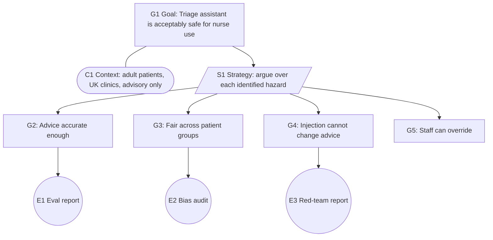

## Beginner-friendly explanation

When you board a plane you do not test the engines yourself. You trust it because a whole system stands behind it: design reviews, test flights, maintenance logs, certified engineers and regulators who check that the paperwork really matches the aircraft. That network of evidence and checks, and the way it is communicated to you, is **assurance**.

AI assurance is the same idea for AI systems. Its goal is **justified confidence**: anyone who must rely on the system (a hospital, a customer, a regulator, a board) can see *why* it is trustworthy for its specific purpose, backed by evidence rather than a vendor's word. Testing is a big part of it, but assurance asks bigger questions: did we test for the right risks, who checked, is the evidence still current, and can we explain the whole story to someone who was not in the room?

## Technical explanation

### Definitions

The UK Department for Science, Innovation and Technology (DSIT) describes AI assurance as the process of measuring, evaluating and communicating the trustworthiness of AI systems. Three words are worth separating:

| Activity | Question it answers | Typical output | Who |
|---|---|---|---|
| Testing and evaluation | How does the system behave on these inputs? | Eval reports, metrics | Engineers, testers |
| Audit | Does the system or organisation meet these criteria? | Audit opinion, findings | Independent internal or external auditors |
| Assurance | Is there justified confidence it is fit for purpose, and how do we show it? | Assurance case, certification, reports to stakeholders | Organisation plus independent parties |

Testing produces evidence. Audit independently checks evidence against criteria. Assurance is the umbrella that decides what evidence is needed, connects it into an argument and communicates it. Independence matters: first-party (self), second-party (customer) and third-party (independent body) assurance carry different weight.

### What "trustworthy" means

Frameworks list overlapping properties. The NIST AI RMF names valid and reliable; safe; secure and resilient; accountable and transparent; explainable and interpretable; privacy-enhanced; and fair with harmful bias managed. The UK's regulatory principles cover safety, security and robustness; transparency and explainability; fairness; accountability and governance; and contestability and redress. Assurance must say which properties matter for this system and this use, because "trustworthy" is always relative to a purpose.

### Assurance cases: claims, arguments, evidence

An **assurance case** (called a safety case in safety-critical industries) is a structured argument:

- **Claim (goal)**: a statement to be justified, e.g. "The triage assistant is acceptably safe for nurses to use".
- **Argument (strategy)**: how the claim is broken down, e.g. "argue over each identified hazard".
- **Evidence (solution)**: artefacts that support the leaf claims: eval reports, bias audits, red-team reports, monitoring dashboards.
- **Context and assumptions**: the scope, intended use and conditions under which the claim holds.

**Goal Structuring Notation (GSN)**, maintained as a community standard by the Safety-Critical Systems Club's Assurance Case Working Group, is the most common graphical notation:



G5 has no evidence yet: the diagram makes that gap obvious. That is the point of an assurance case. Critics rightly note that cases can become confirmation exercises; good practice includes looking for **defeaters**, reasons the claim might be false, and recording how each is addressed.

### Lifecycle assurance

Assurance is not a gate at the end. It follows the lifecycle:

| Stage | Assurance activities |
|---|---|
| Design | Impact assessment, intended use and misuse, risk identification, requirements with acceptance criteria |
| Data | Data provenance and quality checks, datasheets, representativeness review |
| Build and evaluate | Performance testing, robustness, bias audit, red teaming, model cards |
| Deploy | Conformity assessment where required, sign-off, human-oversight design |
| Operate | Monitoring for drift and incidents, periodic re-assessment, change control |
| Retire | Decommissioning, records retention |

Each change to the model, prompt, data or use re-opens the claims that depend on it.

### Techniques

The DSIT guidance describes a toolkit, used in combination:

- **Risk assessment** and **impact assessment**: identify who could be harmed and how, before building.
- **Bias audit**: test outcomes and error rates across groups (see [Bias, fairness and responsible AI](/learn/ai-engineering/bias-fairness-and-responsible-ai)).
- **Compliance audit**: check against internal policy or regulation.
- **Conformity assessment**: show that a system meets specified requirements, for example those of a standard or, for high-risk systems, the EU AI Act (see [AI governance and regulation](/learn/ai-engineering/ai-governance-and-regulation)).
- **Performance testing**: accuracy, robustness and reliability against agreed thresholds.
- **Formal verification**: mathematical proof of specific properties. For neural networks this is limited to narrow properties such as local robustness bounds, and it struggles with very large models. It cannot prove open-ended correctness, because no complete specification of a "correct answer" exists.
- **Certification**: an independent body attests conformity, for example ISO/IEC 42001 certification of an organisation's AI management system.

Standards connect these: ISO/IEC 42001 defines a certifiable AI management system, and the NIST AI RMF's Govern, Map, Measure, Manage functions organise the activities.

## Real-world example

A hospital group plans to deploy a vendor's triage assistant. The vendor offers a glossy accuracy figure. The hospital's assurance lead instead asks for an assurance case scoped to *their* use: adult patients, UK clinics, advice reviewed by a nurse. Building it reveals gaps. The accuracy evidence was measured on a different population; there is no bias audit by age; no one has tested what happens when a referral letter contains injected text; and the override workflow exists only in a slide.

The hospital commissions a local evaluation on its own historical cases, a bias audit, a red-team exercise and a usability test of the override. Two findings lead to fixes before go-live, and the case records that the bias audit must be repeated whenever the vendor updates the model. The board signs off on the case, not on the vendor's headline number.

## Step-by-step walkthrough

1. **Define scope and audience**: the system, its intended use, and who needs confidence.
2. **Identify risks** with an impact assessment, including misuse.
3. **Write the top claim** and break it down by a clear strategy (per hazard, per property, per lifecycle stage).
4. **Specify evidence** for each leaf claim with an acceptance criterion and owner.
5. **Produce the evidence** through testing, audits, analysis.
6. **Review independently** and look for defeaters.
7. **Communicate** to the audience in a form they can use.
8. **Maintain**: tie evidence to versions, set expiry, re-assess on change.

## Code examples

Assurance cases are often kept as documents, but keeping them as structured data lets you check them automatically, for example in CI. This standard-library script flags leaf claims with no evidence, failed evidence or stale evidence:

```python
from datetime import date

TODAY = date(2026, 11, 1)
MAX_AGE_DAYS = 90

# Evidence items: what was produced, when, and whether it met its acceptance criterion
EVIDENCE = {
    "E1": {"what": "Eval report v3: accuracy on held-out triage set", "date": date(2026, 10, 20), "passed": True},
    "E2": {"what": "Bias audit: error rates by age band", "date": date(2026, 5, 2), "passed": True},
    "E3": {"what": "Red-team report: prompt injection", "date": date(2026, 10, 28), "passed": False},
}

# Claims -> arguments -> sub-claims or evidence
CASE = {
    "id": "G1", "claim": "The triage assistant is acceptably safe for use by nurses",
    "argument": "Argue over each identified hazard",
    "children": [
        {"id": "G2", "claim": "Triage advice is accurate enough", "evidence": ["E1"]},
        {"id": "G3", "claim": "Performance is fair across patient groups", "evidence": ["E2"]},
        {"id": "G4", "claim": "Injected instructions cannot change advice", "evidence": ["E3"]},
        {"id": "G5", "claim": "Staff can override every recommendation", "evidence": []},
    ],
}


def assess(node, problems):
    """Return True if the claim is supported; collect reasons when it is not."""
    if "children" in node:
        results = [assess(child, problems) for child in node["children"]]
        return all(results)
    if not node["evidence"]:
        problems.append(f"{node['id']}: no evidence")
        return False
    ok = True
    for eid in node["evidence"]:
        item = EVIDENCE[eid]
        if not item["passed"]:
            problems.append(f"{node['id']}: {eid} failed its criterion")
            ok = False
        elif (TODAY - item["date"]).days > MAX_AGE_DAYS:
            problems.append(f"{node['id']}: {eid} is stale ({(TODAY - item['date']).days} days old)")
            ok = False
    return ok


problems = []
print("Top claim supported:", assess(CASE, problems))
for p in problems:
    print(" -", p)
```

Note that `assess` evaluates every child (the list is built before `all`), so all problems are reported, not only the first.

## Expected output

```text
Top claim supported: False
 - G3: E2 is stale (183 days old)
 - G4: E3 failed its criterion
 - G5: no evidence
```

The script cannot judge whether the argument is *good*; that is a human review. It only makes sure the structure is complete and current.

## Common mistakes

- **Equating assurance with testing**: many tests, but no argument that they cover the real risks.
- **Generic claims** ("the AI is safe") without scope, intended use or context.
- **Evidence from the wrong context**, such as a vendor's benchmark on a different population.
- **One-off assurance** that is never refreshed after model, data or prompt changes.
- **Self-assurance only** for high-impact systems that warrant independent review.
- **Overclaiming formal methods** or certification as proof that every output is correct.
- **Ignoring defeaters**, building only the case for and never the case against.

## Troubleshooting

- **Stakeholders find the case unreadable.** Provide a one-page summary of claims, status and open gaps, with the full case behind it.
- **Evidence goes stale constantly.** Generate it from automated evals in CI and link artefacts by version.
- **No agreement on acceptance criteria.** Start from the impact assessment: the severity of harm drives how strict criteria must be.

## Hands-on exercise

Choose an AI feature in a product you use (a CV screener, a chatbot, a fraud score). Write its context (use, users, limits), a top claim, a strategy and five leaf claims. For each leaf claim, name the technique and the evidence artefact, with an acceptance criterion and an owner. Encode it in the script above, add one deliberately missing and one stale item, and confirm the checker flags them. Finally write two defeaters against your top claim and how you would address them.

## Key takeaways summary

AI assurance builds justified, communicable confidence that an AI system is fit for purpose. Testing produces evidence, audit checks it independently, and assurance ties everything together, often as a claims-arguments-evidence case drawn in GSN. It spans the whole lifecycle and draws on many techniques; no single one, including formal verification, is sufficient on its own. Guidance such as the UK DSIT introduction, the NIST AI RMF and ISO/IEC 42001 provides the shared vocabulary.
