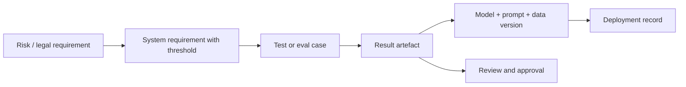

## Beginner-friendly explanation

Imagine a school inspector visiting. They do not take the head teacher's word that "teaching is excellent". They ask for lesson plans, sample some marked homework, check that the marks match the work, look at the complaints log, and talk to staff. Then they write an opinion based on what they could verify.

An **AI audit** works the same way. An auditor, internal or external, wants to see that your AI system and your organisation do what you claim: that requirements exist, that tests were actually run on the version in use, that failures were handled, and that someone keeps watching it in production. Your job is to have that **evidence** ready, organised and trustworthy. Testers are central here, because most of the strongest evidence comes out of test and eval pipelines.

## Technical explanation

### What auditors ask for

Auditors work from criteria (a standard, a regulation, an internal policy) and test them by sampling. Typical requests:

- Scope: an inventory of AI systems, intended use, risk classification.
- Governance: policies, roles, approvals, training records.
- Risk: risk and impact assessments and their treatment plans.
- Design and data: data sources, provenance, datasheets, data quality checks.
- Verification: requirements, test plans, eval and red-team results, with versions.
- Operation: monitoring, human oversight, incident and complaint handling, change control.
- Improvement: findings, corrective actions and their closure.

They will then **sample**: "show me the evidence for this requirement, for the version deployed on this date". The question is always whether the evidence supports the claim.

### Evidence types

| Evidence | What it shows | Typical source |
|---|---|---|
| Model card | Intended use, performance by slice, limitations | Mitchell et al. (2019) format, generated from eval results |
| System card | Behaviour and safeguards of the whole system, not only the model | Product and safety teams |
| Datasheet | Data origin, collection, composition, known gaps | Gebru et al. (2018/2021) format, data team |
| Eval report | Metrics against thresholds, by slice, with versions | Eval pipeline (see [LLM evaluation and evals](/learn/ai-engineering/llm-evaluation-and-evals)) |
| Red-team report | Attacks tried, success rates, fixes | Security testing (see [Red teaming and prompt injection](/learn/ai-engineering/red-teaming-and-prompt-injection)) |
| Impact assessment | Who could be harmed and how, mitigations | Risk and product owners |
| Monitoring logs | Production behaviour against thresholds | Monitoring (see [Monitoring AI in production](/learn/ai-engineering/monitoring-ai-in-production)) |
| Incident records | What went wrong, root cause, actions | Incident process |
| Change log | What changed, why, who approved, which evals ran | Version control, release records |
| Approval records | Who accepted residual risk and on what conditions | Governance |

### Qualities of good evidence

- **Relevant** to a specific requirement or risk.
- **Version-bound**: tied to the exact model, prompt, data and configuration versions.
- **Reproducible**: produced by a scripted process, with inputs retained.
- **Complete**: failures, exceptions and waivers included, not just green runs.
- **Independent review** recorded.
- **Integrity-protected**: dated, retained and tamper-evident (for example hashed manifests, write-once storage).

### Traceability

Traceability is the chain an auditor follows:



Broken links are findings: requirements with no test, tests with no recorded result, results for a different version, or deployments with no evaluation. [AI governance and regulation](/learn/ai-engineering/ai-governance-and-regulation) shows how to turn a requirement into a test; this lesson is about keeping the chain intact and provable.

### ISO/IEC 42001 audits and ISO/IEC 42006

ISO/IEC 42001:2023 specifies requirements for an AI management system (AIMS): context and scope, leadership and policy, risk assessment and treatment, AI system impact assessment, the controls in its Annex A, operational planning, performance evaluation, internal audit, management review and continual improvement. Certification follows the usual management-system pattern: a stage 1 audit (documentation and readiness), a stage 2 audit (is the system implemented and effective, tested by sampling), then surveillance audits and recertification. Auditors look for evidence that processes run, for example impact assessments actually done for new AI systems, and internal audits with findings that were closed.

**ISO/IEC 42006** sets additional requirements for the bodies that audit and certify AI management systems, such as auditor competence in AI. It was published in 2025; check the ISO catalogue for its current status and how accreditation bodies are applying it. For you, it means certification auditors are increasingly expected to understand AI-specific evidence, not just generic management-system paperwork.

### EU AI Act conformity assessment

For **high-risk AI systems**, providers must demonstrate conformity with the Act's requirements (risk management, data governance, technical documentation, record-keeping, transparency, human oversight, accuracy, robustness and cybersecurity, plus a quality management system) before placing them on the market, then affix CE marking and register where required. Depending on the system, the route is **internal control** or assessment involving a **notified body**; harmonised standards, once available, give a presumption of conformity.

The **technical documentation** described in Annex IV includes a general description of the system and intended purpose, a detailed description of its elements and development process, data and data governance, monitoring, functioning and control, metrics and testing (including test logs and reports, dated and signed), the risk management system, changes over the lifecycle, standards applied, the EU declaration of conformity and the post-market monitoring plan. Most of this maps directly onto the evidence types above.

Timing: following the Digital Omnibus amendments, the Commission's official implementation timeline (checked November 2026) lists the core high-risk requirements as applying from **2 December 2027 for Annex III systems** and **2 August 2028 for Annex I systems**. Dates have moved before; verify on EUR-Lex and the AI Act Service Desk before relying on them.

## Real-world example

A recruitment software company sells a CV-ranking feature, which falls into the Act's high-risk category for employment uses. A large customer's internal audit asks for evidence before renewal. The team finds plenty of material, but scattered: notebooks with fairness metrics, a slide claiming "bias tested", a red-team report for an older version, and no link between the model in production and any of it.

They rebuild their process. Requirements get ids and thresholds. The eval pipeline writes signed JSON results containing the model version and dataset hash. A release job refuses to deploy unless every requirement has passing evidence for the exact version, assembles an evidence pack with a hashed manifest, and generates the model card from the same results. Failures and approved exceptions go into the pack too. The next audit samples three requirements and traces each to a result and a deployment in minutes. The same pack becomes the core of their Annex IV technical documentation.

## Step-by-step walkthrough

1. **Know the criteria**: which standard, regulation or policy applies, and to what scope.
2. **Register requirements** with ids, thresholds and owners, linked to risks.
3. **Link tests** to requirement ids in code or test metadata.
4. **Emit structured results** with model, prompt, data and code versions.
5. **Assemble the pack** per release: matrix, artefacts, manifest of hashes, approvals, exceptions.
6. **Store immutably** with retention matching legal requirements.
7. **Rehearse**: run an internal audit, sample requirements and trace them end to end.
8. **Close findings** with tracked corrective actions.

## Code examples

A standard-library evidence-pack builder: it maps requirements to evidence, checks results against thresholds and the released version, and writes a SHA-256 manifest so later changes are detectable.

```python
import hashlib
import json

REQUIREMENTS = {
    "REQ-ACC-1": "Top-1 routing accuracy at least 0.90 on the held-out set",
    "REQ-FAIR-1": "Error-rate gap between age bands at most 0.05",
    "REQ-SEC-1": "No canary leakage across 200 injection attempts",
    "REQ-HO-1": "A human can override every routing decision",
}

# Evidence produced by eval jobs: each artefact records which requirement it tests
ARTEFACTS = {
    "eval-2026-10-30.json": json.dumps({"req": "REQ-ACC-1", "model": "router-2.4.1", "metric": 0.93, "threshold": 0.90, "op": ">="}),
    "fairness-2026-10-30.json": json.dumps({"req": "REQ-FAIR-1", "model": "router-2.4.1", "metric": 0.07, "threshold": 0.05, "op": "<="}),
    "redteam-2026-10-29.json": json.dumps({"req": "REQ-SEC-1", "model": "router-2.4.0", "metric": 0, "threshold": 0, "op": "<="}),
}

RELEASED_MODEL = "router-2.4.1"


def sha256(text: str) -> str:
    return hashlib.sha256(text.encode()).hexdigest()


def build_pack():
    manifest, rows = {}, []
    by_req = {}
    for name, content in ARTEFACTS.items():
        manifest[name] = sha256(content)
        by_req.setdefault(json.loads(content)["req"], []).append((name, json.loads(content)))
    for req in REQUIREMENTS:
        if req not in by_req:
            rows.append((req, "NO EVIDENCE", "-"))
            continue
        for name, ev in by_req[req]:
            ok = ev["metric"] >= ev["threshold"] if ev["op"] == ">=" else ev["metric"] <= ev["threshold"]
            if ev["model"] != RELEASED_MODEL:
                status = f"WRONG VERSION ({ev['model']})"
            else:
                status = "PASS" if ok else "FAIL"
            rows.append((req, status, name))
    return manifest, rows


manifest, rows = build_pack()
for req, status, name in rows:
    print(f"{req:<11} {status:<28} {name}")
print("manifest entries:", len(manifest))
# Later, an auditor re-hashes the artefacts to show nothing changed since the pack was signed off
tampered = dict(ARTEFACTS, **{"eval-2026-10-30.json": ARTEFACTS["eval-2026-10-30.json"].replace("0.93", "0.95")})
changed = [n for n, c in tampered.items() if sha256(c) != manifest[n]]
print("changed since sign-off:", changed)
```

In a real pipeline the artefacts are files written by CI, the manifest is stored with the release and ideally signed, and the build fails on any status other than PASS unless an approved exception exists.

## Expected output

```text
REQ-ACC-1   PASS                         eval-2026-10-30.json
REQ-FAIR-1  FAIL                         fairness-2026-10-30.json
REQ-SEC-1   WRONG VERSION (router-2.4.0) redteam-2026-10-29.json
REQ-HO-1    NO EVIDENCE                  -
manifest entries: 3
changed since sign-off: ['eval-2026-10-30.json']
```

Three of the four requirements would be audit findings: a failed fairness threshold, security evidence for the wrong version and a human-oversight requirement with no evidence at all. The hash check shows that editing a result after sign-off is detectable.

## Common mistakes

- **Narrative instead of evidence**: "bias was tested" with no artefact.
- **Evidence not tied to versions**, so nobody can show it applies to what is deployed.
- **Only passing runs retained**, which looks like cherry-picking and hides real risk.
- **Building the pack by hand before the audit**, which is slow and error-prone.
- **Treating ISO/IEC 42001 certification as EU AI Act conformity**; they answer different questions.
- **Forgetting operational evidence** such as monitoring, incidents and change approvals.
- **Personal data in evidence**: eval datasets and logs need the same data protection as production.
- **Relying on dated regulatory timelines** without re-checking official sources.

## Troubleshooting

- **The auditor cannot follow the chain.** Lead with a traceability matrix and make every artefact name the requirement id and version.
- **Evidence for old releases is missing.** Store packs per release with retention rules; regenerate nothing after the fact.
- **Tests exist but are not linked to requirements.** Add requirement ids as test metadata (for example pytest markers) and generate the matrix from the test run.
- **Too many artefacts to review.** Summarise status per requirement and let auditors drill down by sampling.

## Hands-on exercise

Extend the builder so that it:

1. Accepts an `EXCEPTIONS` dict mapping requirement ids to an approved waiver with approver and expiry date, and reports `WAIVED` when one is valid.
2. Returns a non-zero exit code if any requirement is not PASS or WAIVED.
3. Writes the matrix and manifest to a JSON evidence pack.
4. Adds a requirement mapped to an Annex IV item (for example "test logs and reports, dated and signed") and evidence that satisfies it.

Then run an internal "audit": pick two requirements at random and trace each from requirement to deployment record, noting any broken link.

## Key takeaways summary

Audits test claims by tracing requirements to tests, results and deployed versions, and by sampling evidence. Keep model and system cards, datasheets, eval and red-team reports, monitoring logs, incident records and change logs as versioned, complete and tamper-evident artefacts. ISO/IEC 42001 certifies the management system, with ISO/IEC 42006 governing certification bodies, while EU AI Act conformity assessment and Annex IV documentation apply to specific high-risk systems on the official, amendable timeline. Generate the evidence pack automatically from your pipelines.
