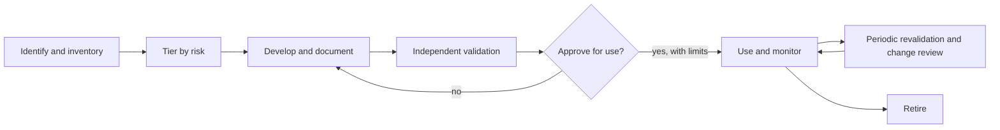

## Beginner-friendly explanation

A bank uses hundreds of models: who gets a loan, which transactions look fraudulent, how much capital to hold. If a model is wrong, or used for something it was never designed for, real money and real people are affected. **Model risk management (MRM)** is the bank's discipline for keeping that in check: know every model you have, decide how risky each one is, get someone independent to check the risky ones properly, watch them in use, and keep records.

Think of it like a fleet of vehicles. You keep a register of every vehicle, inspect the lorries more often than the bicycles, use independent inspectors rather than the drivers, and keep logs. AI models, including large language models, are now a big part of the fleet, and they bring new kinds of fault.

## Technical explanation

### Where model risk management comes from

For fifteen years the reference text was **SR 11-7**, the US Federal Reserve's 2011 *Supervisory Guidance on Model Risk Management* (issued by the OCC as Bulletin 2011-12). It defined a model as a quantitative method that turns inputs into estimates, and model risk as adverse consequences from incorrect or misused model outputs. Banks applied it to ML models too, and many organisations outside banking borrowed its structure.

On 17 April 2026 the Fed, OCC and FDIC issued **SR 26-2, Revised Guidance on Model Risk Management**, which supersedes SR 11-7. It emphasises a risk-based approach tailored to each organisation's model risk profile and is described as most relevant to banking organisations with over 30 billion dollars in assets. Importantly for this course, it states that **generative AI and agentic AI models are not within its scope** because they are novel and evolving, while its principles apply to traditional models and **non-generative, non-agentic AI**. It still expects firms' broader risk management and governance to cover such tools.

In the UK, the PRA's **SS1/23 Model risk management principles for banks** took effect in May 2024 and sets five principles: model identification and classification, governance, model development and use, independent validation, and risk mitigants. It explicitly covers AI and ML models.

Outside banking, the same structure appears in the NIST AI RMF and in AI management systems under ISO/IEC 42001. You will see it in insurance, healthcare and any organisation with material AI. Treat the documents above as current as of November 2026 and check for updates.

### The MRM lifecycle



### Model inventory

You cannot manage models you do not know about. An inventory records for each model: id, name, purpose and intended use, owner, developer or vendor, input data, version, users, tier, validation status and dates, known limitations and monitoring arrangements. For AI, add the model provider and version identifier, prompt and configuration versions, and whether it is generative or agentic. "Shadow AI", teams using AI tools nobody registered, is a common finding in inventory exercises.

### Risk tiering

Effort should match risk. Tiering usually combines:

- **Materiality**: financial impact, number of customers affected, regulatory or reputational exposure, whether decisions are automated.
- **Complexity and uncertainty**: method, data quality, explainability, reliance on judgement.
- **Transparency**: third-party and black-box models score higher because less can be checked.

Tier drives validation depth, revalidation frequency, approval level and monitoring intensity.

### Validation

Validation is an independent check that the model works as intended and its limits are understood. The guidance names three components:

| Component | Question | AI and LLM examples |
|---|---|---|
| Conceptual soundness | Is the design, data and method appropriate for the purpose? | Feature choice, training data representativeness, prompt and retrieval design, fitness of a foundation model for the task |
| Outcomes analysis | Do outputs match reality? | Back-testing, holdout evaluation, eval suites, human review of sampled outputs, bias metrics |
| Ongoing monitoring | Does it keep performing as conditions change? | Drift, input distribution shift, complaint rates, groundedness sampling (see [Monitoring AI in production](/learn/ai-engineering/monitoring-ai-in-production)) |

The cross-cutting principle is **effective challenge**: critical analysis by people with expertise, independence and the organisational standing to force changes. A validation that cannot block a launch is not effective challenge.

### Third-party and foundation-model risk

Vendor models, including hosted LLMs, limit what you can inspect. Practical controls:

- Obtain the vendor's documentation (model or system cards, eval results, known limitations) and record its gaps.
- Validate the **system as you use it**: your prompts, retrieval, tools and data, on your tasks.
- Pin model versions where the provider allows; treat a version change as a model change requiring review.
- Contract for change notification, incident reporting and data-use terms.
- Keep a fallback and an exit plan.

### AI-specific risks to add to validation scope

- **Drift**: data drift, concept drift and, for hosted models, provider-side changes.
- **Hallucination** and unfaithful output (see [Hallucination and groundedness testing](/learn/ai-engineering/hallucination-and-groundedness-testing)).
- **Prompt injection** and insecure output handling (see [Red teaming and prompt injection](/learn/ai-engineering/red-teaming-and-prompt-injection)).
- **Data leakage**: personal or confidential data in prompts, logs or outputs.
- **Bias and unfair outcomes** across groups.
- **Non-determinism**: results vary between runs, so validation needs repeated trials and statistical thresholds.
- **Agentic actions**: tools that change systems raise the stakes of every error.

### Controls and documentation

Model development documentation, validation reports with findings and their severity, approval records with conditions of use, monitoring plans with thresholds, change logs, issue tracking to closure, and exception records when a model is used before findings are resolved.

### Roles: the three lines

- **First line**: model owners, developers and users. Build, document, test, monitor, use within limits.
- **Second line**: model risk management and validation, plus risk and compliance. Set policy, tier, independently validate, challenge and report.
- **Third line**: internal audit. Independently assess whether the whole framework is designed and operating effectively.

The board and senior management own the risk appetite and receive model risk reporting.

## Real-world example

A retail bank's operations team starts using a hosted LLM to draft replies to customer complaints. It is not in the inventory; the team sees it as a productivity tool. During an inventory refresh, the second line identifies it, notes that it influences customer communications in a regulated process and handles personal data, and tiers it highly.

Validation is scoped to the system as used: a conceptual review of the prompt, retrieval of policy text and data flows; outcomes analysis on several hundred historical complaints rated by experienced handlers for accuracy, tone and compliance; red teaming for injection through complaint text; and a check for leakage of other customers' data. Findings include occasional invented policy references and no version pinning. Approval comes with conditions: a human must approve every letter, the model version is pinned with a review on any change, and a monthly sample is reviewed. The model goes into the inventory with those conditions recorded.

## Step-by-step walkthrough

1. **Define what counts as a model** in your policy, explicitly including AI and generative tools.
2. **Build the inventory**, including shadow AI found through procurement, expense and network data.
3. **Tier** each model with a documented method.
4. **Validate** by tier: depth, independence and frequency.
5. **Approve with conditions** and record limitations.
6. **Monitor** against thresholds; escalate breaches.
7. **Manage change**: retrain, prompt, data or vendor version changes trigger review.
8. **Report** model risk to senior management; internal audit reviews the framework.

## Code examples

A standard-library inventory check that tiers models and flags overdue or missing validation, the kind of control a second-line team might automate:

```python
from datetime import date

TODAY = date(2026, 11, 1)

# Materiality and complexity scored 1 (low) to 3 (high) by the model owner, challenged by validation
INVENTORY = [
    {"id": "M-001", "name": "Credit default PD model", "materiality": 3, "complexity": 2,
     "third_party": False, "generative": False, "last_validated": date(2026, 2, 1)},
    {"id": "M-014", "name": "Complaint triage classifier", "materiality": 2, "complexity": 2,
     "third_party": False, "generative": False, "last_validated": date(2025, 6, 1)},
    {"id": "M-022", "name": "Customer-letter drafting (hosted LLM)", "materiality": 2, "complexity": 3,
     "third_party": True, "generative": True, "last_validated": None},
    {"id": "M-030", "name": "Branch footfall forecast", "materiality": 1, "complexity": 1,
     "third_party": False, "generative": False, "last_validated": date(2023, 1, 15)},
]

REVALIDATE_MONTHS = {1: 12, 2: 24, 3: 36}  # tier -> maximum months between validations


def tier(model) -> int:
    score = model["materiality"] * model["complexity"]
    if model["third_party"]:
        score += 1  # less transparency, more reliance on vendor evidence
    return 1 if score >= 6 else 2 if score >= 3 else 3


def months_since(d: date) -> int:
    return (TODAY.year - d.year) * 12 + TODAY.month - d.month


def findings(model) -> list[str]:
    out = []
    t = tier(model)
    if model["last_validated"] is None:
        out.append("never validated: must not be in production use")
    elif months_since(model["last_validated"]) > REVALIDATE_MONTHS[t]:
        out.append(f"validation overdue ({months_since(model['last_validated'])} months, tier {t} limit {REVALIDATE_MONTHS[t]})")
    if model["generative"]:
        out.append("generative: add prompt-injection, leakage and hallucination testing to validation scope")
    return out


for m in sorted(INVENTORY, key=tier):
    print(f"{m['id']} tier {tier(m)}  {m['name']}")
    for f in findings(m):
        print("    -", f)
```

The scoring and frequencies here are illustrative; real ones come from your organisation's MRM policy.

## Expected output

```text
M-001 tier 1  Credit default PD model
M-022 tier 1  Customer-letter drafting (hosted LLM)
    - never validated: must not be in production use
    - generative: add prompt-injection, leakage and hallucination testing to validation scope
M-014 tier 2  Complaint triage classifier
M-030 tier 3  Branch footfall forecast
    - validation overdue (46 months, tier 3 limit 36)
```

## Common mistakes

- **An incomplete inventory**, especially missing vendor and generative AI tools.
- **Validation by the developers themselves**, which is testing, not independent validation.
- **One-size-fits-all validation**, wasting effort on low-risk models and under-checking high-risk ones.
- **Validating the vendor model in isolation** rather than the system as configured and used.
- **Ignoring vendor version changes** as model changes.
- **Treating "out of scope of SR 26-2" as "ungoverned"** for generative or agentic tools.
- **Findings with no owner or deadline**, so issues never close.

## Troubleshooting

- **Teams resist registering AI tools.** Make registration lightweight for low tiers, and tie procurement and API key issuance to inventory entries.
- **Validators lack LLM skills.** Pair validators with AI engineers, and reuse the eval and red-team methods from the AI testing module.
- **Vendor will not share documentation.** Record it as a limitation, increase your own testing and monitoring, and raise it in procurement.

## Hands-on exercise

Extend the script: add `owner` and `monitoring_plan` fields and flag entries missing either; add an `agentic` flag that forces tier 1; and add a rule that a third-party model with no pinned `model_version` gets a finding. Add three AI tools from your own experience, tier them, and write a one-paragraph validation scope for the highest-tier one using the three validation components.

## Key takeaways summary

Model risk management makes sure models are known, tiered, independently validated, monitored and governed. Its structure came from SR 11-7, now superseded in the US by SR 26-2 (which leaves generative and agentic AI out of scope), and appears in the UK's SS1/23 and in AI frameworks generally. For AI, extend validation to drift, hallucination, injection, leakage, bias and vendor changes, and keep clear first, second and third line roles.
