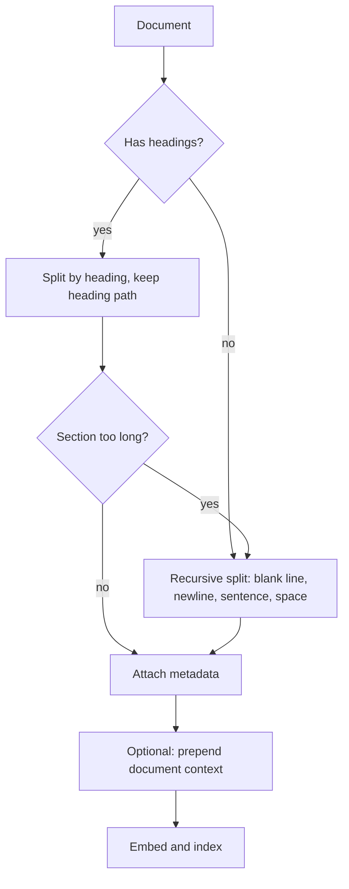

## Beginner-friendly explanation

Imagine you need to answer "how do I reset test data?" from a 200-page operations manual. If someone handed you the whole manual you would spend ages finding the paragraph. If someone handed you index cards, each holding one topic with its section title on top, you would find the right card in seconds.

**Chunking** is cutting documents into those index cards before they go into a search index. Each chunk gets its own embedding, so a search can land on exactly the paragraph that answers the question, and the answer can cite it.

The craft is in *where* you cut. Cut in the middle of a sentence and the card makes no sense. Make cards too small and they lose context ("it takes ten minutes", but what does?). Make them too big and each card is about five things, so it matches nothing strongly.

## Technical explanation

### Why chunk at all

- **One vector per input.** Embedding a whole document averages many topics into one point, which sits near none of them.
- **Input limits.** Embedding models accept a limited number of tokens and may silently truncate longer input.
- **Token budget and focus.** Sending a few relevant chunks to the LLM is cheaper and keeps the evidence prominent. Liu et al. (arXiv 2307.03172, 2023) showed that models use information in the middle of long contexts less reliably than information at the start or end, one more reason to send focused context.
- **Citations.** A chunk ID points to a specific passage a person can check.

### The main strategies

| Strategy | How it works | Strengths | Weaknesses |
|---|---|---|---|
| Fixed-size with overlap | Windows of N characters or tokens, each starting N − overlap after the last | Simple, predictable sizes | Cuts mid-sentence, ignores structure |
| Sentence or paragraph | Split on sentence or blank-line boundaries, then group to a target size | Whole thoughts | Paragraph sizes vary widely |
| Recursive | Try the coarsest separator (blank line), recurse with finer ones (newline, sentence, space) only for pieces still too big | Respects structure where possible, bounded size | Separator list must suit the format |
| Structure-aware | Split on Markdown or HTML headings, code blocks, table rows; keep the heading path | Chunks match the author's topics; great metadata | Needs a parser per format; sections can be huge |
| Semantic | Embed sentences, start a new chunk where similarity between neighbours drops | Follows topic shifts in unstructured text | Extra cost, threshold tuning, results vary |
| Proposition / small units | Split into atomic statements (Chen et al., arXiv 2312.06648) | Very precise matching | Needs an LLM at index time; loses context unless combined with parents |

A common, strong default is **structure-aware first, recursive inside large sections**, with a small overlap.



### Tokens versus characters

Model limits are in tokens. A rough rule for English is about four characters per token, but it varies by language and content (code and non-Latin scripts differ). For precise limits, count with the tokenizer of the embedding model you use.

### Metadata

Every chunk should carry: a stable `id`, `source`, section or heading path, position, last-updated date, and permissions or tenant. Metadata enables filters ("only current versions", "only documents this user may see"), citations and debugging. Prepending the heading path to the chunk text ("Test environment guide > Test data: Reset test data...") is a cheap way to give a chunk context.

### Contextual retrieval

Anthropic's 2024 write-up, *Introducing Contextual Retrieval*, uses an LLM to write a short context for each chunk from the whole document (for example, "This chunk is from ACME's Q2 2023 filing; the previous quarter's revenue was...") and prepends it before both embedding and BM25 indexing. Anthropic reported fewer retrieval failures on its test sets, especially combined with BM25 and reranking. Treat those figures as their measurement, not a guarantee for your corpus; the cost is one LLM call per chunk at indexing time, which prompt caching of the shared document makes cheaper.

### Chunk size trade-offs

| Smaller chunks | Larger chunks |
|---|---|
| Precise matches, sharper embeddings | More context in each hit |
| Lose surrounding context, pronouns lose referents | Diluted embeddings, multiple topics |
| More vectors to store | More tokens per retrieved chunk |

You can get both with **small-to-big retrieval**: search small chunks, then send their parent section to the LLM. That pattern is covered in [Advanced RAG patterns](/learn/ai-engineering/advanced-rag-patterns).

### Evaluating chunking

Chunking is a retrieval decision, so evaluate it with retrieval metrics. Label questions with the *text* that answers them (not a chunk ID, because IDs change with the strategy) and count a hit when a retrieved chunk contains that text. Compare hit rate@k across strategies, then confirm the winner with end-to-end answer quality.

## Real-world example

A test team indexed its Confluence space with fixed 1,000-character chunks and no overlap. Questions about the "reset-data" job often failed. Inspecting chunks showed the heading "Test data" at the end of one chunk and its paragraph at the start of the next, while tables of environment URLs were cut in half. Switching to heading-aware splitting with the heading path prepended, keeping tables whole, and recursive splitting only for sections over 1,500 characters, raised hit rate@3 on their 40 labelled questions noticeably. The lesson they wrote into their runbook: inspect chunks with your eyes before tuning anything else.

## Step-by-step walkthrough

1. **Look at your documents.** Note formats, headings, tables, code and typical section lengths.
2. **Pick a structure-aware split** for formats that have structure; recursive for the rest.
3. **Choose a target size and overlap**, for example a few hundred tokens with 10 to 20 percent overlap, as a starting point only.
4. **Attach metadata** and prepend heading paths or generated context.
5. **Print and read 20 random chunks.** Look for cut sentences, orphan headings, broken tables.
6. **Build a small labelled set:** questions plus the passage that answers each.
7. **Compare strategies** with hit rate@k, and keep the winner.
8. **Re-chunk everything** when you change strategy; do not mix strategies in one index unintentionally.

## Code examples

Three chunkers in plain Python (standard library only):

```python
import re

DOC = """# Test environment guide

## Staging
Staging-2 replaced staging-1 in March. Staging-1 is decommissioned. Use staging-2 for all smoke tests.

## Test data
Reset test data with the reset-data job before every regression run. The job takes about ten minutes. Never reset data while a release is in progress.

## Access
Request access through the service desk. Access is reviewed every quarter."""

def fixed_size(text: str, size: int, overlap: int) -> list[str]:
    """Character windows of `size`, each starting `size - overlap` after the previous one."""
    if not 0 <= overlap < size:
        raise ValueError("overlap must be >= 0 and smaller than size")
    step = size - overlap
    return [text[i:i + size] for i in range(0, max(len(text) - overlap, 1), step)]

def recursive_split(text: str, max_chars: int, seps=("\n\n", "\n", ". ", " ")) -> list[str]:
    """Split on the coarsest separator that works, recursing into pieces that are still too big."""
    if len(text) <= max_chars:
        return [text] if text.strip() else []
    if not seps:
        return [text[i:i + max_chars] for i in range(0, len(text), max_chars)]
    sep, rest = seps[0], seps[1:]
    chunks, current = [], ""
    for piece in text.split(sep):
        candidate = f"{current}{sep}{piece}" if current else piece
        if len(candidate) <= max_chars:
            current = candidate
        else:
            if current:
                chunks.append(current)
            if len(piece) > max_chars:
                chunks.extend(recursive_split(piece, max_chars, rest))
                current = ""
            else:
                current = piece
    if current.strip():
        chunks.append(current)
    return chunks

def markdown_sections(text: str, source: str) -> list[dict]:
    """One chunk per ## section, carrying the heading path as metadata."""
    title = re.search(r"^# (.+)$", text, re.M).group(1)
    chunks = []
    for i, sec in enumerate(re.split(r"\n(?=## )", text)[1:]):
        heading, _, body = sec.partition("\n")
        chunks.append({
            "id": f"{source}#{i}",
            "source": source,
            "section": f"{title} > {heading.lstrip('# ').strip()}",
            "text": body.strip(),
        })
    return chunks

fixed = fixed_size(DOC, size=120, overlap=20)
print(len(fixed), "fixed chunks; chunk 2 starts:", repr(fixed[1][:30]))
rec = recursive_split(DOC, max_chars=200)
print(len(rec), "recursive chunks; sizes:", [len(c) for c in rec])
for c in markdown_sections(DOC, "env-guide.md"):
    print(c["id"], "|", c["section"], "|", c["text"][:40])
```

Contextual retrieval with Claude (`pip install anthropic`); the document goes in a cached system block so each per-chunk call reuses it:

```python
from anthropic import Anthropic

client = Anthropic()

def situate(document: str, chunk: str) -> str:
    resp = client.messages.create(
        model="claude-sonnet-5-5",
        max_tokens=150,
        system=[{"type": "text", "text": f"<document>\n{document}\n</document>",
                 "cache_control": {"type": "ephemeral"}}],
        messages=[{"role": "user", "content":
            f"Here is a chunk from the document:\n<chunk>\n{chunk}\n</chunk>\n"
            "Write one or two sentences situating this chunk within the document to improve search "
            "retrieval. Answer with only that context."}],
    )
    return next(b.text for b in resp.content if b.type == "text")

for c in markdown_sections(DOC, "env-guide.md"):
    c["embed_text"] = situate(DOC, c["text"]) + "\n" + c["text"]   # embed and BM25-index this
```

Prompt caching only applies above a minimum prompt length, so a tiny document like this one will not be cached; real documents usually are long enough.

## Expected output

The standard-library chunkers print:

```text
4 fixed chunks; chunk 2 starts: 'ned. Use staging-2 for all smo'
3 recursive chunks; sizes: [139, 163, 84]
env-guide.md#0 | Test environment guide > Staging | Staging-2 replaced staging-1 in March. S
env-guide.md#1 | Test environment guide > Test data | Reset test data with the reset-data job 
env-guide.md#2 | Test environment guide > Access | Request access through the service desk.
```

Notice the fixed-size chunk starting mid-word ("ned." from "decommissioned"), while the recursive and heading splits keep whole thoughts. The contextual-retrieval loop produces model-written context, so wording varies between runs; expect something like "This chunk is from the Test data section of the test environment guide, describing how to reset data before regression runs."

## Common mistakes

- **Never looking at the chunks.** Most chunking bugs are obvious once printed.
- **Orphan headings:** a heading at the end of one chunk, its content in the next.
- **Splitting tables and code blocks** into meaningless fragments.
- **Dropping metadata**, making citations and permission filters impossible.
- **Overlap equal to or larger than the size**, causing endless loops or near-duplicate chunks.
- **Assuming characters equal tokens** and exceeding the embedding model's input limit.
- **Copying a default size** from a tutorial without measuring on your own questions.

## Troubleshooting

- **Right section exists but is never retrieved:** print its chunks; check for truncation, orphan headings, or context-free text such as "it" and "this".
- **Retrieved chunks are relevant but answers are incomplete:** chunks may be too small; try larger chunks or small-to-big retrieval.
- **Retrieval returns long, vaguely related chunks:** chunks are too large or mix topics; split by headings.
- **Duplicate near-identical hits:** too much overlap or duplicated documents; deduplicate.

## Hands-on exercise

Take a real document of at least 3,000 words (a test strategy or runbook). Chunk it with `fixed_size(size=500, overlap=50)`, `recursive_split(max_chars=500)` and `markdown_sections`. Write eight questions and, for each, the sentence that answers it. For each strategy, count how many answer sentences appear complete inside a single chunk. Report the counts and one example where a strategy failed and why.

## Key takeaways summary

Chunking turns documents into retrievable, citable passages. Fixed-size windows are simple; recursive and structure-aware splitting respect the author's boundaries; semantic and proposition chunking are options to measure, not defaults. Keep rich metadata, consider adding context to ambiguous chunks, read your chunks, and decide sizes with a labelled retrieval evaluation.
