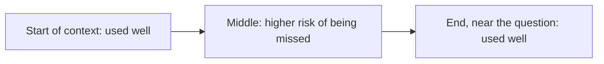

## Beginner-friendly explanation

Imagine briefing a brilliant contractor who has no memory of yesterday. Every morning you hand them a folder, and they can only work from what is in it. The folder has a page limit. If you stuff it with every email ever sent, the important page gets buried; if you leave out the spec, they guess. **Context engineering** is the skill of packing that folder well: the right instructions, the right documents, a short summary of what happened so far, and the question, in a sensible order.

For an LLM, the folder is the **context window**: the maximum number of tokens the model can take in at once (input plus the answer it writes). Models have no memory between API calls; anything they "remember" in a chat is there because the application sent the history again. So the application, not the model, decides what the model knows on each turn.

Bigger windows help, but they are not magic. More text costs more, takes longer, and can make the model miss the one sentence that matters.

## Technical explanation

### What competes for the window

| Component | Purpose | Typical budget concern |
|---|---|---|
| System prompt | Role, rules, output format | Stable; good cache candidate |
| Tool definitions | Names, descriptions, JSON schemas | Can be large with many tools |
| Examples (few-shot) | Show desired behaviour | Each example costs tokens |
| Retrieved documents | Facts for this question | Biggest variable cost |
| Memory | Long-term facts about user or task | Must be selected, not dumped |
| Conversation history | Earlier turns, tool calls and results | Grows every turn |
| User message | The actual question | Small but essential |
| Output reservation | `max_tokens` for the reply (and thinking) | Must fit too |

Current Claude models have large windows (hundreds of thousands of tokens, and up to a million for some models and configurations); check the context-windows documentation for exact current limits, which change. The same principles apply to every provider.

### Ordering

A practical default:

1. **System prompt** with stable rules and tool definitions (stable, so cacheable).
2. **Long reference material** (documents, wrapped in tags with IDs).
3. **Conversation summary and recent turns.**
4. **The question** last, close to where the answer begins.

Anthropic's long-context prompting guidance recommends putting long documents near the top and the query at the end, and wrapping each document in XML-style tags with metadata.

### Lost in the middle

Liu, Lin, Hewitt, Paranjape, Bevilacqua, Petroni and Liang, "Lost in the Middle: How Language Models Use Long Contexts" (2023, arXiv 2307.03172, published in TACL 2024), tested multi-document question answering and key-value retrieval while moving the relevant passage through the context. Performance was typically highest when the relevant information was at the **beginning or end** and lowest in the **middle**, a U-shaped curve, and extended-context models were not automatically better at using their extra length. Models have improved since, and newer long-context benchmarks probe harder multi-fact reasoning, so treat this as a risk to measure on your model and data rather than a fixed law.



Design responses: retrieve fewer, better chunks; rerank so the best are first; put the key material at the start or immediately before the question; repeat critical instructions near the end for very long prompts; and test.

### Token budgeting

Decide budgets per component before you hit the limit, for example: system and tools 3k, documents 20k, history 8k, output 2k. Count tokens with the provider's tokenizer or API (`client.messages.count_tokens` for Claude) rather than guessing from characters. When over budget, drop the lowest-priority items first (older history, lower-ranked chunks), never the rules.

### Prompt caching

Repeated prefixes (a long system prompt, a big document, tool definitions) are processed again on every call unless cached. With Claude you mark a breakpoint with `cache_control: {"type": "ephemeral"}`; later requests with an **identical prefix** up to that point read from the cache at a reduced price and lower latency. The default lifetime is short (minutes, refreshed on use) with a longer option available, and there is a minimum cacheable length that depends on the model; see the prompt-caching docs for current values and pricing. The response's `usage` shows `cache_creation_input_tokens` and `cache_read_input_tokens`, which you should assert on in tests.

Rule: **stable first, variable last.** A timestamp, user name or shuffled tool list early in the prompt breaks caching.

### Summarisation and compaction

Long conversations and agent runs outgrow any window. Options:

- **Sliding window:** keep the last N turns. Simple, forgets early facts.
- **Rolling summary:** when history passes a threshold, summarise older turns into a compact note and keep recent turns verbatim.
- **Tool-result clearing:** replace large tool outputs that have already been used with a short stub.
- **External memory:** store facts in a file or database and retrieve them when relevant (see [Agent memory and planning](/careers/ai-engineering/ai-engineering/agent-memory-and-planning)).

Anthropic's article on context engineering for agents describes compaction, structured note-taking and sub-agents with clean contexts as complementary strategies, and the Claude API offers context-management features for this; check the docs for the current options. Summaries lose detail, so test what survives: facts, decisions, open tasks and user constraints.

### Long context versus RAG

| Factor | Long context | RAG |
|---|---|---|
| Corpus size | Fits in the window | Any size |
| Changes often | Re-send each time | Re-index changed docs |
| Per-user permissions | Must filter before sending | Filter at retrieval |
| Cross-document reasoning | Strong, model sees everything | Limited to what was retrieved |
| Cost and latency per call | High (mitigated by caching) | Lower |
| Citations | Possible with document IDs | Natural, per chunk |

Often the answer is both: retrieve generously, rerank, then let a long window hold the top results (see [Building RAG pipelines](/careers/ai-engineering/ai-engineering/building-rag-pipelines)).

## Real-world example

A test-management assistant answered questions about a team's 300-page test strategy. Version one put the whole document into every request. It was slow and expensive, and testers noticed it missed the section on accessibility testing, which sat in the middle of the document. Version two cached the document prefix, which cut cost and latency on repeated questions, but the misses remained. Version three retrieved the 8 most relevant sections, put them first in relevance order, and kept the question last; it also summarised chat history beyond 10 turns. A 50-question eval with the answer location tagged (start, middle, end) showed the middle-section misses had largely disappeared, and the team kept the eval as a regression gate for future model upgrades.

## Step-by-step walkthrough

1. **Inventory** everything sent to the model per call and count tokens per component.
2. **Set budgets** per component and a priority order for what to drop.
3. **Order** stable content first, documents next, history, then the question.
4. **Cache** the stable prefix and verify cache reads in usage data.
5. **Compact** history with a rolling summary when it passes a threshold.
6. **Test position sensitivity** by moving key facts and measuring accuracy.
7. **Decide long context vs RAG** per use case using corpus size, freshness, permissions and cost.

## Code examples

### 1. A token-budget packer (standard library only)

Uses a rough 4-characters-per-token estimate for illustration; use a real tokenizer or the API's token counter in production.

```python
def est_tokens(text: str) -> int:
    return max(1, len(text) // 4)

def pack_context(system: str, chunks: list[dict], history: list[str], question: str, budget: int):
    """Always keep system and question; add chunks by score, then most recent history, until the budget is used."""
    used = est_tokens(system) + est_tokens(question)
    if used > budget:
        raise ValueError("system prompt and question alone exceed the budget")
    kept_chunks, kept_history = [], []
    for c in sorted(chunks, key=lambda c: -c["score"]):
        cost = est_tokens(c["text"])
        if used + cost <= budget:
            kept_chunks.append(c["id"])
            used += cost
    for turn in reversed(history):
        cost = est_tokens(turn)
        if used + cost > budget:
            break
        kept_history.insert(0, turn)
        used += cost
    return {"chunks": kept_chunks, "history_turns": len(kept_history), "tokens": used}

chunks = [
    {"id": "strategy#a11y", "score": 0.91, "text": "x" * 400},
    {"id": "strategy#perf", "score": 0.55, "text": "x" * 800},
    {"id": "strategy#intro", "score": 0.20, "text": "x" * 1200},
]
history = ["turn " + "y" * 200 for _ in range(6)]
print(pack_context("s" * 200, chunks, history, "What is our accessibility test approach?", budget=600))
```

### 2. Rolling-summary compaction trigger

```python
def compact(history: list[str], max_tokens: int, keep_recent: int, summarise) -> list[str]:
    if sum(est_tokens(t) for t in history) <= max_tokens:
        return history
    old, recent = history[:-keep_recent], history[-keep_recent:]
    return [f"SUMMARY: {summarise(old)}"] + recent

fake_summarise = lambda turns: f"{len(turns)} earlier turns about test planning"
long_history = [f"turn {i}: " + "z" * 120 for i in range(10)]
for line in compact(long_history, max_tokens=200, keep_recent=3, summarise=fake_summarise):
    print(line[:40])
```

### 3. Prompt caching and token counting with Claude

`pip install anthropic`, set `ANTHROPIC_API_KEY`, and save a long document as `strategy.md` (it must exceed the model's minimum cacheable length to be cached).

```python
from pathlib import Path
from anthropic import Anthropic

client = Anthropic()
MODEL = "claude-sonnet-5-5"
doc = Path("strategy.md").read_text(encoding="utf-8")

system = [
    {"type": "text", "text": "You answer questions about the team's test strategy. Answer only from the document and cite section headings."},
    {"type": "text", "text": f"<document name=\"strategy.md\">\n{doc}\n</document>", "cache_control": {"type": "ephemeral"}},
]

count = client.messages.count_tokens(
    model=MODEL, system=system, messages=[{"role": "user", "content": "How do we test accessibility?"}]
)
print("input tokens:", count.input_tokens)

for question in ["How do we test accessibility?", "Who signs off performance results?"]:
    resp = client.messages.create(
        model=MODEL,
        max_tokens=500,
        system=system,
        messages=[{"role": "user", "content": question}],
    )
    u = resp.usage
    print(question)
    print(" ", next(b.text for b in resp.content if b.type == "text")[:120], "...")
    print(f"  cache write={u.cache_creation_input_tokens} cache read={u.cache_read_input_tokens} uncached input={u.input_tokens}")
```

## Expected output

The packer prints `{'chunks': ['strategy#a11y', 'strategy#perf'], 'history_turns': 4, 'tokens': 564}`. System and question cost 60 tokens, the two best chunks add 300, the 300-token intro chunk does not fit, and four of the six 51-token history turns (the most recent ones) fill most of the rest. Change `budget` to see the trade-off between documents and history. The compaction script prints `SUMMARY: 7 earlier turns about test plan` (truncated to 40 characters for display) followed by turns 7, 8 and 9. The API script prints the input token count, then for the first question a non-zero `cache write` and zero `cache read`, and for the second question (within the cache lifetime) a non-zero `cache read`, showing the document prefix was reused.

## Common mistakes

- **Stuffing everything in** because the window is big, raising cost and burying key facts.
- **Variable content at the top**, which breaks prompt caching.
- **Estimating tokens from words** in production instead of counting them.
- **Forgetting the output** (`max_tokens`, thinking) needs room in the window.
- **Silent truncation** of history or documents with no log of what was dropped.
- **Summaries that drop decisions or constraints**, so the agent repeats work or breaks rules.
- **Assuming lost in the middle is solved** without testing your model on your data.

## Troubleshooting

- **Answers miss information you know was sent:** check its position, reduce the number of documents, rerank, and put the question last.
- **No cache reads:** compare prefixes byte for byte; check the minimum length, breakpoint placement and cache lifetime.
- **Context-length errors:** count tokens before sending, enforce budgets, and compact history.
- **Agent forgets earlier decisions:** add a structured notes file or memory and test what the summary keeps.

## Hands-on exercise

Build a position-sensitivity test: create 20 short filler documents and one "needle" document containing a unique fact such as a release code. For positions 1, 5, 10, 15 and 21, build the context, ask a model for the fact 5 times each, and record accuracy per position. Then repeat with only the top 5 retrieved documents and compare. Write up which context design you would ship and why.

## Key takeaways summary

Context engineering decides what the model knows on every call. Treat the window as a budget, order content deliberately, keep the prefix stable so prompt caching works, compact long histories, and remember that more context is not automatically better: measure position effects and pick long context, RAG or both based on your data and costs.
