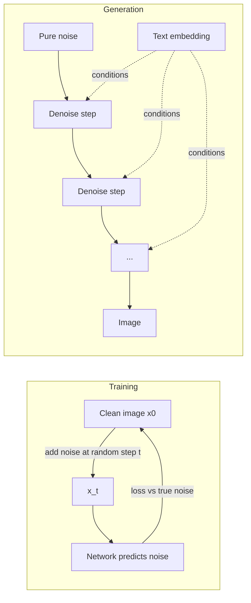

## Beginner-friendly explanation

Imagine a photo slowly dissolving into TV static: each second a little more random noise is sprinkled on, until nothing of the photo remains. That is easy to do. Now imagine training an artist to do the reverse: shown a slightly noisy photo, they learn to clean away *just a bit* of the noise. Repeat that cleaning hundreds of times, starting from pure static, and a brand new, clean picture appears.

That is a **diffusion model**. It never copies an image; it has learned how to turn noise into something that looks like the images it was trained on. If you also whisper a description to the artist at each step ("a red fox in snow"), the cleaning leans towards a picture that matches. That is **text-to-image** generation, the technology behind tools such as Stable Diffusion, Midjourney, DALL·E, Imagen and Firefly.

For a tester, two points stand out: the same prompt gives different pictures each time (the starting noise is random), and "is this image good?" has no single correct answer, so evaluation mixes metrics with human judgement.

## Technical explanation

### Forward process: adding noise

Given a clean image x₀ and a **noise schedule** β₁…β_T (small values increasing over T steps, often T = 1000 in training), the forward process adds Gaussian noise. A convenient closed form (Ho et al., 2020, DDPM) lets you jump straight to any step t:

x_t = √(ᾱ_t) · x₀ + √(1 − ᾱ_t) · ε, where ε ~ N(0, I) and ᾱ_t = ∏(1 − β_s) for s ≤ t.

As t grows, ᾱ_t shrinks towards 0, so x_T is almost pure noise.

### Reverse process: denoising

A network ε_θ(x_t, t) (classically a U-Net; newer models increasingly use diffusion transformers) is trained with a simple loss: pick a random image, step t and noise ε, build x_t, and minimise ‖ε − ε_θ(x_t, t)‖². At generation time you start from x_T ~ N(0, I) and repeatedly use the predicted noise to estimate a slightly cleaner x_{t−1}. Faster **samplers** (DDIM and later solvers) reduce the hundreds of steps to tens, and distillation methods reduce them further.



### Latent diffusion

Running hundreds of steps on a 1024×1024×3 pixel array is expensive. **Latent diffusion** (Rombach et al., 2022, the basis of Stable Diffusion) first trains an autoencoder that compresses an image into a much smaller latent tensor (for example 8× smaller in each spatial dimension), runs diffusion in that latent space, then decodes the final latent to pixels. Quality stays high while compute drops sharply.

### Text conditioning and classifier-free guidance

A text encoder (CLIP's text encoder or a language model such as T5) turns the prompt into embeddings. The denoiser attends to them through **cross-attention** (see [Transformers and attention](/learn/ai-engineering/transformers-and-attention)).

**Classifier-free guidance** (Ho and Salimans, 2022) trains the same network both with and without the prompt by randomly dropping it. At sampling time:

guided = ε_uncond + w · (ε_cond − ε_uncond)

The **guidance scale** w trades diversity for prompt adherence. Too high and images get oversaturated or distorted; too low and they drift from the prompt.

### VAEs and GANs, for contrast

| Family | Idea | Strengths | Weaknesses |
|---|---|---|---|
| VAE (Kingma and Welling, 2013) | Encode to a probabilistic latent, decode back | Stable training, useful latent space | Samples tend to be blurry on their own |
| GAN (Goodfellow et al., 2014) | Generator vs discriminator game | Fast one-step sampling, sharp images | Unstable training, mode collapse (low diversity) |
| Diffusion | Learn to reverse gradual noising | High quality and diversity, stable training | Many steps, so slower and costlier unless distilled |

Note how they combine: latent diffusion uses a VAE-style autoencoder plus, in the original paper, an adversarial loss when training it.

### Evaluation and its limits

- **FID (Fréchet Inception Distance;** Heusel et al., 2017**):** compares the mean and covariance of Inception-network features for a set of generated images versus real images. Lower is better. Limits: population-level only, needs thousands of samples to be stable, sensitive to the reference set and implementation, blind to prompts.
- **CLIP score:** cosine similarity between CLIP embeddings of the image and its prompt (see [Multimodal models](/learn/ai-engineering/multimodal-models)). Measures alignment roughly; weak on counting, text rendering, spatial relations and negation, and inherits CLIP's biases.
- **Human evaluation:** pairwise preference or rubric scores on a fixed prompt suite. Slower and costlier, but the only way to judge quality and intent reliably. Use several raters and measure agreement.

### Safety and provenance

- **Input and output filtering:** classifiers on prompts and generated images for disallowed content.
- **Bias:** neutral prompts ("a photo of a doctor") can produce skewed demographics; audit systematically (see [Bias, fairness and responsible AI](/learn/ai-engineering/bias-fairness-and-responsible-ai)).
- **Invisible watermarking:** a signal embedded in pixels (for example Google DeepMind's SynthID) that a detector can find. Robust to some edits, not all.
- **C2PA Content Credentials:** an open standard from the Coalition for Content Provenance and Authenticity in which a cryptographically signed manifest records how an asset was created and edited. It travels as metadata, so it can be stripped; verification shows whether a valid manifest is present and intact. Watermarks and C2PA complement each other.
- **Regulation is moving:** for example the EU AI Act includes transparency obligations for AI-generated content. Check current requirements for your market.

## Real-world example

A marketing platform added "generate a banner image" for small businesses. Testing found four classes of issue. Functional: the 16:9 option silently returned square images when the provider timed out and the fallback path ran. Quality: prompts with brand text produced garbled lettering, so the product moved text overlay into normal HTML instead of the image. Bias: "a professional plumber at work" returned men in nearly every image across 50 seeds, so the team added prompt diversification and a review. Provenance: images lost their C2PA manifest after the platform's own resize step, which re-encoded files without carrying metadata; the fix was to sign after resizing. None of these would have shown up in an FID number.

## Step-by-step walkthrough

1. Define the user tasks and a **prompt suite** (typical, edge, adversarial, multilingual).
2. Fix and record **seeds, model version, sampler, steps and guidance** for reproducible comparisons.
3. Test functional behaviour: sizes, formats, timeouts, retries, error messages, cost per image.
4. Score **prompt adherence and quality** with a rubric and at least two raters; track CLIP score as a cheap regression signal.
5. Run **safety** prompts and check filters block, warn or allow as designed.
6. Run a **bias audit** over neutral prompts with many seeds.
7. Verify **watermark / C2PA** presence at the point the user downloads the file.
8. Monitor in production: blocked-prompt rate, user reports, latency, cost.

## Code examples

### 1. The forward process in one dimension (standard library only)

```python
import math
import random

random.seed(0)
T = 1000
betas = [1e-4 + (0.02 - 1e-4) * t / (T - 1) for t in range(T)]  # linear schedule from DDPM

alpha_bar = []
prod = 1.0
for b in betas:
    prod *= (1 - b)
    alpha_bar.append(prod)

x0 = 1.0  # one "pixel" of a clean image

def noisy(x0, t):
    eps = random.gauss(0, 1)
    return math.sqrt(alpha_bar[t]) * x0 + math.sqrt(1 - alpha_bar[t]) * eps, eps

for t in [0, 100, 250, 500, 999]:
    xt, _ = noisy(x0, t)
    print(f"t={t:4d}  signal weight={math.sqrt(alpha_bar[t]):.3f}  x_t={xt:+.3f}")
```

### 2. One ideal reverse step and classifier-free guidance

If the network predicted the noise perfectly, you could recover x₀ exactly. Guidance mixes two noise predictions.

```python
def estimate_x0(xt, eps_pred, t):
    return (xt - math.sqrt(1 - alpha_bar[t]) * eps_pred) / math.sqrt(alpha_bar[t])

xt, true_eps = noisy(x0, 500)
print("recovered x0 with perfect noise prediction:", round(estimate_x0(xt, true_eps, 500), 6))

def cfg(eps_uncond, eps_cond, w):
    return eps_uncond + w * (eps_cond - eps_uncond)

for w in [0.0, 1.0, 7.5]:
    print(f"w={w}: guided noise = {cfg(0.20, 0.50, w):.2f}")
```

### 3. Testing an image pipeline: a CLIP-score regression check

In a real project you compute CLIP similarities with a library such as `open_clip` or `transformers`. The test logic itself is plain Python: compare a new model version against the baseline per prompt and flag regressions.

```python
baseline = {"red fox in snow": 0.31, "two cats on a sofa": 0.29, "a plumber at work": 0.27}
candidate = {"red fox in snow": 0.32, "two cats on a sofa": 0.22, "a plumber at work": 0.27}

TOLERANCE = 0.02
regressions = {p: (baseline[p], candidate[p]) for p in baseline if candidate[p] < baseline[p] - TOLERANCE}
print("regressions:", regressions)
```

## Expected output

The forward-process script prints the signal weight falling from about 1.000 at t=0 to about 0.006 at t=999, with x_t values drifting from close to 1.0 to random-looking numbers (exact values depend on the seed). The reverse-step script prints `recovered x0 with perfect noise prediction: 1.0` and guided noise values of `0.20`, `0.50` and `2.45` for w = 0, 1 and 7.5, showing how large w amplifies the conditional direction. The regression check prints `{'two cats on a sofa': (0.29, 0.22)}`, a prompt to send to human review (CLIP scores are known to be weak at counting).

## Common mistakes

- **Comparing models with different seeds, samplers or step counts** and attributing the difference to the model.
- **Relying on FID alone**, or computing it on a few dozen images.
- **Treating CLIP score as ground truth** for counting, text or spatial relations.
- **Asserting exact pixels** in tests when the pipeline is stochastic.
- **Stripping provenance** with your own resize or compression step.
- **Skipping bias audits** because each single image looks fine.
- **Cranking guidance up** to fix adherence and getting oversaturated, artefact-filled images.

## Troubleshooting

- **Images ignore part of the prompt:** simplify the prompt, try a moderate guidance increase, or use a model with a stronger text encoder.
- **Garbled text in images:** render text separately in the UI, or choose a model evaluated for text rendering.
- **Results not reproducible:** pin model version, seed, sampler, steps, guidance and image size; note that GPU nondeterminism can still cause small differences.
- **Content credentials missing:** check every processing step after generation; sign last or use tools that preserve C2PA manifests.

## Hands-on exercise

Extend the 1D toy into a "dataset" of 1,000 values drawn from two clusters (around −2 and +2). Noise them to t = 999, then write a reverse loop using an "oracle" that knows the true noise and check you recover both clusters. Then write a short test plan (10 prompts, a rubric, safety and provenance checks) for an image feature in a product you know.

## Key takeaways summary

Diffusion models generate by learning to undo noise step by step; latent diffusion makes it affordable and classifier-free guidance makes it follow prompts. GANs and VAEs offer different trade-offs. Metrics such as FID and CLIP score help track trends but cannot replace human evaluation, and a shippable image feature also needs safety, bias, provenance and operational testing.
