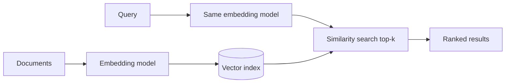

## Beginner-friendly explanation

Imagine a giant map where every sentence is a dot. Sentences about cats sit in one neighbourhood, sentences about invoices in another, and "my bill is wrong" sits right next to "I was overcharged" even though they share no words. An **embedding** is the coordinates of a sentence on that map, given as a list of numbers. **Vector search** is finding the dots nearest to your question.

This is how modern semantic search works, and it is the "retrieval" part of retrieval-augmented generation (RAG).

## Technical explanation

### What an embedding is

An embedding model (often a transformer encoder) maps an input text to a vector of fixed length, for example a few hundred to a few thousand dimensions depending on the model. Training pushes texts with related meaning toward similar directions. Individual dimensions are not human-interpretable; only relative positions matter.

Popular sources:

- Hosted APIs (Anthropic's docs point to Voyage AI embeddings; OpenAI and others offer embedding endpoints).
- Open models via **sentence-transformers** that run locally.

Note that Claude itself is a generative model; for embeddings you use a dedicated embedding model.

### Similarity measures

| Measure | Formula | Notes |
|---|---|---|
| Cosine similarity | a·b / (‖a‖‖b‖) | Range −1 to 1; ignores magnitude |
| Dot product | a·b | Equals cosine for unit vectors |
| Euclidean distance | ‖a − b‖ | For unit vectors, ranks the same as cosine |

Normalising every vector to length 1 at index time is common: then the dot product *is* cosine similarity, and matrix multiplication finds all scores at once.

### Search at scale

- **Exact (brute force):** compare the query with every vector. Fine for thousands to low millions with numpy or `faiss.IndexFlatIP`.
- **Approximate nearest neighbour (ANN):** structures such as HNSW graphs or IVF clustering search a fraction of vectors. Much faster, slightly lower recall, tunable.
- **Vector databases** (and vector extensions to existing databases, including MongoDB Atlas Vector Search and PostgreSQL pgvector) add persistence, metadata filtering, updates and replication.

### Hybrid search

Embeddings are weak at exact tokens: error codes, SKUs, names. Many production systems combine **keyword search (BM25)** with vector search and merge the rankings, often followed by a **reranker** model that re-scores the top results.

### Evaluating retrieval

With labelled query → relevant-document pairs:

- **recall@k:** fraction of queries where a relevant document appears in the top k.
- **MRR (mean reciprocal rank):** rewards putting the relevant document near the top.



## Real-world example

An internal QA knowledge base used keyword search. Testers searching "flaky login test" missed the page titled "Intermittent authentication failures in CI". The team added embeddings with a sentence-transformers model and saw paraphrase queries succeed. Then a new problem appeared: searching for the exact error code `ERR_CERT_DATE_INVALID` returned general "certificate" pages but not the one runbook that contained the code. They moved to hybrid search (keyword + vector) and built a 50-query labelled set covering paraphrases and identifiers, measuring recall@5 before every change. When someone later swapped to a newer embedding model, the test set caught that the document vectors had not been regenerated.

## Step-by-step walkthrough

1. Choose an embedding model and note its dimension and max input length.
2. Embed every document (or chunk) and normalise.
3. Store vectors with IDs and metadata.
4. Embed the query with the same model, normalise.
5. Score with dot product, take top-k.
6. Evaluate with labelled queries; iterate on model, chunking and hybrid search.

## Code examples

Cosine similarity and top-k with numpy and a local sentence-transformers model (`pip install sentence-transformers numpy`):

```python
import numpy as np
from sentence_transformers import SentenceTransformer

model = SentenceTransformer("all-MiniLM-L6-v2")

docs = [
    "How to reset your password from the login page",
    "Refunds are processed within the policy window",
    "Intermittent authentication failures in CI pipelines",
    "Configuring Playwright retries for flaky tests",
    "Exporting test results to CSV",
]

doc_vecs = model.encode(docs, normalize_embeddings=True)   # shape (5, dim)

def search(query: str, k: int = 3):
    q = model.encode([query], normalize_embeddings=True)[0]
    scores = doc_vecs @ q                                    # cosine, since unit length
    top = np.argsort(-scores)[:k]
    return [(docs[i], float(scores[i])) for i in top]

for doc, score in search("my login test fails randomly in the pipeline"):
    print(f"{score:.3f}  {doc}")
```

Cosine similarity written out explicitly:

```python
def cosine(a: np.ndarray, b: np.ndarray) -> float:
    return float(a @ b / (np.linalg.norm(a) * np.linalg.norm(b)))
```

Measuring recall@k:

```python
labelled = {
    "forgot my password": 0,
    "login test fails randomly in CI": 2,
    "rerun unstable tests automatically": 3,
}

def recall_at_k(k: int) -> float:
    hits = 0
    for query, relevant_idx in labelled.items():
        q = model.encode([query], normalize_embeddings=True)[0]
        top = np.argsort(-(doc_vecs @ q))[:k]
        hits += int(relevant_idx in top)
    return hits / len(labelled)

print("recall@1", recall_at_k(1), "recall@3", recall_at_k(3))
```

Scaling with FAISS (`pip install faiss-cpu`):

```python
import faiss

index = faiss.IndexFlatIP(doc_vecs.shape[1])   # exact inner-product search
index.add(doc_vecs.astype("float32"))
q = model.encode(["export results"], normalize_embeddings=True).astype("float32")
scores, ids = index.search(q, 2)
print(ids[0], scores[0])
```

Hosted embedding APIs follow the same shape: send a list of texts, receive a list of vectors, then use exactly the same numpy or FAISS code.

## Expected output

The top result for "my login test fails randomly in the pipeline" is "Intermittent authentication failures in CI pipelines" with the highest score, despite few shared words. Recall values print between 0 and 1; with this tiny set you will likely see high recall@3. The FAISS search returns the CSV export document first.

## Common mistakes

- **Mixing embedding models** between documents and queries, or after an upgrade without re-embedding.
- **Forgetting to normalise** and then treating dot product as cosine.
- **Embedding huge documents whole**, exceeding the model's input limit (silently truncated) and blurring meaning; chunk instead.
- **Relying only on vectors** for exact identifiers; add keyword or hybrid search.
- **No labelled evaluation set**, so quality changes go unnoticed.
- **Ignoring metadata filters** (tenant, permissions), leaking documents across users.

## Troubleshooting

- **Irrelevant top results:** inspect scores, try a better or domain-suited model, chunk differently, add a reranker.
- **Slow queries at scale:** move from brute force to an ANN index and tune it against exact results.
- **Scores look similar for everything:** check for empty or boilerplate-heavy chunks dominating.

## Key takeaways summary

Embeddings place text in a vector space where nearness means similar meaning. Normalise, use cosine (dot product), take top-k, and scale with ANN indexes or vector databases. Keep the model consistent, combine with keyword search for exact terms, and prove quality with recall@k on labelled queries.
