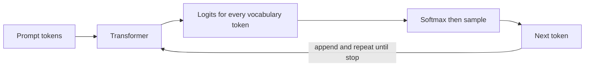
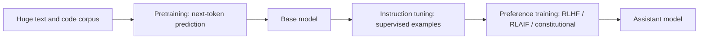

## Beginner-friendly explanation

Think of the autocomplete on your phone. You type "See you" and it suggests "tomorrow". It has learned which words usually come next. Now imagine an autocomplete trained on a huge share of the public internet, books and code, which can keep suggesting the next word hundreds of times in a row, and which has been coached to be helpful when you ask it something. That is, roughly, a **large language model (LLM)**, the best-known kind of **generative AI**.

"Generative" means the model **creates new content**: text, code, images, audio or video. Most machine learning you may have met before was **discriminative**: it looks at something and *labels* it (spam or not spam, cat or dog, likely-to-fail or not). A generative model has learned what the data *itself* looks like, so it can produce new examples that look like the real thing.

Two consequences matter for anyone who builds or tests software:

1. The output is **plausible**, not **verified**. The model writes what is likely to come next, which is usually right, but sometimes confidently wrong. That is called **hallucination**.
2. The output can **vary** between runs, because the model samples from a range of likely next words. Testing it needs different techniques from testing a normal function that always returns the same thing.

## Technical explanation

### Discriminative versus generative

| | Discriminative | Generative |
|---|---|---|
| Learns | P(label \| input) | P(data), or P(next token \| previous tokens) |
| Output | A label or score | New samples (text, images, audio) |
| Examples | Logistic regression, image classifiers, BERT fine-tuned for classification | GPT-style LLMs, Claude, diffusion models, VAEs, GANs |
| Testing focus | Accuracy, precision, recall on labelled data | Quality, faithfulness, safety, variability, human or model-graded evals |

Generative models can also be used for discriminative jobs (ask an LLM to classify a ticket), which is a big reason they spread so fast.

### How an LLM generates text, token by token

Text is split into **tokens** (pieces of words; see [LLM fundamentals and tokens](/learn/ai-engineering/llm-fundamentals-and-tokens)). A decoder-only **transformer** (Vaswani et al., 2017; see [Transformers and attention](/learn/ai-engineering/transformers-and-attention)) reads all tokens so far and outputs a score (**logit**) for every token in its vocabulary. A softmax turns the scores into probabilities. The system picks one token, appends it and repeats. This is called **autoregressive** generation.



How the next token is chosen is the **decoding strategy**:

- **Greedy:** always take the most likely token. Repeatable but can be dull or loop.
- **Temperature sampling:** divide logits by a temperature before softmax. Lower is sharper (more predictable), higher is flatter (more varied).
- **Top-k / top-p (nucleus):** sample only from the k most likely tokens, or from the smallest set whose probabilities add up to p.

Note for Claude users: current Claude models reject non-default `temperature`, `top_p` and `top_k`, so you control variability through the prompt and evaluation rather than these knobs. Other providers and open-weight models still expose them. Either way, design tests that tolerate variation.

### How a model is trained: three broad stages



1. **Pretraining.** Self-supervised next-token prediction on a very large corpus. The result is a **base model**: knowledgeable and fluent, but it continues text rather than following instructions. Ask it "Write a test plan" and it might write more questions.
2. **Instruction tuning (supervised fine-tuning, SFT).** Train on curated prompt and ideal-response pairs so the model learns the assistant format.
3. **Preference training.** In **RLHF** (reinforcement learning from human feedback), people compare pairs of responses, a **reward model** is trained to predict their preferences, and the model is optimised to score well (Ouyang et al., 2022, InstructGPT). **RLAIF** uses AI-generated preference labels instead of, or alongside, human ones. Anthropic's **Constitutional AI** (Bai et al., 2022) has the model critique and revise its own outputs against a written set of principles and then uses AI feedback based on those principles for the preference stage. Newer methods such as direct preference optimisation (DPO) skip the separate reward model; the field keeps moving, so treat the exact recipe of any commercial model as partly unknown unless the provider documents it.

### Foundation models

Bommasani et al. (2021) coined **foundation model** for a model trained on broad data at scale that can be adapted to many downstream tasks. One pretrained model becomes the base for chat, coding, summarising, classification and more, via prompting, retrieval ([Building RAG pipelines](/learn/ai-engineering/building-rag-pipelines)) or fine-tuning ([Fine-tuning and adaptation](/learn/ai-engineering/fine-tuning-and-adaptation)). The upside is reuse; the downside is that a flaw or bias in the foundation is inherited by everything built on it.

### Capabilities and failure modes

| Strong at | Common failure modes |
|---|---|
| Drafting, rewriting, summarising | **Hallucination:** fluent, confident, false statements or invented citations |
| Code generation and explanation | **Outdated knowledge:** training data has a cutoff date |
| Extracting structure from messy text | **Inconsistency:** different answers to the same question |
| Classification with few examples | **Prompt sensitivity:** small wording changes shift output |
| Reasoning through multi-step problems | **Arithmetic and counting slips** without tools |
| Following format instructions | **Prompt injection:** obeying instructions hidden in input data |
| | **Bias and unsafe content** learned from data |

Hallucination is not a bug you can patch once. The training objective rewards plausible text, and the model has no built-in signal separating "I know this" from "this sounds right". You reduce it with grounding, citations, tools, permission to say "I don't know" and evaluation (see [Hallucination and groundedness testing](/learn/ai-engineering/hallucination-and-groundedness-testing)).

### Open-weight versus closed models

| | Open-weight (e.g. Llama, Mistral, Qwen, Gemma families) | Closed / API (e.g. Claude, GPT, Gemini) |
|---|---|---|
| Access | Download weights, run anywhere | Call a hosted API |
| Control | Full: fine-tune, inspect, run offline | Limited to what the API offers |
| Operations | You run GPUs, scaling, patching | Provider runs it |
| Capability | Strong and improving; check current evals | Usually at the frontier |
| Data | Stays on your infrastructure | Sent to provider under their data terms |

"Open-weight" is more precise than "open source": many such models publish weights but not training data or code, and licences differ. Read the licence.

### Where generative AI fits in products and testing

Good fits: drafting and summarising with a human in the loop, search and Q&A over your documents with citations, extracting fields from unstructured text, test-idea generation, code assistance. Risky fits: anything needing guaranteed exact answers (prices, legal terms, dosages) without grounding and checks. Poor fits: deterministic calculations a normal function does perfectly.

For testers, generative AI is both a **tool** (generate test data, draft cases, triage logs; see [AI-assisted test automation](/learn/ai-engineering/ai-assisted-test-automation)) and a **system under test** that needs evals, groundedness checks, red teaming and monitoring.

## Real-world example

An insurance company added "explain my policy" to its customer portal. A pilot used a general chat model with only the customer's question. In user testing it answered fluently, but testers found it describing a "30-day cooling-off period" for a product that has 14 days, a hallucination built from typical policies in its training data. The team changed the design: the bot now retrieves the customer's actual policy wording, answers only from it with clause citations, and says "I can't find that in your policy, please contact us" otherwise. QA built an eval set of 60 questions, 15 of them deliberately unanswerable, and set release gates on citation accuracy and the abstention rate. The model did not change; the product design and the tests did.

## Step-by-step walkthrough

1. **State the task**: generate or classify? Who reads the output and what happens if it is wrong?
2. **Pick a model class**: closed API for fastest start; open-weight if data or control requires it.
3. **Write a prompt** with role, task, constraints and output format (see [Prompt engineering](/learn/ai-engineering/prompt-engineering)).
4. **Ground it** in your data when facts matter, and allow abstention.
5. **Run it several times** on the same input to see variability.
6. **Build a small eval set**, including edge cases and unanswerable questions.
7. **Decide on guardrails and human review** for high-impact outputs.

## Code examples

### 1. Next-token generation from scratch (standard library only)

This toy bigram model is nothing like a real transformer in scale, but the generation loop is the same idea: predict a distribution over the next token, pick one, append, repeat.

```python
import math
import random
from collections import Counter, defaultdict

corpus = (
    "the test passed . the test failed . the build passed . "
    "the build failed . the test was flaky . the build was green . "
    "the test passed . the test passed ."
).split()

# "Training": count which token follows which
follows = defaultdict(Counter)
for prev, nxt in zip(corpus, corpus[1:]):
    follows[prev][nxt] += 1

def next_token_probs(prev, temperature=1.0):
    counts = follows[prev]
    logits = {tok: math.log(c) for tok, c in counts.items()}
    scaled = {tok: l / temperature for tok, l in logits.items()}
    m = max(scaled.values())
    exps = {tok: math.exp(v - m) for tok, v in scaled.items()}
    total = sum(exps.values())
    return {tok: e / total for tok, e in exps.items()}

def generate(start, n=6, temperature=1.0, greedy=False, seed=None):
    rng = random.Random(seed)
    out = [start]
    for _ in range(n):
        probs = next_token_probs(out[-1], temperature)
        if greedy:
            tok = max(sorted(probs), key=probs.get)
        else:
            tok = rng.choices(list(probs), weights=list(probs.values()))[0]
        out.append(tok)
        if tok == ".":
            break
    return " ".join(out)

print("P(next | 'the'):", {k: round(v, 2) for k, v in next_token_probs("the").items()})
print("greedy :", generate("the", greedy=True))
for s in range(3):
    print(f"sample {s}:", generate("the", seed=s))
print("low temp :", {k: round(v, 2) for k, v in next_token_probs("test", 0.3).items()})
print("high temp:", {k: round(v, 2) for k, v in next_token_probs("test", 3.0).items()})
```

### 2. Calling a real LLM and observing variability

`pip install anthropic`, set `ANTHROPIC_API_KEY`.

```python
from anthropic import Anthropic

client = Anthropic()
MODEL = "claude-sonnet-5-5"

def ask(prompt: str) -> str:
    resp = client.messages.create(
        model=MODEL,
        max_tokens=300,
        messages=[{"role": "user", "content": prompt}],
    )
    # Responses can start with a thinking block, so pick the first text block
    return next(b.text for b in resp.content if b.type == "text")

prompt = "In one sentence, suggest a name for a test-data generator tool."
answers = [ask(prompt) for _ in range(3)]
for a in answers:
    print("-", a)
print("distinct answers:", len(set(answers)))

# Allowing abstention reduces invented answers
print(ask(
    "What was the exact pass rate of the Saige-Prep nightly regression suite last Tuesday? "
    "If you do not have this information, say 'I don't know' and explain what data you would need."
))
```

## Expected output

The bigram script is deterministic for the given seeds. It prints:

```text
P(next | 'the'): {'test': 0.62, 'build': 0.38}
greedy : the test passed .
sample 0: the build was flaky .
sample 1: the test was green .
sample 2: the build was flaky .
low temp : {'passed': 0.95, 'failed': 0.02, 'was': 0.02}
high temp: {'passed': 0.42, 'failed': 0.29, 'was': 0.29}
```

Greedy always picks the likeliest path; sampling produces different sentences, including "the test was green", which never appears in the corpus. That is a tiny hallucination: each step is locally plausible but the whole is new and unsupported. Low temperature concentrates probability on "passed"; high temperature spreads it out.

The API script prints three tool names that will usually differ in wording, a count of distinct answers (often 3), and an answer to the pass-rate question that says it does not know and asks for CI data. Exact text varies run to run, which is the point.

## Common mistakes

- **Treating output as fact.** Fluent is not the same as correct; verify or ground.
- **Expecting identical output** from the same prompt and writing exact-match assertions.
- **Using an LLM for exact computation** that a normal function does reliably.
- **Confusing a base model with an assistant model** and wondering why it rambles.
- **Calling every downloadable model "open source"** without reading the licence.
- **Forgetting the knowledge cutoff** and asking about recent events without supplying sources.
- **Sending non-default temperature to current Claude models**, which returns an error.

## Troubleshooting

- **Invented facts or citations:** add retrieved sources, require citations, allow "I don't know", and test with unanswerable questions.
- **Answers vary too much:** tighten the prompt, add examples, constrain the format with structured output, and evaluate on several runs rather than one.
- **Model ignores instructions:** move rules into the system prompt, make them specific, and check for conflicting instructions in user data.
- **API 400 errors on sampling parameters:** remove `temperature`, `top_p` and `top_k` for models that do not accept them.

## Hands-on exercise

Extend the bigram generator into a **trigram** model (predict from the previous two tokens), train it on a few paragraphs of your team's release notes, and compare greedy and sampled output at temperatures 0.5, 1.0 and 2.0. Then write five questions about your product that an LLM could not know, ask a real model each one with and without "say I don't know if unsure", and record how often it invents an answer.

## Key takeaways summary

Generative AI creates new content by learning the distribution of data. LLMs do this one token at a time, sampling from predicted probabilities, after pretraining, instruction tuning and preference training. That makes them powerful and flexible but non-deterministic and prone to hallucination, so products need grounding and abstention, and testers need evals that tolerate variation and target failure modes.
