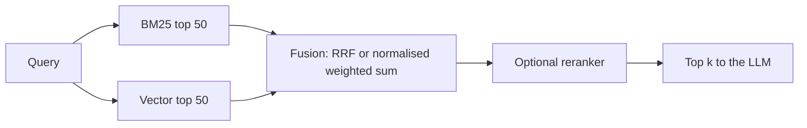

## Beginner-friendly explanation

There are two ways to find a recipe in a large cookbook. One is the **index at the back**: look up "saffron" and get the exact pages that mention it. The other is asking a friend who knows cooking: "something warm with rice and a yellow colour", and they suggest paella even though you never said the word.

**Lexical (keyword) search** is the index at the back. It matches the actual words, and it is unbeatable when you know the exact term: an error code, a product name, a ticket number. **Vector search** is the knowledgeable friend: it understands meaning and paraphrase, but it can be vague with exact strings and might suggest the recipe next to the one you named.

**Hybrid search** asks both and merges their suggestions. BM25 is the standard formula behind the index at the back, and **reciprocal rank fusion** is a simple, reliable way to merge.

## Technical explanation

### From word counts to TF-IDF

Lexical search starts with an **inverted index**: for every term, the list of documents containing it, and how often. A naive score counts matches, but two problems appear:

1. Common words ("the", "payment" in a payments wiki) match everything. **Inverse document frequency (IDF)** down-weights terms found in many documents.
2. A document mentioning "timeout" 20 times is not 20 times more relevant than one mentioning it once. Term frequency should **saturate**.

**TF-IDF** multiplies term frequency by IDF. **BM25** ("Best Matching 25", from the probabilistic relevance framework of Robertson, Spärck Jones and colleagues; see Robertson and Zaragoza, 2009) refines it with saturation and length normalisation.

### The BM25 formula

For query terms q₁…qₙ and document D:

```text
score(D, Q) = Σ IDF(qᵢ) · f(qᵢ, D) · (k1 + 1) / ( f(qᵢ, D) + k1 · (1 − b + b · |D| / avgdl) )

IDF(q) = ln( 1 + (N − n(q) + 0.5) / (n(q) + 0.5) )
```

| Symbol | Meaning |
|---|---|
| f(q, D) | How many times term q occurs in D |
| \|D\|, avgdl | Length of D in tokens, average length across the collection |
| N, n(q) | Number of documents, number containing q |
| k1 | Saturation; typical defaults are around 1.2 (Lucene and Elasticsearch use 1.2) |
| b | Length normalisation from 0 (none) to 1 (full); 0.75 is a common default |

The IDF variant shown, with `1 +` inside the log, is the one Lucene uses; it is always positive. Other implementations differ slightly, so scores from different libraries will not match exactly.

### Worked example

Four short support documents (the code below uses the same ones):

| ID | Text | Length |
|---|---|---|
| d1 | Error E1042 means the payment gateway timed out. Retry the payment after one minute. | 14 |
| d2 | Payment failures are usually caused by expired cards or a gateway timeout. | 12 |
| d3 | To reset your password, open settings and choose reset password. | 10 |
| d4 | The gateway returns E2001 when the card number fails validation. | 10 |

N = 4 and avgdl = 46 / 4 = 11.5. Query: **"gateway timeout payment"**, k1 = 1.2, b = 0.75.

**IDF:** "gateway" is in 3 documents: ln(1 + 1.5/3.5) = 0.3567. "timeout" is in 1: ln(1 + 3.5/1.5) = 1.2040. "payment" is in 2: ln(1 + 2.5/2.5) = 0.6931.

**Score for d2** (length 12, each term once): the length factor is k1 · (0.25 + 0.75 · 12/11.5) = 1.2 · 1.0326 = 1.2391. Each term's TF part is 1 · 2.2 / (1 + 1.2391) = 0.9825. Score = (0.3567 + 1.2040 + 0.6931) · 0.9825 = **2.2144**.

**Score for d1** (length 14): length factor 1.2 · (0.25 + 0.75 · 14/11.5) = 1.3957. "gateway" once: 0.3567 · 2.2/2.3957 = 0.3276. "payment" twice: 0.6931 · 4.4/3.3957 = 0.8981. "timeout" is absent, because d1 says "timed out". Score = **1.2257**.

d2 wins because it contains the rare word "timeout". Note the lesson: BM25 has no idea that "timed out" means "timeout". That is exactly what embeddings are good at, and why the two complement each other.

### When keywords beat embeddings, and the reverse

| Lexical (BM25) is stronger | Vector search is stronger |
|---|---|
| Error codes, IDs, SKUs, version numbers | Paraphrases and synonyms ("can't log in" vs "authentication failure") |
| Names of people, products, internal tools | Questions phrased differently from documents |
| Rare jargon unseen by the embedding model | Cross-lingual queries (with multilingual models) |
| Queries where the user knows the exact term | Vague, descriptive queries |

### Combining results: hybrid search

Run both retrievers, take the top N from each, and merge.



**Option 1: score normalisation.** Rescale each list's scores to 0..1 (min-max, or z-scores) and compute `α · vector + (1 − α) · bm25`. It can use score magnitudes, but min-max is sensitive to outliers and to how many results you take, and α needs tuning.

**Option 2: reciprocal rank fusion (RRF).** From Cormack, Clarke and Büttcher (SIGIR 2009):

```text
RRF(d) = Σ over lists  1 / (k + rank(d))      with k commonly 60
```

Only ranks matter, so there is nothing to calibrate. Documents ranked well by both retrievers rise; a document that only one list loves still scores. Elasticsearch, OpenSearch and several vector databases offer RRF natively. Whether hybrid beats either retriever alone depends on your data, so measure it.

## Real-world example

An internal test-tooling assistant answered questions over CI logs and runbooks. Testers pasting failure codes such as `TST-INFRA-0412` received runbooks for neighbouring codes, because the embedding model treated codes as similar-looking noise. The team added BM25 over the same chunks with a tokenizer that kept hyphenated codes whole, merged with RRF (k = 60) and evaluated on 60 logged queries labelled with the correct runbook. Code queries improved sharply and natural-language queries stayed level. They also found a bug while testing: the default tokenizer had split `TST-INFRA-0412` into three common tokens, making BM25 nearly useless until the tokenizer was fixed.

## Step-by-step walkthrough

1. **Collect real queries** and label the relevant chunk for each. Tag queries that contain codes or names.
2. **Check tokenisation** of your identifiers; decide whether to keep hyphens, dots and case.
3. **Build BM25** over the same chunks you embed (ideally including any contextual prefix).
4. **Run both retrievers** with a generous N (for example 50).
5. **Fuse with RRF** as a baseline; try a normalised weighted sum if you have time to tune α.
6. **Compare hit rate@k or recall@k** for BM25 only, vector only and hybrid, split by query type.
7. **Add a reranker** on the fused list if top-k precision still matters (see [Reranking and cross-encoders](/learn/ai-engineering/reranking-and-cross-encoders)).

## Code examples

BM25 and RRF from scratch, standard library only:

```python
import math
import re
from collections import Counter

DOCS = {
    "d1": "Error E1042 means the payment gateway timed out. Retry the payment after one minute.",
    "d2": "Payment failures are usually caused by expired cards or a gateway timeout.",
    "d3": "To reset your password, open settings and choose reset password.",
    "d4": "The gateway returns E2001 when the card number fails validation.",
}

def tokenize(text: str) -> list[str]:
    return re.findall(r"[a-z0-9]+", text.lower())

class BM25:
    def __init__(self, docs: dict[str, str], k1: float = 1.2, b: float = 0.75):
        self.k1, self.b = k1, b
        self.tf = {d: Counter(tokenize(t)) for d, t in docs.items()}
        self.len = {d: sum(c.values()) for d, c in self.tf.items()}
        self.avgdl = sum(self.len.values()) / len(docs)
        n = len(docs)
        df = Counter(term for c in self.tf.values() for term in c)
        # Lucene-style IDF: always positive
        self.idf = {t: math.log(1 + (n - f + 0.5) / (f + 0.5)) for t, f in df.items()}

    def score(self, query: str, doc_id: str) -> float:
        tf, dl, s = self.tf[doc_id], self.len[doc_id], 0.0
        for term in tokenize(query):
            if term not in tf:
                continue
            f = tf[term]
            norm = self.k1 * (1 - self.b + self.b * dl / self.avgdl)
            s += self.idf[term] * f * (self.k1 + 1) / (f + norm)
        return s

    def search(self, query: str, k: int = 3) -> list[tuple[str, float]]:
        scored = [(d, self.score(query, d)) for d in self.tf]
        scored = [x for x in scored if x[1] > 0]
        return sorted(scored, key=lambda x: -x[1])[:k]

def rrf(rankings: list[list[str]], k: int = 60) -> list[tuple[str, float]]:
    """Reciprocal rank fusion: sum 1/(k + rank) over every list a document appears in."""
    fused: dict[str, float] = {}
    for ranking in rankings:
        for rank, doc_id in enumerate(ranking, start=1):
            fused[doc_id] = fused.get(doc_id, 0.0) + 1 / (k + rank)
    return sorted(fused.items(), key=lambda x: -x[1])

bm25 = BM25(DOCS)
for d, s in bm25.search("what does E1042 mean"):
    print(f"bm25 {d} {s:.3f}")

lexical = [d for d, _ in bm25.search("gateway timeout payment", k=4)]
dense = ["d2", "d4", "d3"]   # pretend output from a vector search
print("lexical:", lexical)
for d, s in rrf([lexical, dense]):
    print(f"rrf {d} {s:.5f}")
```

In production you would use a search engine's BM25 (Elasticsearch, OpenSearch, Postgres full-text search, or the hybrid features of a vector database) or the `rank_bm25` Python package for experiments, and a real embedding model for `dense`.

## Expected output

```text
bm25 d1 1.106
lexical: ['d2', 'd1', 'd4']
rrf d2 0.03279
rrf d4 0.03200
rrf d1 0.01613
rrf d3 0.01587
```

Only d1 contains the token `e1042`, so it is the single BM25 hit; "mean" does not match "means" because this tokenizer does no stemming. In the fusion, d2 is first in both lists and wins; d4 (second in vector, third in BM25) overtakes d1, which appears in only one list.

## Common mistakes

- **Adding raw BM25 and cosine scores** that live on different scales.
- **A tokenizer that destroys identifiers**, splitting `TST-INFRA-0412` or lowercasing case-sensitive codes.
- **Indexing different text** in BM25 and vector stores, so the fused lists refer to different chunks.
- **Assuming hybrid always helps** without measuring per query type.
- **Taking too few candidates** from each retriever before fusion, so fusion has nothing to reconcile.
- **Ignoring stemming and stop words** decisions, which change BM25 behaviour.

## Troubleshooting

- **Exact codes still missed:** inspect the tokens produced for the code and the query; add a keyword field with a whitespace or pattern tokenizer.
- **Hybrid worse than vector alone on natural questions:** BM25 may be dominated by common words; check stop words, lower the BM25 weight or rely on RRF.
- **Long documents always win or always lose:** adjust b, or fix chunking so lengths are comparable.
- **Scores differ from another library:** IDF variants and tokenizers differ; compare rankings, not absolute scores.

## Hands-on exercise

Add three documents to `DOCS` that mention "timed out", "time-out" and "timeout" respectively. Predict, then check, how BM25 ranks them for the query "timeout". Then implement a min-max normalised weighted sum `alpha * vector + (1 - alpha) * bm25` using invented vector scores, and find a value of `alpha` where its ranking differs from RRF. Explain in two sentences which you would ship and why.

## Key takeaways summary

BM25 scores documents by rarity, saturating term frequency and length normalisation; it is cheap, training-free and excellent with exact tokens. Embeddings handle meaning and paraphrase. Hybrid search runs both and merges them, most simply with reciprocal rank fusion, which needs no score calibration. Fix tokenisation for identifiers, keep both indexes on the same chunks, and measure the gain on your own labelled queries.
