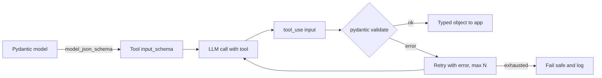

## Beginner-friendly explanation

When you chat with an assistant in a web app, a program behind it is sending your text to an **API** and getting text back. As an engineer you write that program. Two things make it hard in practice: networks and services fail, and the reply is text written by a probabilistic model, while your code needs predictable data such as `{"severity": "high"}`.

This lesson covers both: calling the API robustly, and getting **structured output** that your code can trust after validating it.

## Technical explanation

### The messages API

A request contains:

- `model`: which model to use, e.g. `claude-sonnet-5-5`.
- `system`: durable instructions.
- `messages`: alternating `user` and `assistant` turns. The API is **stateless**, so you send the whole conversation every time.
- `max_tokens`, `temperature`, optional `stop_sequences`, `tools`.

The response contains `content` blocks (text, tool use), `stop_reason` (`end_turn`, `max_tokens`, `tool_use`, `stop_sequence`...) and `usage` (input and output tokens). Log usage; it is your cost and latency signal.

### Reliability

| Problem | Practice |
|---|---|
| Rate limits (429), overload, 5xx | Exponential backoff with jitter, capped attempts; the official SDK retries by default (`max_retries`) |
| Hanging requests | Set `timeout` on the client |
| Bad requests (400), auth (401/403) | Do not retry; fix and alert |
| Long responses | Stream to improve perceived latency |
| Secrets | Key from environment or secret manager, never committed |

### Structured output

Options from weakest to strongest:

1. **"Reply in JSON"** in the prompt. Often works, sometimes adds prose or gets truncated.
2. **Examples** in the prompt to steer format. (Assistant-message prefill used to be another lever, but current Claude models reject a prefilled last assistant turn with a 400.)
3. **Tool-based extraction**: define a "tool" whose `input_schema` is your JSON schema and instruct the model to call it. Older models let you force the call with `tool_choice={"type": "tool", ...}`; current Claude models (Sonnet 5.5, Opus 5.5) reject forced `tool` / `any` choices with a 400, so use `tool_choice={"type": "auto"}` plus an explicit instruction, optionally with `strict: true` on the tool. The model returns a `tool_use` block with arguments matching the schema. You do not actually need to run a tool; you just read the arguments.
4. **Native structured-output modes** offered by providers (for example OpenAI's structured outputs, and Anthropic's structured outputs via `output_config.format`, or `strict: true` on a tool) constrain generation to a schema.

Whatever you use, **validate on your side** with pydantic: types, enums, ranges and business rules (e.g. `total >= 0`). Schema-valid is not the same as correct; a field can be well-typed and wrong, so evaluation still matters.



## Real-world example

A test-management tool let users paste a free-text defect description and auto-filled fields: component, severity, steps, environment. The first version asked for JSON in the prompt and parsed with `json.loads`. Around one call in a few dozen failed in testing: the model sometimes wrapped JSON in a sentence, and long inputs hit `max_tokens`, truncating the object. Worse, severity occasionally came back as "Severe", which was not a valid option, and was saved to the database.

The rebuilt version defined a pydantic model with an enum for severity, used tool-based extraction, checked `stop_reason`, validated, retried once with the validation error, and otherwise showed the user an empty form. The QA team added an evaluation set of 60 real descriptions and mocked unit tests for the retry path.

## Step-by-step walkthrough

1. Define the pydantic model with types, enums and descriptions.
2. Generate its JSON schema and use it as a tool's `input_schema`.
3. Call the API with that tool and an instruction to use it.
4. Find the `tool_use` block and validate its `input`.
5. On `ValidationError`, retry once with the error text; then fail safe.
6. Unit-test with a fake client; evaluate with real calls on a labelled set.

## Code examples

```python
from enum import Enum
from anthropic import Anthropic
from pydantic import BaseModel, Field, ValidationError

client = Anthropic(timeout=30.0, max_retries=3)  # SDK retries transient errors with backoff
MODEL = "claude-sonnet-5-5"

class Severity(str, Enum):
    low = "low"
    medium = "medium"
    high = "high"
    critical = "critical"

class Defect(BaseModel):
    title: str = Field(min_length=5, max_length=120)
    component: str | None = Field(description="Affected component, or null if not stated")
    severity: Severity
    steps: list[str] = Field(min_length=1)

EXTRACT_TOOL = {
    "name": "record_defect",
    "description": "Record a structured defect extracted from the user's description.",
    "input_schema": Defect.model_json_schema(),
}

def extract_defect(text: str, attempts: int = 2) -> Defect | None:
    messages = [{"role": "user", "content": f"Extract the defect.\n<description>{text}</description>"}]
    for _ in range(attempts):
        resp = client.messages.create(
            model=MODEL,
            max_tokens=1024,
            system="Always call record_defect. Extract only facts present in the description. Use null for unknown fields.",
            tools=[EXTRACT_TOOL],
            tool_choice={"type": "auto"},  # forced "tool"/"any" choices return 400 on current Claude models
            messages=messages,
        )
        if resp.stop_reason == "max_tokens":
            continue  # truncated: do not trust partial arguments
        block = next((b for b in resp.content if b.type == "tool_use"), None)
        if block is None:
            continue  # model answered in text instead of calling the tool
        try:
            return Defect.model_validate(block.input)
        except ValidationError as err:
            # Give the model its own output and the error, then try again
            messages += [
                {"role": "assistant", "content": resp.content},
                {"role": "user", "content": [{
                    "type": "tool_result", "tool_use_id": block.id, "is_error": True,
                    "content": f"Validation failed: {err.errors(include_input=False)}. Fix and call again.",
                }]},
            ]
    return None

print(extract_defect("Payments: card form crashes app when expiry is 13/30. Repro: open checkout, type 13/30, submit."))
```

Testing the deterministic logic without the network, using a fake client:

```python
from types import SimpleNamespace as NS

def fake_response(payload, stop="tool_use"):
    return NS(stop_reason=stop, content=[NS(type="tool_use", id="t1", input=payload)])

def test_invalid_severity_then_valid(monkeypatch):
    replies = iter([
        fake_response({"title": "Crash on expiry", "component": None, "severity": "Severe", "steps": ["a"]}),
        fake_response({"title": "Crash on expiry", "component": None, "severity": "high", "steps": ["a"]}),
    ])
    monkeypatch.setattr(client.messages, "create", lambda **kw: next(replies))
    result = extract_defect("x")
    assert result is not None and result.severity is Severity.high
```

Other providers follow the same pattern: OpenAI exposes function calling and a structured-outputs mode with a JSON schema; you still validate with pydantic.

## Expected output

`extract_defect` returns a `Defect` such as `title='Card form crashes on invalid expiry 13/30' component='Payments' severity=<Severity.high: 'high'> steps=[...]`. The pytest test passes, proving that an invalid enum triggers exactly one retry.

## Common mistakes

- **`json.loads` on free text** with no schema or validation.
- **Ignoring `stop_reason`** and using truncated output.
- **Retrying everything forever**, including 400s, causing cost spikes.
- **No timeout**, so a stuck call blocks a worker.
- **Trusting schema-valid values as correct** without evaluation.
- **Echoing raw model output into SQL, HTML or shell** without sanitising.
- **Hardcoding API keys.**

## Troubleshooting

- **Fields invented instead of null:** make fields optional, describe "null if not stated", add an example.
- **Frequent validation failures:** simplify the schema, add field descriptions, check enums are obvious.
- **Rate limits in batch jobs:** add concurrency limits, or use the provider's batch API for offline work.

## Key takeaways summary

Treat the LLM API like any remote dependency: timeouts, bounded retries for transient errors, logging and secrets hygiene. For machine-readable results, define a schema once in pydantic, have the model fill it through tools or structured output, validate every time, and test both the glue code (mocked) and the behaviour (evaluated).
