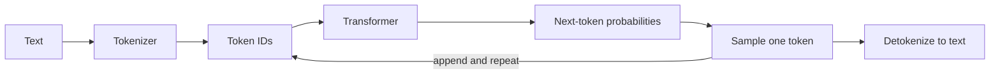

## Beginner-friendly explanation

Think of the autocomplete on your phone keyboard. You type "See you" and it suggests "tomorrow". A **large language model (LLM)** is that idea scaled up enormously: trained on a huge amount of text, it has learned which pieces of text tend to follow which. When you ask it a question, it does not look up an answer. It writes one, a small piece at a time, each time choosing a likely next piece given everything before it.

That one fact explains most LLM behaviour you will meet as an engineer or tester:

- It is **fluent**, because it learned the patterns of language.
- It can be **wrong while sounding confident**, because "likely-sounding" is not the same as "true". This is often called hallucination.
- It can give **different answers to the same question**, because it samples from probabilities.
- It has a **limited memory per request**, called the context window.

## Technical explanation

### Tokens

Models do not read characters or words. Text is split into **tokens** by a tokenizer: common words are often a single token, rare words are split into several sub-word pieces, and punctuation, spaces and code symbols are tokens too. The exact split depends on the model's tokenizer, so never hardcode a "words to tokens" ratio as fact; measure with the provider's token counter.

Tokens matter because they are the unit of:

| Concern | Why tokens matter |
|---|---|
| Limits | The context window and `max_tokens` are measured in tokens |
| Cost | Providers bill per input and output token (see their pricing pages) |
| Latency | Output is generated token by token, so long answers take longer |

Non-English text, code, long numbers and minified JSON often use more tokens than you would guess from their length.

### Next-token prediction

Inside, a transformer turns the token sequence into vectors, applies layers of attention (each token can weigh every earlier token) and produces a score for every token in its vocabulary. A softmax turns scores into probabilities. The generator then **samples** one token, appends it and repeats. This is called **autoregressive** generation. See [transformers and attention](/learn/ai-engineering/transformers-and-attention) for the internals.

### Sampling controls

- **temperature**: lower values sharpen the distribution so the most likely tokens dominate; higher values flatten it and increase variety. Low temperature suits extraction and classification; higher suits brainstorming.
- **top_p / top_k**: restrict sampling to the most likely tokens. Most teams change temperature *or* top_p, not both.
- **max_tokens**: a hard cap on output length. When it is hit, generation stops even mid-sentence.
- **stop sequences**: strings that end generation when produced.

Even at temperature 0, do not assume perfectly deterministic output across calls; design tests that tolerate variation.

Provider support varies: current Claude models (for example Sonnet 5.5) reject non-default `temperature`, `top_p` and `top_k` values with a 400 error, so on those models you steer output with the prompt and the `effort` setting instead. Check the model's documentation before relying on sampling parameters.

### Context window

The **context window** is the maximum tokens the model can consider in one request: system prompt + messages + any documents + tool definitions + the generated output. The model is **stateless** between API calls; "chat memory" is just your application resending the history each time. That is why long chats get slower and more expensive, and eventually fail with a context-length error unless you trim or summarise.

### Training stages, briefly

1. **Pre-training** on large text corpora teaches language and broad knowledge via next-token prediction.
2. **Post-training** (instruction tuning, reinforcement learning from human or AI feedback) teaches the model to follow instructions, hold conversations and refuse harmful requests.
3. The model has a **knowledge cutoff**; it does not know about events after its training data unless you supply them in the prompt (which is what retrieval does).



## Real-world example

A support team built an assistant that answered questions about refund policy. In testing it looked perfect. In production, two problems appeared. First, long conversations started failing with a request-too-large error, because the app resent the whole chat history plus a 30-page policy document on every turn. Second, occasionally the bot invented a "60-day" refund window that did not exist, because the model filled gaps with plausible text when the relevant paragraph had been truncated.

The fixes followed directly from fundamentals: count tokens before sending, keep only recent turns plus a summary, retrieve only the relevant policy sections, and instruct the model to say "I don't know" when the answer is not in the supplied text. Tests were changed from exact-string checks to property checks run several times each.

## Step-by-step walkthrough

1. Install the SDK: `pip install anthropic` and set `ANTHROPIC_API_KEY` in your environment (never in code).
2. Count tokens for a prompt before sending it.
3. Send a message with an explicit `max_tokens`.
4. Inspect `usage` and `stop_reason` in the response.
5. Repeat the call several times to observe variation.

## Code examples

```python
import os
from anthropic import Anthropic

client = Anthropic()  # reads ANTHROPIC_API_KEY from the environment
MODEL = "claude-sonnet-5-5"

messages = [{"role": "user", "content": "Explain what a token is in two sentences."}]

# 1. Count input tokens before sending
count = client.messages.count_tokens(model=MODEL, messages=messages)
print("input tokens:", count.input_tokens)

# 2. Generate with an explicit output limit
# (current Claude models reject non-default temperature/top_p/top_k with a 400)
response = client.messages.create(
    model=MODEL,
    max_tokens=200,
    messages=messages,
)
print(next(b.text for b in response.content if b.type == "text"))  # skip any thinking block
print("stop_reason:", response.stop_reason)          # "end_turn" or "max_tokens" ...
print("usage:", response.usage.input_tokens, response.usage.output_tokens)

# 3. Observe variability
answers = set()
for _ in range(5):
    r = client.messages.create(
        model=MODEL, max_tokens=30,
        messages=[{"role": "user", "content": "Suggest one name for a test-automation robot."}],
    )
    answers.add(next(b.text for b in r.content if b.type == "text").strip())
print(len(answers), "distinct answers out of 5")
```

The pattern is very similar with other providers: a client object, a model name, a list of role-tagged messages, and a response with text plus usage information. Only parameter names and response shapes differ.

A tiny, provider-independent illustration of temperature using numpy:

```python
import numpy as np

logits = np.array([2.0, 1.0, 0.5, 0.1])  # scores for 4 candidate tokens

def softmax(x, temperature):
    z = x / temperature
    z = z - z.max()
    e = np.exp(z)
    return e / e.sum()

for t in (0.2, 1.0, 2.0):
    print(t, np.round(softmax(logits, t), 3))
```

## Expected output

The token count prints an integer that is close to, but not equal to, the word count. `stop_reason` is `end_turn` for a normal finish. In the variability loop you will typically see several distinct names. In the numpy example, temperature 0.2 puts almost all probability on the first token, while 2.0 spreads it out.

## Common mistakes

- **Treating the model as a database of facts.** It generates plausible text; verify or ground factual answers.
- **Asserting exact output strings in tests.** Check properties, schemas and pass rates instead.
- **Estimating tokens from word count** for budgeting. Use the token counter.
- **Forgetting the model is stateless** and assuming it remembers earlier calls.
- **Not checking `stop_reason`**, so truncated answers are silently shown as complete.
- **Putting API keys in source code** or notebooks you share.

## Troubleshooting

- **Context length error:** count tokens, trim history, retrieve smaller excerpts.
- **Answers cut off:** raise `max_tokens` or ask for brevity.
- **Too repetitive or too random:** adjust temperature in small steps and re-evaluate on a fixed test set.

## Key takeaways summary

An LLM is a next-token predictor running in a loop. Tokens are the unit of limits, cost and latency; the context window is shared by everything you send and receive; sampling makes output variable. Build and test with those facts in mind and most surprises disappear.
