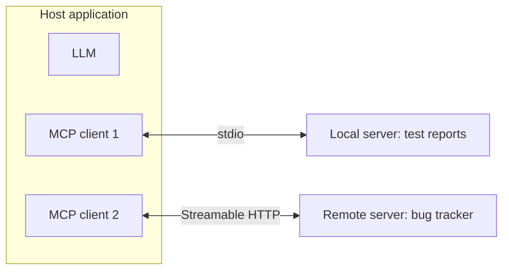

## Beginner-friendly explanation

Before USB, every printer, mouse and camera had its own plug. Each computer needed a different port and driver for each device. USB said: "here is one standard plug; build to it and it works everywhere."

**The Model Context Protocol (MCP)** does that for AI applications. Without it, if you want your AI assistant to read your bug tracker, your test reports and your database, someone has to write custom glue code for each assistant and each system. With MCP, the bug-tracker team writes **one MCP server**, and any AI application that speaks MCP (an IDE assistant, a desktop chat app, your own agent) can plug it in.

The server says, in effect: "here are the **tools** I offer (actions like `create_bug`), the **resources** I can share (data like `report://run/1842`), and some **prompts** (ready-made templates)". The AI application lists them, shows them to the model, and calls them when needed.

Like any plug, it can carry something harmful. Plugging in an unknown USB stick is risky; so is installing an unknown MCP server.

## Technical explanation

### Origins and status

Anthropic introduced MCP as an **open protocol** in **November 2024**, with an open specification and SDKs. It has since been adopted by many hosts and providers, and the specification is versioned by date (revisions in 2025 added Streamable HTTP and an OAuth-based authorization model, among other changes). The project's governance has also moved toward a broader open foundation. The protocol is still evolving, so check the current revision at modelcontextprotocol.io before relying on any detail.

### Architecture



- **Host**: the AI application. It owns the model, the UI, user consent and security decisions.
- **Client**: a connector inside the host; **one client per server**, each with a stateful session.
- **Server**: a program exposing capabilities. It can be local or remote.

Messages use **JSON-RPC 2.0**. A session begins with an `initialize` handshake in which client and server agree a protocol version and declare capabilities. Then the client can call methods such as `tools/list`, `tools/call`, `resources/list`, `resources/read` and `prompts/get`. Servers can send notifications (for example, that the tool list changed).

### Server primitives

| Primitive | Controlled by | What it is | Example |
|---|---|---|---|
| Tools | The model (with host approval) | Functions with a name, description and JSON Schema input; may have side effects | `create_bug(title, severity)` |
| Resources | The application | Read-only data identified by a URI | `reports://run/1842` |
| Prompts | The user | Reusable templates, often exposed as slash commands | `/triage-failures` |

Clients can also offer capabilities to servers, such as **sampling** (the server asks the host's model for a completion), **roots** (which directories the server may work in) and **elicitation** (the server asks the user for input). Support for these varies between hosts.

### Transports

- **stdio**: the host launches the server as a subprocess and exchanges messages over standard input and output. Simple, local, no network exposure.
- **Streamable HTTP**: the server is an HTTP endpoint; clients send JSON-RPC messages with HTTP POST and the server can respond with JSON or stream messages using Server-Sent Events. It replaced the older HTTP+SSE transport in the 2025-03-26 revision. Remote servers should use the specification's OAuth-based authorization.

### MCP versus plain tool use

MCP does not replace the tool-use protocol you learned in [Tool use and AI agents](/careers/ai-engineering/ai-engineering/tool-use-and-ai-agents). The host still turns MCP tools into tool definitions for the model, and still executes calls on the model's behalf. MCP standardises the **connection between the application and the tool provider**.

### Security

- **Tool poisoning**: tool descriptions and results reach the model, so hidden instructions there are prompt injection. A server can also change its descriptions after you approved it (sometimes called a "rug pull").
- **Untrusted servers**: a local server runs with your user's permissions. Vet the source, pin versions, and prefer official servers.
- **Over-privilege**: give each server the narrowest credentials and scopes; read-only by default.
- **Authorization for remote servers**: follow the spec's OAuth model; tokens must be issued for that server, and servers must not simply pass tokens through to other APIs (the "confused deputy" problem).
- **Human in the loop**: hosts should show what a tool will do and ask for approval on sensitive calls.
- **Input validation and command injection**: never build shell commands from tool arguments.
- **Local HTTP servers**: bind to localhost and validate the `Origin` header to prevent DNS rebinding.

See [Agent guardrails and safety](/careers/ai-engineering/ai-engineering/agent-guardrails-and-safety) for the controls in depth.

## Real-world example

A test team exposed their test-results database to their IDE assistant through an MCP server. Version 1 had a single tool, `run_sql(query)`, with the database's read-write credentials. During a demo, the assistant was asked to "clean up the old runs" and proposed a `DELETE` across the main table. Nobody approved it, but it showed the risk.

Version 2 replaced `run_sql` with three narrow tools: `get_run(run_id)`, `list_failures(run_id, limit)` and `compare_runs(a, b)`, using a read-only database user. Run reports became **resources** (`reports://run/{id}`) so the user could attach them explicitly. A `/triage` prompt gave everyone the same triage template. Tests called each tool with valid, invalid and missing IDs, and a CI job ran the server through the MCP Inspector's CLI mode to verify `tools/list`.

## Step-by-step walkthrough

1. Decide what to expose: actions as **tools**, data as **resources**, templates as **prompts**.
2. Design narrow, well-described tools with typed parameters.
3. Implement with an official SDK (Python, TypeScript and others are listed on modelcontextprotocol.io).
4. Run locally over stdio and inspect it with the **MCP Inspector**.
5. Unit test the underlying functions; integration test through a client session.
6. Configure a host to launch the server; review its tool approvals.
7. For remote deployment, use Streamable HTTP with proper authorization, logging and rate limits.

## Code examples

A small MCP server with the official Python SDK (`pip install "mcp[cli]"`). `FastMCP` derives tool schemas from type hints and docstrings.

```python
# test_reports_server.py
from mcp.server.fastmcp import FastMCP

mcp = FastMCP("test-reports")

RUNS = {
    1842: {"passed": 120, "failed": ["test_login_lockout", "test_export_csv"]},
    1843: {"passed": 122, "failed": []},
}

@mcp.tool()
def list_failures(run_id: int, limit: int = 10) -> list[str]:
    """List failed test names for a test run. Read-only."""
    if run_id not in RUNS:
        raise ValueError("Unknown run id")
    if not 1 <= limit <= 50:
        raise ValueError("limit must be between 1 and 50")
    return RUNS[run_id]["failed"][:limit]

@mcp.resource("reports://run/{run_id}")
def run_report(run_id: int) -> str:
    """A plain-text summary of a test run."""
    r = RUNS.get(int(run_id))
    if r is None:
        return "No such run."
    return f"Run {run_id}: {r['passed']} passed, {len(r['failed'])} failed"

@mcp.prompt()
def triage(run_id: int) -> str:
    """Template for triaging a run's failures."""
    return f"Triage the failures in run {run_id}. For each, give the likely cause and next step."

if __name__ == "__main__":
    mcp.run()  # stdio transport by default
```

Run it with the Inspector (needs Node.js): `mcp dev test_reports_server.py`, or `npx @modelcontextprotocol/inspector python test_reports_server.py`. To serve over Streamable HTTP instead, the SDK supports `mcp.run(transport="streamable-http")`; check the SDK README for the current options.

Testing it. Function-level tests are fast and need no protocol. An integration test goes through a real client session over stdio:

```python
# test_server.py  (pip install pytest)
import asyncio
import pytest
from mcp import ClientSession, StdioServerParameters
from mcp.client.stdio import stdio_client
from test_reports_server import list_failures, run_report

def test_list_failures_limit():
    assert list_failures(1842, limit=1) == ["test_login_lockout"]

def test_unknown_run_rejected():
    with pytest.raises(ValueError):
        list_failures(9999)

def test_report_for_missing_run():
    assert run_report(9999) == "No such run."

def test_tools_over_protocol():
    async def main():
        params = StdioServerParameters(command="python", args=["test_reports_server.py"])
        async with stdio_client(params) as (read, write):
            async with ClientSession(read, write) as session:
                await session.initialize()
                tools = await session.list_tools()
                assert [t.name for t in tools.tools] == ["list_failures"]
                result = await session.call_tool("list_failures", {"run_id": 1843})
                assert result.isError is False
    asyncio.run(main())
```

To see the wire format, here is what a `tools/call` request looks like as JSON-RPC (you rarely write this by hand):

```json
{"jsonrpc": "2.0", "id": 7, "method": "tools/call",
 "params": {"name": "list_failures", "arguments": {"run_id": 1842, "limit": 5}}}
```

## Expected output

`pytest -q` reports four passing tests. In the Inspector you see one tool (`list_failures`) with an input schema containing `run_id` (integer, required) and `limit` (integer, default 10), one resource template `reports://run/{run_id}` and one prompt `triage`. Calling `list_failures` with `run_id` 9999 returns an error result rather than crashing the server.

## Testing checklist for an MCP server

| Area | What to check |
|---|---|
| Discovery | `tools/list` returns exactly the expected tools, with clear descriptions and correct schemas (required fields, types, enums) |
| Happy path | Each tool returns the documented result for valid input |
| Validation | Missing, extra, wrongly typed and out-of-range arguments return an error result, never a crash or partial side effect |
| Errors | Downstream failures (database down, timeout) come back as `isError` results with safe messages that leak no secrets |
| Permissions | The server's credentials cannot perform actions outside its purpose; try one and confirm it fails at the downstream system |
| Description drift | A stored snapshot of tool names and descriptions is compared in CI, so any change is reviewed |
| Transport | stdio servers write nothing but protocol messages to stdout; HTTP servers enforce authorization and Origin checks |

Keep the function-level tests fast and run the protocol-level test in CI too, because a server can pass every unit test and still fail to start inside a host.

## Common mistakes

- **Generic, powerful tools** such as `run_sql` or `run_shell` with broad credentials.
- **Installing servers from unknown sources** without reading their code or descriptions.
- **Vague tool descriptions**, so the model misuses them.
- **Using a tool where a resource fits**, giving the model control of something the user should choose.
- **Writing logs to stdout in a stdio server**, which corrupts the JSON-RPC stream; log to stderr.
- **Passing user tokens straight through** to downstream APIs from a remote server.
- **Assuming the spec is static**; it is versioned and evolving.

## Troubleshooting

- **Host does not show the server**: check the launch command and absolute paths in the host's config, and read the host's MCP logs.
- **"Parse error" or the session drops**: something printed to stdout; move prints to stderr.
- **Tool missing from the list**: the decorator was not applied or the module failed on import; run the file directly to see the error.
- **Version mismatch**: update the SDK; the initialize handshake negotiates protocol versions.
- **Remote auth fails**: verify the OAuth metadata endpoints and token audience against the current spec.

## Hands-on exercise

1. Add a `compare_runs(a: int, b: int)` tool that returns tests that newly failed in `b`.
2. Add tests for unknown IDs, identical runs and a run with no failures.
3. Add a deliberately "poisoned" description to a copy of a tool, view it in the Inspector, and write down how a host or reviewer could detect it (diffing descriptions between versions, scanning for imperative instructions, pinning).

## Key takeaways summary

MCP standardises how AI applications connect to tools and data: a host runs one client per server, speaking JSON-RPC 2.0 over stdio or Streamable HTTP. Servers expose tools for model-invoked actions, resources for application-controlled data and prompts for user-chosen templates. Building a server in Python takes a few decorators; making it safe takes least privilege, vetted sources, careful descriptions, approvals and proper authorization. Test it at the function level and through a real client session.
