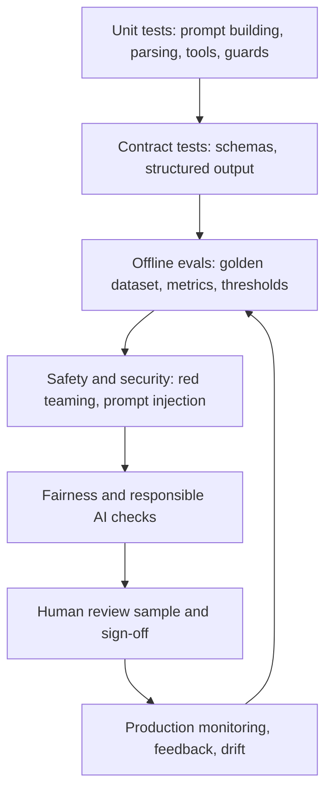

## Beginner-friendly explanation

Testing ordinary software is like checking a calculator: type `2 + 2`, expect `4`, and if you see `5` you have found a bug. AI systems are more like checking a new colleague's written answers. Ask the same question twice and you may get two different wordings, both correct. Ask a slightly unusual question and they may be confidently wrong. There is often no single "right" answer to compare against.

That does not make AI untestable. It changes **how** we test. Instead of one example with one expected value, we use **many examples** (a dataset), **rules that any good answer must follow** (for example, "the answer must be valid JSON" or "never reveal another customer's data"), and **scores** that tell us how often the system behaves well. We decide in advance what score is good enough to release, and we check it every time something changes.

A useful mental model is to split the system in two:

- **Deterministic parts**: code that calls the model, parses responses, applies business rules and stores data. Test these exactly, like any other code.
- **Probabilistic parts**: the model itself and anything that depends on its free-text output. Test these statistically, with datasets and thresholds.

If you have already studied [testing AI applications](/learn/specialist/testing-ai-applications) in the specialist track, this lesson turns those ideas into a full engineering strategy.

## Technical explanation

### What changes when a model is in the loop

| Classic assumption | What happens with AI |
|---|---|
| Same input gives same output | Sampling, model updates and retrieval changes make outputs vary |
| An expected value exists | Many valid outputs exist; some inputs have no agreed answer |
| A bug is reproducible | Failures can be intermittent and only visible as a lower pass rate |
| Behaviour changes only when code changes | Behaviour also changes when the prompt, model version, data or configuration change |
| Coverage is measured on code paths | Coverage is measured over the input space: topics, languages, edge cases, user groups |

**Non-determinism** has several sources: sampling temperature, provider-side updates behind a floating model alias, inference-stack effects such as batching, retrieval results that change as documents are added, and tool calls whose results depend on live data. Setting temperature to 0 reduces variation but does not guarantee identical outputs across providers or over time. Your strategy must therefore **pin what you can** (model version identifiers, prompt versions, dataset snapshots) and **measure what you cannot** (repeat runs, report a pass rate and its spread).

### Test oracles for AI

An **oracle** is how a test decides pass or fail. For AI you usually stack several:

1. **Exact oracles**: structured fields with one correct answer, such as a category label, a JSON schema, a refusal flag or an extracted date.
2. **Property oracles**: invariants every acceptable output satisfies, such as length limits, no personal data, citations only point to retrieved documents, the answer is in the user's language.
3. **Metamorphic oracles**: relationships between outputs. Paraphrasing a question should not change the classification; adding irrelevant text should not change a sentiment score; swapping a name associated with one gender for another should not change a screening score.
4. **Reference-based oracles**: compare to a golden answer using exact match, token overlap, embedding similarity or a model-based grader.
5. **Human review**: domain experts label a sample; their labels are the ground truth used to calibrate automated graders (see [LLM-as-judge and human review](/learn/ai-engineering/llm-as-judge-and-human-review)).

### A layered strategy



| Layer | Question it answers | Typical tools |
|---|---|---|
| Unit | Does our code around the model work? | pytest, fakes of the model client |
| Contract | Does the model output fit the shape we need? | Pydantic, JSON Schema |
| Offline eval | How good is the behaviour across representative cases? | pytest harness, promptfoo, Ragas |
| Safety and security | Can it be misused or manipulated? | Injection suites mapped to the OWASP LLM Top 10 |
| Fairness | Does quality or outcome differ across groups? | Fairlearn, sliced metrics |
| Human review | Do experts agree it is good enough? | Labelling tools, rubrics |
| Monitoring | Is it still good with real traffic? | Logging, sampled grading, user feedback |

The security layer should be organised around the **OWASP Top 10 for LLM Applications**, which lists risks such as prompt injection, sensitive information disclosure, improper output handling and excessive agency. The overall risk process maps onto the **NIST AI Risk Management Framework**: *Govern* (who owns AI risk and how decisions are made), *Map* (what this system does and what can go wrong), *Measure* (testing, evaluation, verification and validation) and *Manage* (prioritise, mitigate, monitor and respond).

### Coverage for AI

Code coverage tells you little about model behaviour. Track **input-space coverage** instead: a matrix of intents, difficulty, languages, input lengths, adversarial patterns and user segments. Each important cell should have examples in your eval dataset. Empty cells are untested behaviour.

## Real-world example

A team builds an assistant that answers HR policy questions from an internal handbook using retrieval-augmented generation. Their first test plan was "ask ten questions and check the answers look right." After launch, an updated handbook was indexed and answers about parental leave started quoting the old policy, because both versions were being retrieved. Nobody noticed for days.

The revised strategy:

- **Unit tests** for chunking, filtering by document version and the prompt template.
- **A golden dataset** of questions written with the HR team, each with a reference answer and its source section, stored in version control.
- **Metrics**: answer correctness graded against a rubric, faithfulness to retrieved context, and a citation property check (every citation must be a current handbook section).
- **Thresholds** agreed with HR, for example a minimum correctness rate and zero answers citing superseded documents.
- **A regression eval in CI** whenever the prompt, model or index changes.
- **Monitoring**: a weekly sample of real conversations graded by an HR reviewer.

The next handbook update failed the citation property in CI, before it reached employees.

## Step-by-step walkthrough

1. **Describe the system and its risks.** List components, users, decisions it influences and harms if it fails (NIST AI RMF *Map*).
2. **Separate deterministic from probabilistic parts.** Write normal unit tests for the deterministic parts first.
3. **Define success criteria** in measurable terms: "at least 90% of answers graded correct", "100% valid JSON", "no system prompt leaks in the injection suite".
4. **Build a golden dataset** covering common, edge, adversarial and fairness-sensitive cases. Start with tens to a few hundred examples and grow it from production failures.
5. **Choose oracles per criterion**: exact, property, metamorphic, reference or human.
6. **Automate the eval harness** and run it on every change to prompt, model, data or code.
7. **Add security and fairness suites** based on the OWASP LLM Top 10 and your group-level risks.
8. **Plan human review**: who labels, how many items, how disagreements are resolved.
9. **Monitor in production** and feed new failures back into the dataset.

## Code examples

Deterministic code around the model is tested with a fake client that returns controlled text, so the test is fast, free and repeatable:

```python
# app/triage.py
import json
from dataclasses import dataclass

ALLOWED = {"billing", "technical", "account", "other"}

@dataclass
class Ticket:
    category: str
    urgent: bool

def parse_triage(raw: str) -> Ticket:
    data = json.loads(raw)  # raises json.JSONDecodeError, a ValueError subclass
    category = data.get("category", "other")
    if category not in ALLOWED:
        category = "other"
    return Ticket(category=category, urgent=bool(data.get("urgent", False)))

def triage(client, message: str) -> Ticket:
    raw = client.complete(f"Classify this support message as JSON: {message}")
    return parse_triage(raw)
```

```python
# tests/test_triage_unit.py
import pytest
from app.triage import parse_triage, triage

class FakeClient:
    def __init__(self, reply: str):
        self.reply = reply
        self.prompts = []

    def complete(self, prompt: str) -> str:
        self.prompts.append(prompt)
        return self.reply

def test_unknown_category_falls_back_to_other():
    assert parse_triage('{"category": "weather", "urgent": true}').category == "other"

def test_invalid_json_raises():
    with pytest.raises(ValueError):
        parse_triage("Sure! Here is the JSON...")

def test_user_message_is_included_in_prompt():
    client = FakeClient('{"category": "billing"}')
    triage(client, "I was charged twice")
    assert "I was charged twice" in client.prompts[0]
```

A metamorphic test against the real model checks that paraphrases keep the same label. It is marked so it runs in the eval job rather than in every unit test run (register the `eval` marker in `pytest.ini`):

```python
# evals/test_triage_metamorphic.py
import pytest
from app.triage import triage
from app.clients import real_client  # your configured, version-pinned model client

PARAPHRASES = [
    ("I was charged twice this month", "There are two charges on my bill this month"),
    ("I cannot log in", "Login is not working for me"),
]

@pytest.mark.eval
@pytest.mark.parametrize("a,b", PARAPHRASES)
def test_paraphrase_keeps_category(a, b):
    client = real_client()
    assert triage(client, a).category == triage(client, b).category
```

## Expected output

Running `pytest tests/` passes quickly and offline because the model is faked. Running `pytest -m eval evals/` calls the real model, takes longer and may cost money; a failing paraphrase pair is reported with both inputs in the test id, so you can see the inconsistency directly.

## Common mistakes

- **Testing by vibes**: a few manual prompts in a playground, with no saved dataset or criteria.
- **Asserting exact strings** from a model, which makes tests flaky and teaches the team to ignore failures.
- **Only testing the happy path**, with no adversarial, multilingual, long-input or fairness-sensitive cases.
- **Treating prompt or model changes as configuration** rather than releases that need regression evals.
- **No pinned versions**: using a floating model alias, so results change without any commit.
- **Forgetting the deterministic layer**: parsers, guards and tool code are where many real bugs live, and they are cheap to unit-test.
- **No production feedback loop**, so the dataset never learns from real failures.

## Troubleshooting

- **Eval scores move between runs with no changes.** Check for a floating model alias, non-zero temperature or retrieval index updates. Run each case several times and report the mean and spread.
- **Stakeholders cannot agree on thresholds.** Run the eval on the current system first; use that baseline and the cost of failure to set an initial threshold, then revisit it.
- **The dataset feels too small.** Start small and focused; add every production failure and every newly identified risk as a test case.

## Key takeaways summary

Testing AI systems means separating deterministic code (tested exactly) from probabilistic behaviour (measured over datasets against thresholds), using layered oracles from schemas to human review, and treating every model, prompt and data change as a release. Security (OWASP LLM Top 10), fairness and production monitoring complete the strategy, and the NIST AI RMF gives a shared vocabulary for governing it. The next lessons build each layer: [LLM evaluation and evals](/learn/ai-engineering/llm-evaluation-and-evals), [red teaming and prompt injection](/learn/ai-engineering/red-teaming-and-prompt-injection) and [bias, fairness and responsible AI](/learn/ai-engineering/bias-fairness-and-responsible-ai).
