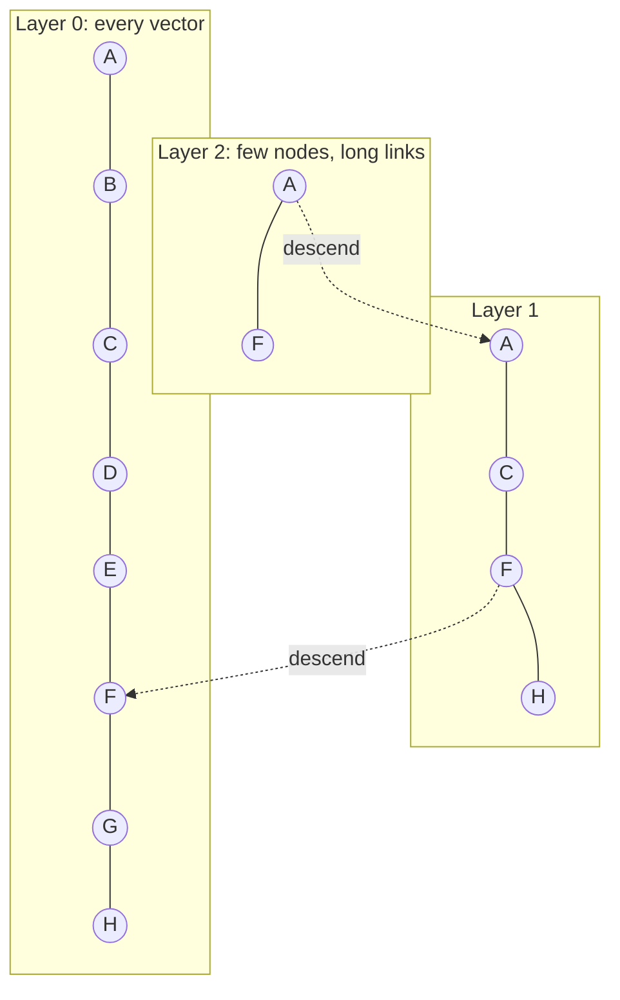

## Beginner-friendly explanation

In [Embeddings and vector search](/learn/ai-engineering/embeddings-and-vector-search) you put every embedding in an array and compared the query with all of them. That is like finding a book by walking past every shelf in a library. It always works, and in a small library it is quick enough.

Now imagine a library with a hundred million books, new books arriving every minute, books being withdrawn, and readers who only want books in French published after 2020. Walking every shelf is too slow. A good library has a **catalogue** (an index that takes you to the right aisle), **sections** (filters), and a building that does not lose books when the lights go out (persistence).

A **vector database** is that library. It stores vectors with their metadata, builds an index that finds *probably the closest* vectors without checking every one, filters by metadata, and handles updates, backups and scaling. The word *probably* matters: most indexes are **approximate**, and a tester's job is to measure how approximate.

## Technical explanation

### What a database adds over an array

| Need | numpy array | Vector database or extension |
|---|---|---|
| Persistence | You save and load files yourself | Durable storage, backups |
| Search speed at scale | Linear scan, O(N·d) per query | ANN index visits a small fraction |
| Metadata filters | Write your own masks | Filter expressions applied during search |
| Updates | Rebuild or append manually | Insert, update, delete (CRUD) |
| Multi-user, scale | One process | Concurrency, replication, sharding, access control |
| Hybrid search | Not built in | Often combined keyword and vector search |

Brute force is still the right answer surprisingly often. A matrix multiplication over a few hundred thousand 768-dimensional vectors is fast on a laptop, and its recall is perfect by definition. Reach for an ANN index when latency, cost or data size forces you to.

### Exact versus approximate search

**Exact k-nearest-neighbour (kNN)** scores every vector. **Approximate nearest neighbour (ANN)** search uses a data structure to visit a small subset. Quality is measured as **recall@k**: the fraction of the true top k (from exact search) that the ANN index also returns. Recall of 0.95 at k=10 means that, on average, 9.5 of the true 10 nearest neighbours were found.

### HNSW: a navigable graph

**Hierarchical Navigable Small World** graphs were introduced by Malkov and Yashunin (arXiv 1603.09320, 2016). Every vector is a node linked to some of its near neighbours. Nodes are also randomly promoted into sparser upper layers, a little like express lanes on a motorway.



A query enters at the top layer, greedily walks to the neighbour closest to the query, drops down a layer, and repeats until it reaches layer 0, where it keeps a candidate list and returns the best k.

| Parameter | When set | Effect of increasing it |
|---|---|---|
| `M` | Build | More links per node: higher recall, more memory, slower builds |
| `ef_construction` | Build | Better graph quality, slower builds |
| `ef` / `ef_search` | Query | More candidates explored: higher recall, higher latency |

HNSW gives strong recall and latency trade-offs and supports incremental inserts, but it keeps the graph in memory and deletes are usually handled by marking nodes, which can degrade quality until a rebuild or compaction.

### IVF: search only the nearby cells

An **inverted file (IVF)** index clusters the vectors with k-means into `nlist` cells. Each vector goes into the list of its nearest centroid. At query time you find the `nprobe` closest centroids and only scan their lists. With `nlist=1024` and `nprobe=8`, you scan roughly 8/1024 of the data. Raising `nprobe` raises recall and latency. IVF needs a training step on representative data, and if your data drifts the centroids become less useful.

### Product quantization: compress the vectors

**Product quantization (PQ)**, from Jégou, Douze and Schmid (IEEE TPAMI, 2011), saves memory. Split each vector into `m` sub-vectors, learn a small codebook (often 256 centroids) for each sub-space, and store each sub-vector as the one-byte ID of its nearest centroid. A 768-dimensional float32 vector (3,072 bytes) with `m=96` becomes 96 bytes. Distances are computed approximately from lookup tables. PQ is lossy, so it is commonly combined with IVF (`IVF-PQ`) and followed by **re-scoring** the top candidates with full-precision vectors. Simpler **scalar quantization** (float32 to int8) and **binary quantization** are also widely offered.

The [FAISS library](https://arxiv.org/abs/2401.08281) from Meta implements all of these and is a good place to experiment; it is a library, not a database.

### Distance metrics

Use the metric the embedding model was trained for, usually cosine. If you normalise vectors to unit length, inner product equals cosine and Euclidean distance ranks identically, so many systems store normalised vectors and use inner product. A mismatch, such as indexing with L2 on unnormalised vectors from a cosine-trained model, silently lowers quality.

### Metadata filtering: pre versus post

- **Post-filtering:** run ANN for top k, then drop non-matching results. Simple, but a selective filter (one tenant out of fifty) can leave you with zero results.
- **Pre-filtering:** restrict to matching items first. Always returns k results if they exist. Naively done it becomes a brute-force scan over the subset, which is fine when the subset is small.
- **Filtered traversal:** modern engines apply the filter while walking the graph or lists, and some switch strategy automatically based on how selective the filter is. Read your engine's documentation on this; behaviour differs, and it matters for multi-tenant permission filtering.

### Choosing an option (neutral overview)

| Option | What it is | Typical reason to choose |
|---|---|---|
| pgvector | Postgres extension with exact search, HNSW and IVFFlat | You already run Postgres and want vectors next to relational data and transactions |
| MongoDB Atlas Vector Search, Elasticsearch/OpenSearch | Vector search inside an existing database or search engine | Reuse existing infrastructure, combine with keyword search |
| FAISS | C++/Python library | Research, batch jobs, custom services; you handle persistence |
| Qdrant, Weaviate, Milvus | Dedicated open-source vector databases (also offered as managed services) | Vector-first features, filtering, scaling |
| Pinecone | Managed vector database service | No infrastructure to run |
| Chroma | Lightweight, developer-friendly vector store | Prototypes and small to medium apps |

Features and performance change release by release. Do not trust published benchmark charts for your decision: run your own data, queries, filters and recall target. Consider operational factors too: backups, access control, cost model, hybrid search support and whether your team can run it.

## Real-world example

A support platform stored help-centre chunks for 300 customer companies in one HNSW collection and filtered by `tenant_id` after retrieving the top 20. Small tenants started reporting "no answer found" for questions their own articles covered. A tester reproduced it: for a tenant owning about 0.3% of the vectors, the top 20 neighbours almost always belonged to larger tenants, so post-filtering left nothing. The fix was to use the engine's filtered search with an indexed `tenant_id` payload field, plus a regression test that runs 50 labelled queries for the three smallest tenants and asserts recall@5 above an agreed threshold. The same test later caught a configuration change that had silently disabled the payload index.

## Step-by-step walkthrough

1. **Decide whether you need ANN at all.** Measure brute-force latency on your real data size. If it meets the target, stop there.
2. **Pick the metric** the embedding model expects and normalise if using inner product.
3. **Build ground truth:** sample a few hundred realistic queries and compute exact top k for each.
4. **Build the index** (HNSW or IVF) with default parameters.
5. **Sweep the query-time knob** (`ef_search` or `nprobe`) and record recall@k and p50/p95 latency.
6. **Choose the cheapest setting** meeting the recall target; record it in configuration, not code comments.
7. **Test filters** with selective values, especially permission and tenant filters.
8. **Automate the check** so it reruns after reindexing, upgrades or large data growth.

## Code examples

This runnable example (numpy only) builds a tiny IVF index from scratch and measures recall@10 against exact search as `nprobe` grows.

```python
import numpy as np

rng = np.random.default_rng(42)
N, D, K = 20_000, 64, 10

# Clustered synthetic data (real embeddings are clustered too, not uniform noise)
centres = rng.normal(size=(200, D))
data = centres[rng.integers(0, 200, N)] + 1.0 * rng.normal(size=(N, D))
data /= np.linalg.norm(data, axis=1, keepdims=True)            # unit length: dot = cosine
queries = data[rng.choice(N, 100, replace=False)] + 0.5 * rng.normal(size=(100, D))
queries /= np.linalg.norm(queries, axis=1, keepdims=True)

def exact_topk(q, k=K):
    scores = data @ q
    idx = np.argpartition(-scores, k)[:k]
    return idx[np.argsort(-scores[idx])]

# --- A tiny IVF index: k-means into nlist cells, search only nprobe cells ---
def kmeans(x, n_clusters, iters=10):
    cent = x[rng.choice(len(x), n_clusters, replace=False)]
    for _ in range(iters):
        assign = np.argmax(x @ cent.T, axis=1)
        for c in range(n_clusters):
            members = x[assign == c]
            if len(members):
                v = members.mean(axis=0)
                cent[c] = v / np.linalg.norm(v)
    return cent, np.argmax(x @ cent.T, axis=1)

NLIST = 128
cent, assign = kmeans(data, NLIST)
lists = [np.where(assign == c)[0] for c in range(NLIST)]

def ivf_topk(q, nprobe, k=K):
    cells = np.argsort(-(cent @ q))[:nprobe]
    cand = np.concatenate([lists[c] for c in cells])
    scores = data[cand] @ q
    order = np.argsort(-scores)[:k]
    return cand[order], len(cand)

truth = [set(exact_topk(q)) for q in queries]
for nprobe in (1, 4, 16, 64):
    recalls, scanned = [], []
    for q, t in zip(queries, truth):
        ids, n = ivf_topk(q, nprobe)
        recalls.append(len(t & set(ids)) / K)
        scanned.append(n)
    print(f"nprobe={nprobe:>3}  recall@10={np.mean(recalls):.3f}  vectors scanned={np.mean(scanned)/N:6.1%}")
```

Continue in the same session to see why post-filtering fails for selective filters:

```python
tenant = rng.integers(0, 50, N)          # 50 tenants, about 2% of vectors each
q, wanted = queries[0], 7

# Post-filter: ANN top 10 first, then drop other tenants' results
ids, _ = ivf_topk(q, nprobe=16)
post = [i for i in ids if tenant[i] == wanted]

# Pre-filter: restrict the candidate set first, then rank (exact, here)
allowed = np.where(tenant == wanted)[0]
pre = allowed[np.argsort(-(data[allowed] @ q))[:K]]

print("post-filter results:", len(post))
print("pre-filter results: ", len(pre))
```

The same experiment with a real engine, here FAISS HNSW (`pip install faiss-cpu`), follows the same shape: build, sweep `efSearch`, compare with exact search.

```python
import faiss  # reuse data, queries, truth and K from above

index = faiss.IndexHNSWFlat(D, 32, faiss.METRIC_INNER_PRODUCT)   # M = 32
index.hnsw.efConstruction = 100
index.add(data.astype("float32"))
for ef in (16, 64, 256):
    index.hnsw.efSearch = ef
    _, I = index.search(queries.astype("float32"), K)
    recall = np.mean([len(t & set(row)) / K for t, row in zip(truth, I)])
    print(f"efSearch={ef:<4} recall@10={recall:.3f}")
```

## Expected output

The IVF sweep printed this on our run (numpy 2.x, seed 42; exact digits can differ slightly across library versions):

```text
nprobe=  1  recall@10=0.262  vectors scanned=  0.8%
nprobe=  4  recall@10=0.563  vectors scanned=  3.2%
nprobe= 16  recall@10=0.848  vectors scanned= 12.5%
nprobe= 64  recall@10=0.989  vectors scanned= 50.0%
```

The filter demo prints `post-filter results: 0` and `pre-filter results:  10`. The FAISS sweep shows recall rising with `efSearch`; exact values depend on your machine and FAISS version, so treat them as your own measurement rather than a benchmark. The point is the shape: recall climbs toward 1.0 as you pay for more work.

## Common mistakes

- **Adding a vector database before measuring brute force.** Many corpora are small enough for exact search.
- **Never measuring ANN recall.** Default settings may give recall well below what you assume.
- **Metric mismatch:** L2 on unnormalised vectors from a cosine-trained model.
- **Post-filtering selective filters**, especially for tenants and permissions, giving empty or leaky results.
- **Trusting vendor benchmarks** instead of testing your data, filters and hardware.
- **Mixing embedding models** in one index after an upgrade; old and new vectors are not comparable. Re-embed everything.
- **Forgetting deletes:** removed documents still returned because tombstones or sync jobs failed.

## Troubleshooting

- **Recall too low:** raise `ef_search` or `nprobe`; if still low, rebuild with higher `M` or more `nlist` training data; with PQ, re-score top candidates in full precision.
- **Latency spikes:** check whether a filter triggered a brute-force fallback, whether the index fits in memory, and p95 rather than averages.
- **Results got worse after a data load:** IVF centroids may no longer fit the data; retrain. Check the embedding model version on new vectors.
- **Deleted documents still appear:** verify the delete path, compaction and any cache in front of the database.

## Hands-on exercise

Using the IVF code above, extend the sweep to `nprobe` values 1, 2, 4, 8, 16, 32, 64 and 128 and time each query with `time.perf_counter()`. Write down the smallest `nprobe` that achieves recall@10 of at least 0.95 and its p95 latency. Then change `NLIST` to 32 and 512 and explain, in two sentences, how the best `nprobe` moved and why.

## Key takeaways summary

A vector database is similarity search plus everything production needs: persistence, ANN indexes, filters, updates and scaling. HNSW, IVF and PQ each trade recall for speed or memory, with `ef_search` and `nprobe` as the everyday dials. Measure ANN recall@k against exact search on your own queries, test selective filters explicitly, and remember that a perfect index only reproduces what your embeddings consider similar; relevance needs its own evaluation, covered in [Reranking and cross-encoders](/learn/ai-engineering/reranking-and-cross-encoders).
