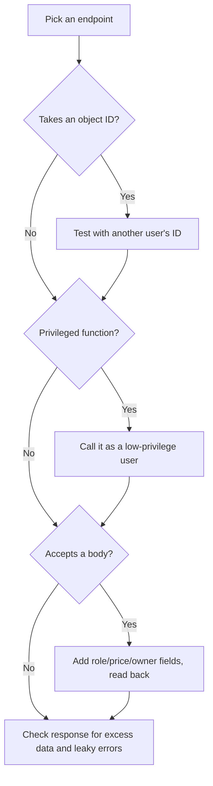

## Beginner-friendly explanation

Picture a bank's safe-deposit room. Your key opens **your** box. A secure bank checks your key against **that specific box** every time. An insecure bank only checks that you are a customer, then lets you open any box whose number you type in.

APIs are like that room. Most serious API security defects are not exotic hacking; they are missing checks: "is this user allowed to see **this** record?", "is this user allowed to call **this** admin function?", "should the client be allowed to set **this** field?". A functional tester who thinks like this finds real vulnerabilities with ordinary tools like Postman.

**Ethics first:** only test systems you own or have written permission to test, within the agreed scope, in a test environment.

## Technical explanation

The **OWASP API Security Top 10 (2023)** is the standard list of API risks:

| ID | Risk | What a tester checks |
|---|---|---|
| API1 | Broken Object Level Authorization (BOLA) | User B accessing user A's object by ID |
| API2 | Broken Authentication | Missing/expired/tampered tokens, weak login protections |
| API3 | Broken Object Property Level Authorization | Mass assignment; over-exposed fields in responses |
| API4 | Unrestricted Resource Consumption | No rate limits, huge page sizes, giant uploads |
| API5 | Broken Function Level Authorization | Normal user calling admin endpoints |
| API6 | Unrestricted Access to Sensitive Business Flows | Automating flows like bulk buying or coupon abuse |
| API7 | Server Side Request Forgery (SSRF) | API fetching a user-supplied URL without restriction |
| API8 | Security Misconfiguration | Verbose errors, permissive CORS, missing TLS, debug endpoints |
| API9 | Improper Inventory Management | Old versions (`/v1`) still live without fixes |
| API10 | Unsafe Consumption of APIs | Trusting third-party API data without validation |

Key distinctions:

- **401 Unauthorized** — not authenticated (no or invalid credentials).
- **403 Forbidden** — authenticated but not allowed. Some APIs return **404** for others' objects to avoid revealing they exist; either is fine if consistent.
- **Object level** (which record) versus **function level** (which operation) authorization.



## Real-world example

A fitness app's API had `GET /api/users/{id}/workouts`. The UI only ever requested the logged-in user's ID. A tester on the team, in the staging environment, created two accounts and replaced the ID with the other account's. The API returned the other user's workouts, including GPS routes that revealed home addresses.

The same tester tried `PATCH /api/users/me` with `"subscription":"premium"` added to the body. It persisted — free users could upgrade themselves. Both were found with Postman in under an hour, and both were fixed by adding ownership checks and an explicit allow-list of writable fields.

## Step-by-step walkthrough

1. **Confirm scope and permission** in writing: environment, endpoints, techniques, dates.
2. **Create test users:** two per role, plus an admin.
3. **Inventory endpoints** from the OpenAPI spec and from traffic (including old versions).
4. **Authentication tests:** no token, malformed, expired, tampered signature, token from another environment, token after logout or password change.
5. **BOLA tests:** for every ID parameter, swap in another user's ID for GET, PUT/PATCH and DELETE.
6. **Function-level tests:** call admin and internal endpoints as a normal user.
7. **Property-level tests:** add privileged fields to writes; inspect reads for excess fields.
8. **Resource tests:** very large `pageSize`, large payloads, and a gentle check that rate limiting exists (429) — without overloading shared environments.
9. **Injection and misconfiguration:** special characters in inputs (should be handled safely), error bodies without stack traces, CORS headers per policy.
10. **Report privately** with exact requests, responses and impact.

### Sample test cases

| ID | Request | As | Expected |
|---|---|---|---|
| SEC-01 | GET /orders/{A's id} | User B | 403 or 404 |
| SEC-02 | DELETE /orders/{A's id} | User B | 403 or 404; order still exists |
| SEC-03 | GET /admin/users | Customer | 403 |
| SEC-04 | PATCH /users/me with `role` | Customer | 400, or field ignored; role unchanged |
| SEC-05 | GET /users/me | Customer | No password hash or internal flags |
| SEC-06 | Any endpoint, expired token | Anyone | 401 |
| SEC-07 | GET /orders?pageSize=100000 | Customer | Capped or 400 |

## Code examples

A RestAssured BOLA check that runs for every user pair:

```java
@Test
public void userCannotReadAnotherUsersOrder() {
    String orderId = given().auth().oauth2(tokenA)
        .contentType(ContentType.JSON).body(validOrder)
        .post("/orders").then().statusCode(201)
        .extract().path("id");

    given().auth().oauth2(tokenB)
    .when().get("/orders/{id}", orderId)
    .then().statusCode(anyOf(is(403), is(404)));
}
```

## Common mistakes

- **Testing with one user.** BOLA is invisible without a second account.
- **Trusting the UI** to hide fields or buttons.
- **Checking only status codes** for writes — read the object back.
- **Running scanners or heavy load** against shared or third-party systems without permission.
- **Filing security defects in public trackers** with full exploit details.

## Key takeaways summary

Most API security defects are missing authorization checks. With two users per role, a list of endpoints and the OWASP API Top 10 as a checklist, a functional tester can find serious issues — always within authorized scope, and reported responsibly.
