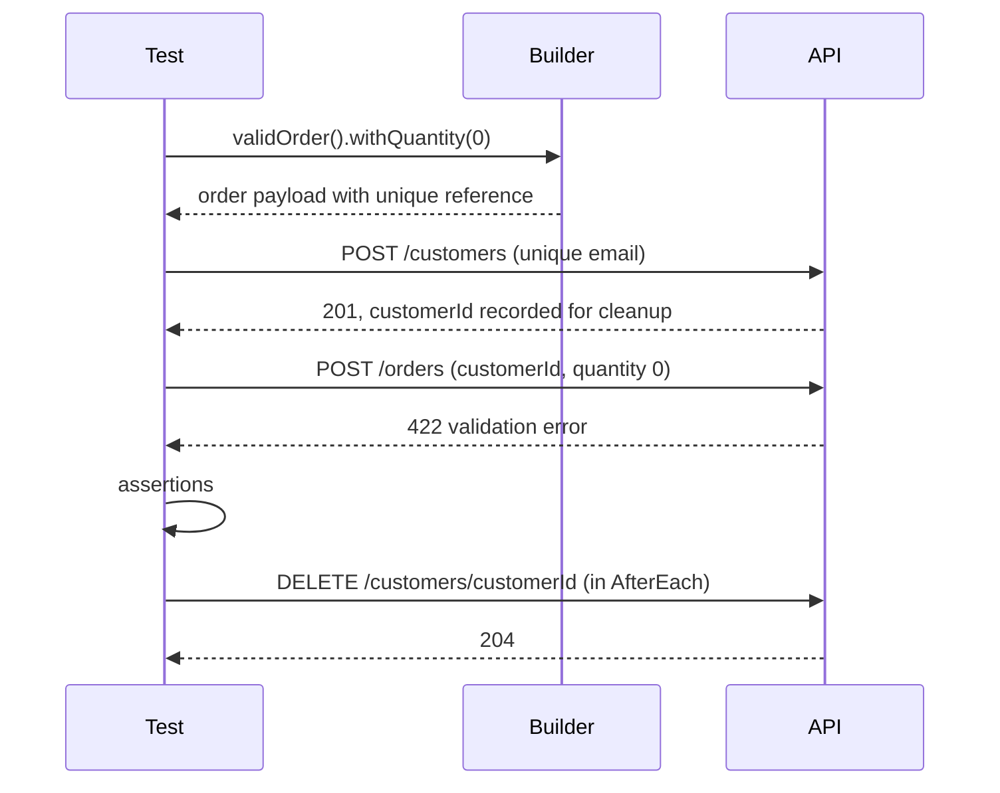

## Beginner-friendly explanation

Imagine a cookery class where every student shares one fridge. Your recipe says "use the eggs in the fridge", but another student already used them, or put in eggs of a different size. Your cake fails, and it's not your fault.

API tests that rely on whatever data happens to be in a shared environment have the same problem. The fix is to **bring your own ingredients**: each test creates exactly the data it needs, labelled with its own name, and tidies up afterwards. That way the test works the same today, tomorrow, alone or alongside a hundred others.

## Technical explanation

Test data management covers how data is **created**, **isolated**, **varied**, **verified** and **removed**.

### Strategies for creating data

| Strategy | How | Strengths | Watch out for |
|---|---|---|---|
| Via the API under test | `POST /customers` in setup | Realistic, exercises validation | Depends on create endpoint working |
| Seeding endpoint or fixture | Test-only endpoint or SQL fixture | Fast, can create states the API can't easily reach | Must not exist in production builds |
| Static reference data | Versioned seed scripts (currencies, countries) | Stable lookups | Keep it small and read-only |
| Factories / builders | Code that produces valid objects with overrides | Readable tests, valid defaults | Keep defaults realistic |
| Data files | CSV/JSON driving parameterised tests | Many cases, little code | Don't hide the intent of each case |

### Isolation

Parallel and repeated runs need **unique identifiers**. A common pattern is a run id (from CI, e.g. the build number) plus a random suffix: `qa-4711-7f3a@example.test`. Tag created records so a sweeper job can delete leftovers. Use reserved domains such as `example.test` for emails so nothing is ever delivered.

### Lifecycle



### Privacy

Production data commonly contains personal data. Copying it into test environments may breach privacy law and policy. Prefer synthetic data; if realistic data is essential, use approved masking or anonymisation.

## Real-world example

A banking QA team's API suite used a single "golden" test customer, created by hand years earlier. Tests updated its address, closed and reopened its accounts, and changed its limits. Run alone, each test passed; run together, results depended on order. When someone else's exploratory testing froze the account, forty tests failed at once.

The team replaced the golden customer with a `CustomerBuilder` and per-test creation through the API, added `@AfterEach` cleanup and a nightly sweeper for records tagged with the `qa-` prefix. The suite then ran in parallel and failures pointed to one behaviour each.

## Step-by-step walkthrough

1. **Inventory** what data each test needs and which of it is reference data.
2. **Build factories** that return valid objects by default.
3. **Make identifiers unique** with a run id and random suffix.
4. **Create data in setup** through the API or a fixture; record ids.
5. **Assert only on data the test created.**
6. **Clean up** in after-each hooks, in reverse dependency order.
7. **Add a sweeper** for anything left behind.
8. **Externalise large case sets** to CSV/JSON with a clear `description` column.

## Code examples

A builder and a test with guaranteed cleanup (JUnit 5 + RestAssured):

```java
public final class CustomerBuilder {
    private static final String RUN = System.getenv().getOrDefault("RUN_ID", "local");
    private String email = "qa-" + RUN + "-" + UUID.randomUUID().toString().substring(0, 8) + "@example.test";
    private String name = "Test Customer";
    private String tier = "standard";

    public static CustomerBuilder aCustomer() { return new CustomerBuilder(); }
    public CustomerBuilder withTier(String tier) { this.tier = tier; return this; }
    public Map<String, Object> build() { return Map.of("email", email, "name", name, "tier", tier); }
}

class CustomerTierTest {
    private final List<String> created = new ArrayList<>();

    @Test
    void goldCustomerGetsFreeShipping() {
        String id = given().spec(req).body(aCustomer().withTier("gold").build())
                .post("/customers")
                .then().statusCode(201).extract().path("id");
        created.add(id);

        given().spec(req).get("/customers/{id}/benefits", id)
               .then().statusCode(200).body("freeShipping", equalTo(true));
    }

    @AfterEach
    void cleanUp() {
        created.forEach(id -> given().spec(req).delete("/customers/{id}", id));
        created.clear();
    }
}
```

A data-driven JUnit 5 test reading a CSV from test resources:

```java
@ParameterizedTest(name = "{0}")
@CsvFileSource(resources = "/data/order-quantity.csv", numLinesToSkip = 1)
void quantityRules(String description, int quantity, int expectedStatus) {
    given().spec(req).body(OrderBuilder.anOrder().withQuantity(quantity).build())
           .post("/orders").then().statusCode(expectedStatus);
}
```

## Expected output

Running the class twice in parallel produces two independent passes, with distinct emails visible in failure logs if anything goes wrong:

```text
[INFO] Tests run: 1, Failures: 0, Errors: 0, Skipped: 0 -- in CustomerTierTest
[INFO] Tests run: 4, Failures: 0, Errors: 0, Skipped: 0 -- in OrderQuantityTest
```

After the run, `GET /customers?email=qa-<runId>*` (if the mock supports prefix search) returns no records.

## Common mistakes

- **Shared "golden" records** modified by many tests.
- **Fixed identifiers** like `test@example.com` reused by every run.
- **Cleanup at the end of the test body**, which is skipped on failure.
- **Test-only seeding endpoints** that accidentally ship to production.
- **Data files with no description**, so nobody knows what row 37 tests.
- **Real customer data** in lower environments.

## Troubleshooting

- **Unique-constraint errors (409)** on create: identifiers are not unique enough; add the run id.
- **Tests pass locally, fail in CI**: CI runs in parallel or against a shared environment; look for shared records.
- **Leftover data accumulating**: cleanup is failing silently; log delete responses and add a sweeper.

## Key takeaways summary

Good API tests own their data: they create it with valid defaults and unique ids, assert only on what they created, and clean up even when they fail. Builders keep tests readable, data files scale cases, and synthetic data keeps privacy risk out of your test environments.
