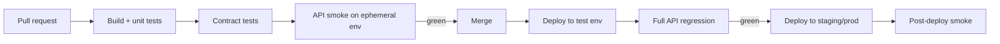

## Beginner-friendly explanation

Imagine a bakery where every new batch of bread is tasted before it goes on the shelf — automatically, every single time, not just when someone remembers. If a batch tastes wrong, it never reaches customers, and the baker knows immediately which change to the recipe caused it.

**CI/CD** (continuous integration and continuous delivery/deployment) is that automatic tasting for software. Every time a developer pushes code, a pipeline builds it and runs tests. **API tests in CI** mean your Postman collections or RestAssured suites run automatically, and a failure stops a broken change before it ships.

## Technical explanation

A **pipeline** is a series of stages triggered by events (push, pull request, merge, schedule). Common tools are GitHub Actions, GitLab CI, Jenkins and Azure Pipelines. API tests plug in at several points:

| Stage | Trigger | What runs | Blocks? |
|---|---|---|---|
| Pull request | Every PR | Unit, [contract](/learn/api-testing/contract-testing), API smoke against an ephemeral or service-level environment | Merge |
| After merge | Merge to main, deploy to test env | Full API regression | Promotion to staging |
| Nightly | Schedule | Long-running suites, data-heavy cases | Raises a ticket |
| Post-deploy | Each deployment | Small read-only smoke suite | Rollback decision |

Requirements for running tests in CI:

- **Headless command-line execution:** Newman for Postman collections (see [Newman command-line runs](/learn/api-testing/newman-command-line-runs)), `mvn test` for RestAssured with TestNG or JUnit.
- **Exit codes:** a failing test must make the command exit non-zero so the job fails.
- **Configuration from the environment:** base URLs and credentials come from environment variables or CI secrets, not from files in Git.
- **Reports:** JUnit XML (understood by most CI systems), plus HTML artifacts for humans.
- **Isolation:** each test creates the data it needs; no order dependence.



## Real-world example

A logistics team ran their Postman collection manually "before releases". Releases happened twice a week, and twice in a month a backend change broke the shipment-tracking endpoint for a day. They moved the collection to Newman in GitHub Actions on every PR against a containerised test environment. The next breaking change — a renamed query parameter — failed the PR check within minutes, with the failed request highlighted in the JUnit report. The developer fixed it before merging.

## Step-by-step walkthrough

1. **Make tests runnable headless** with one command and no manual steps.
2. **Externalise configuration:** base URL, tokens and test-account credentials as environment variables.
3. **Add secrets** to the CI secret store and reference them in the workflow.
4. **Write the workflow** (below): check out, set up tools, run tests, publish reports.
5. **Decide gates:** what blocks a merge, what blocks a deploy, what only notifies.
6. **Watch flakiness:** track failure rates; quarantine with a ticket; fix the root cause.

## Code examples

GitHub Actions running a Postman collection with Newman on every pull request:

```yaml
name: api-tests
on:
  pull_request:
    branches: [main]

jobs:
  newman:
    runs-on: ubuntu-latest
    steps:
      - uses: actions/checkout@v4
      - uses: actions/setup-node@v4
        with:
          node-version: 20
      - name: Run API tests
        env:
          API_KEY: ${{ secrets.API_TEST_KEY }}
        run: >
          npx newman run tests/orders.postman_collection.json
          -e tests/ci.postman_environment.json
          --env-var "apiKey=$API_KEY"
          --reporters cli,junit
          --reporter-junit-export results/newman.xml
      - name: Upload report
        if: always()
        uses: actions/upload-artifact@v4
        with:
          name: newman-report
          path: results/
```

For a RestAssured suite, the run step becomes `mvn -B test -DbaseUrl=$BASE_URL`, and Maven Surefire writes JUnit XML to `target/surefire-reports`. Action versions change over time; check the current major versions in the GitHub Actions documentation.

## Expected output

On success the job is green. On failure Newman prints a summary and exits non-zero:

```text
┌─────────────────────────┬──────────┬──────────┐
│                         │ executed │   failed │
├─────────────────────────┼──────────┼──────────┤
│              assertions │       48 │        1 │
└─────────────────────────┴──────────┴──────────┘
#  failure        detail
1. AssertionError Status code is 200
                  expected response to have status code 200 but got 400
```

## Troubleshooting

- **Works locally, fails in CI:** compare base URL, environment variables, time zone, and whether the CI runner can reach the environment (network rules).
- **Secrets appear empty:** secrets are not passed to workflows triggered from forks by default; check the trigger.
- **Intermittent failures:** look for shared data, fixed sleeps, and environment restarts during the run.

## Common mistakes

- **Committing environment files with real tokens.**
- **Running the entire slow regression on every PR**, so developers stop waiting for it.
- **Tests that depend on each other's data or order.**
- **Retrying failures automatically and never investigating.**
- **Production smoke tests that create real transactions.**

## Key takeaways summary

Put fast, reliable API checks on every pull request and fuller suites after deployment. Configure through environment variables and secrets, publish JUnit reports, and keep the pipeline trustworthy by fixing flaky tests rather than hiding them.
