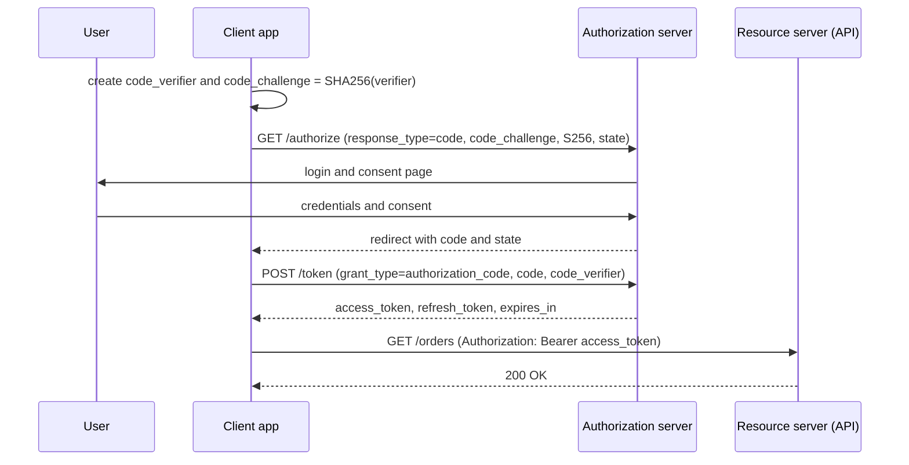

## Beginner-friendly explanation

At an office building, the reception desk checks your ID and gives you a visitor badge. That is **authentication**: proving who you are. Later, your badge opens the meeting room on floor 2 but not the server room. That is **authorization**: deciding what you're allowed to do.

APIs work the same way. Every request carries some kind of badge: a password, a key or a token. The API first checks that the badge is genuine, then checks whether the badge's owner may perform this action on this particular piece of data. Testers check both gates, and especially the second one, because that is where serious data leaks happen.

## Technical explanation

| Concept | Question | Failure status |
|---|---|---|
| Authentication | Who is calling? | `401 Unauthorized` + `WWW-Authenticate` |
| Authorization | May they do this to this resource? | `403 Forbidden` (or `404` to hide existence, if documented) |

### Common schemes

- **Basic** (RFC 7617): `Authorization: Basic base64(username:password)`. Base64 is encoding, not encryption, so it is only acceptable over HTTPS.
- **API key**: a static secret in a header such as `X-API-Key`. Simple, but keys identify an application rather than a user, rarely expire and leak easily if sent in query strings.
- **Bearer token** (RFC 6750): `Authorization: Bearer <token>`. Whoever holds the token can use it, so tokens are short-lived.

### OAuth 2.0

OAuth 2.0 (RFC 6749) is a **delegated authorization** framework: an authorization server issues access tokens that a resource server (the API) accepts. Key grants:

- **Client credentials**: a confidential client authenticates with its own id and secret and gets a token for itself. No user involved; used for service-to-service calls.
- **Authorization code with PKCE** (RFC 7636): the user signs in at the authorization server, the client receives a one-time code and exchanges it for tokens. PKCE binds the code to the client that started the flow.
- **Refresh token**: exchanged at the token endpoint (`grant_type=refresh_token`) for a new access token without asking the user to sign in again.

The implicit and resource owner password grants are discouraged by the OAuth 2.0 Security Best Current Practice (RFC 9700).



### JWT structure and validation

A JWT (RFC 7519) in its common signed form is three base64url parts separated by dots: `header.payload.signature`. The header names the algorithm (`alg`, e.g. `RS256`) and often a key id (`kid`). The payload holds **claims** such as `sub` (subject), `iss` (issuer), `aud` (audience), `exp` (expiry), `iat` and `scope`.

A server must, at minimum:

1. Verify the signature using a key it trusts, with an **allow-list of algorithms** (never trust `alg` blindly; reject `none`).
2. Check `exp` and `nbf` with a small clock-skew tolerance.
3. Check `iss` and `aud` match this API.
4. Check scopes or roles for the requested action.

Known pitfalls: accepting `alg: none`, algorithm confusion (an RS256 public key used as an HS256 secret), skipping `aud` checks so a token for another API is accepted, and putting sensitive data in claims.

## Real-world example

A team building an internal reporting API validated JWT signatures and expiry but not the `aud` claim. Every service in the company used the same identity provider. A token issued for a low-risk wiki integration was therefore accepted by the reporting API, granting access to financial reports.

A tester found it by requesting a token for a different audience in the test environment and calling the reporting API with it. The expected `401` came back as `200`. Adding an audience check closed the gap.

## Step-by-step walkthrough

1. **Build an access matrix**: roles down the side, endpoints and actions across, expected status in each cell.
2. **Test authentication negatives**: no header, malformed header, wrong scheme, expired token, token with a tampered payload, token signed by another key.
3. **Test authorization**: each role against each action; then the same role against *another user's* resource ids.
4. **Test token lifecycle**: expiry, refresh, refresh after logout or revocation, reuse of a rotated refresh token.
5. **Check hygiene**: credentials never in URLs or response bodies, error messages that don't say whether the username or password was wrong.

## Code examples

Client credentials with `curl`, then calling the API:

```bash
curl -s -X POST http://localhost:8080/oauth/token \
  -u "$CLIENT_ID:$CLIENT_SECRET" \
  -d "grant_type=client_credentials&scope=orders.read"

curl -i http://localhost:8080/orders -H "Authorization: Bearer $ACCESS_TOKEN"
```

Decoding a JWT payload locally (inspection only, this does not verify anything):

```python
import base64, json

def decode_part(part: str) -> dict:
    padded = part + "=" * (-len(part) % 4)
    return json.loads(base64.urlsafe_b64decode(padded))

header, payload, _signature = token.split(".")
print(decode_part(header))
print(decode_part(payload))
```

## Expected output

The token endpoint returns JSON like this (values differ):

```text
{"access_token":"eyJhbGciOiJSUzI1NiIsImtpZCI6ImsxIn0...","token_type":"Bearer","expires_in":3600,"scope":"orders.read"}
```

The decoder prints something like `{'alg': 'RS256', 'kid': 'k1'}` and a payload with `iss`, `aud`, `sub`, `exp` and `scope`.

## Common mistakes

- **Testing only valid credentials.** Most auth defects are in the negative paths.
- **Confusing 401 and 403** in expectations.
- **Testing authorization with a single user per role.** You need two users to test cross-account access.
- **Pasting real tokens into online debuggers** or committing them to collections and repositories.
- **Assuming a decodable JWT is a valid JWT.**
- **Hardcoding long-lived tokens in tests**, which then fail when they expire or hide refresh defects.

## Troubleshooting

- **Valid token, still 401**: check clock skew, audience, issuer and whether the API expects a different scheme or header name.
- **403 for an action you expected to work**: inspect the token's scopes or roles; the token may have been requested with too narrow a scope.
- **`invalid_grant` from the token endpoint**: the code or refresh token was already used, expired, or the PKCE verifier doesn't match.

## Key takeaways summary

Authentication and authorization are separate gates with separate status codes. Know how each scheme sends credentials, choose the right OAuth grant for the client type, never trust a JWT without full validation, and test the token lifecycle and cross-user access as rigorously as the login itself.
