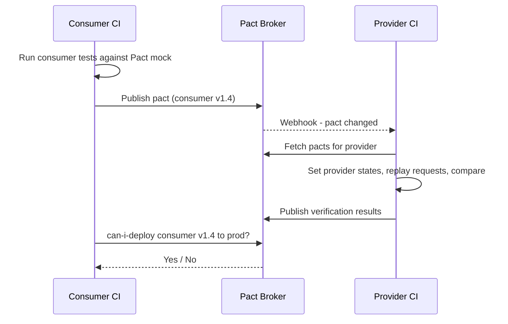

## Beginner-friendly explanation

Imagine a restaurant kitchen (the **provider**) and a delivery app (the **consumer**). The app shows customers each dish's name, price and photo. One day the kitchen decides to rename "price" to "cost" on its menu feed. The kitchen's own tests pass — the data is all there. The app breaks instantly, showing no prices.

A **contract** is a written agreement: "When the app asks for the menu, the kitchen will reply with name, price and photo for each dish." **Contract testing** checks both sides keep that agreement, separately and quickly, so neither side can break the other by surprise.

## Technical explanation

In a system of many services, each **integration** has a consumer (the caller) and a provider (the API). Traditional ways to test integrations:

| Approach | Strength | Weakness |
|---|---|---|
| End-to-end tests | Realistic | Slow, flaky, need everything deployed, fail late |
| Mocks in consumer tests | Fast | The mock can drift from the real provider |
| Schema validation | Checks response shape | Doesn't know what each consumer actually uses |
| Contract tests | Fast, isolated, both sides checked against the same file | Doesn't test business logic |

**Consumer-driven contract testing** (the approach of [Pact](https://docs.pact.io/)) works like this:

1. The consumer's test describes an **interaction**: given a **provider state** ("order 42 exists"), when the consumer sends `GET /orders/42`, the response has status 200 and a body with `id` (number) and `status` (string).
2. Pact runs a **mock provider** that responds as described; the consumer's real client code calls it. If the consumer's code works, Pact writes the interactions to a **pact file** (JSON).
3. The pact is published to a **Pact Broker** (or PactFlow) with the consumer's version.
4. The provider's build fetches pacts for all its consumers and **verifies** them: it sets up each provider state, replays each request against the real provider, and compares responses with the expectations.
5. Results go back to the broker. **`can-i-deploy`** asks: are this version and the versions already in the target environment verified as compatible?



**Matchers** keep contracts flexible: "any integer", "a string matching this date regex", "an array with at least one element like this". Specifying exact values the consumer doesn't care about makes contracts brittle.

**Provider-driven** or schema-based approaches start from the provider's OpenAPI spec instead. They are useful, especially for public APIs with unknown consumers, but can't tell you which real consumer depends on a field.

## Real-world example

An e-commerce company had a mobile app, a web app and a partner portal calling an Orders service. The Orders team removed a `legacyStatus` field that "nobody used". The schema was updated, all Orders tests passed, and it shipped. The partner portal broke for two days.

After adopting consumer-driven contracts, each consumer published what it used. Removing a field now ran provider verification against all three pacts. The partner portal's pact failed in the Orders build, the team saw exactly which consumer and interaction would break, and coordinated the change.

## Step-by-step walkthrough

1. **Pick one integration** with frequent breakage as the pilot.
2. **Consumer side:** write a Pact test for each request the consumer makes, using matchers, and run it to produce the pact file.
3. **Set up a broker** and publish the pact from consumer CI with the git commit as the version.
4. **Provider side:** add a verification test that loads pacts from the broker and implements each provider state (seed data).
5. **Publish verification results** from provider CI.
6. **Add `can-i-deploy`** before each deployment step, and record deployments to the broker.
7. **Grow coverage** integration by integration.

## Code examples

A consumer-side interaction with Pact JS (the API shape varies slightly between Pact versions; check the docs for yours):

```javascript
const { PactV3, MatchersV3 } = require("@pact-foundation/pact");
const { like, integer } = MatchersV3;

const provider = new PactV3({ consumer: "web-app", provider: "orders-service" });

it("gets an order", () => {
  provider
    .given("order 42 exists")
    .uponReceiving("a request for order 42")
    .withRequest({ method: "GET", path: "/orders/42" })
    .willRespondWith({
      status: 200,
      headers: { "Content-Type": "application/json" },
      body: { id: integer(42), status: like("PAID") },
    });

  return provider.executeTest(async (mockServer) => {
    const order = await getOrder(mockServer.url, 42); // real client code
    expect(order.status).toBe("PAID");
  });
});
```

## Common mistakes

- **Treating contract tests as functional tests** and asserting exact business values.
- **Contracts that list every field** instead of what the consumer uses.
- **Skipping provider states**, so verification depends on whatever data happens to exist.
- **Publishing pacts but never gating deployment** with can-i-deploy.
- **Dropping all end-to-end tests.** Keep a thin set for critical journeys.

## Key takeaways summary

Contract testing turns an integration agreement into an executable file both sides test against. Consumers generate pacts from real client code, providers verify them on every build, and a broker gates deployment, so breaking changes are caught in minutes rather than in production.
