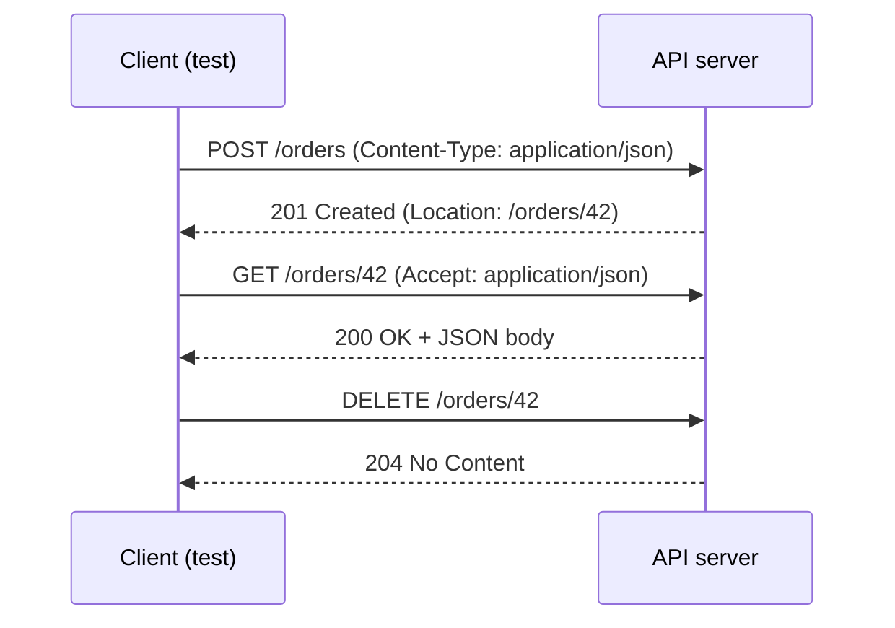

## Beginner-friendly explanation

Think of ordering at a restaurant counter. You walk up and say **what you want done** ("I'd like to order"), **which item** ("the veggie burger"), add some **notes** ("no onions, I'm paying by card") and maybe hand over a **written slip** with details. The cashier replies with **a quick verdict** ("done", "we're out of that", "you can't order from the staff menu"), some notes of their own ("ready in 10 minutes") and finally **your food**.

HTTP works the same way. The client (your browser, Postman, or a test) sends a **request**. The server sends back a **response**. API testing is mostly about sending carefully chosen requests and checking that every part of the response is what the requirement says it should be.

## Technical explanation

HTTP semantics are defined in [RFC 9110](https://www.rfc-editor.org/rfc/rfc9110). The message format differs between HTTP/1.1, HTTP/2 and HTTP/3, but the semantics (methods, status codes, headers) are the same.

A **request** contains:

- a **method** (GET, POST, …),
- a **target URI** (scheme, host, path and optional query, e.g. `https://api.example.test/orders?status=open`),
- **header fields** (metadata such as `Content-Type`, `Accept`, `Authorization`),
- an optional **body** (content), typically JSON for modern APIs.

A **response** contains a **status code** (e.g. `200`), header fields and an optional body.

### Methods and their properties

RFC 9110 defines two properties testers must know:

- **Safe**: the client does not request any state change. Safe methods are essentially read-only.
- **Idempotent**: the intended effect of N identical requests is the same as one request.

| Method | Intended meaning | Safe | Idempotent |
|---|---|---|---|
| GET | Retrieve a representation of the resource | Yes | Yes |
| HEAD | Same as GET but without the response body | Yes | Yes |
| OPTIONS | Describe communication options (e.g. allowed methods) | Yes | Yes |
| POST | Process the enclosed body (often "create a child resource") | No | No |
| PUT | Create or replace the target resource with the body | No | Yes |
| DELETE | Remove the association for the target resource | No | Yes |
| PATCH | Apply a partial modification (RFC 5789) | No | No (not guaranteed) |

Idempotency describes **server state**, not the response. A repeated DELETE may return `204` and then `404`; it is still idempotent because the resource is gone either way.

### Headers testers check most often

| Header | Direction | Purpose |
|---|---|---|
| `Content-Type` | both | Media type of the body, e.g. `application/json` |
| `Accept` | request | Media types the client can handle |
| `Authorization` | request | Credentials, e.g. `Bearer <token>` |
| `Location` | response | URI of a newly created resource (with `201`) or redirect target |
| `Cache-Control` | both | Caching directives |
| `Allow` | response | Methods the resource supports (with `405` or `OPTIONS`) |



## Real-world example

An ordering team exposed `PUT /carts/{id}/items` to "add an item". Because PUT is idempotent, a mobile SDK retried it automatically on network timeouts. Each retry added another item, so customers who were on poor connections saw duplicate products in their cart.

The fix was a design change, not a code tweak: adding an item became `POST /carts/{id}/items`, and PUT was reserved for replacing the whole item list. A tester who knew method semantics could have flagged the mismatch in design review by asking one question: "if this PUT is sent twice, is the result the same?"

## Step-by-step walkthrough

1. **Read the endpoint contract.** Note the method, path, required headers, body schema and documented responses.
2. **Send the happy-path request** with explicit `Content-Type` and `Accept` headers.
3. **Assert on the status line first**, then on important headers (`Content-Type`, `Location`), then on the body.
4. **Check method semantics.** Repeat PUT and DELETE and confirm state is unchanged after the first call. Confirm GET does not change state.
5. **Try unsupported methods**, for example PATCH on a read-only resource, and expect `405 Method Not Allowed` with an `Allow` header.
6. **Vary headers.** Send a wrong `Content-Type` (expect `415`) and an unsupported `Accept` (often `406`).

## Code examples

The same conversation using `curl`. `-i` prints the status line and headers.

```bash
# Create
curl -i -X POST http://localhost:8080/orders \
  -H "Content-Type: application/json" \
  -H "Accept: application/json" \
  -d '{"sku": "BOOK-001", "quantity": 2}'

# Read
curl -i http://localhost:8080/orders/42 -H "Accept: application/json"

# HEAD returns the same headers as GET but no body
curl -I http://localhost:8080/orders/42
```

## Expected output

For the create call against a correct implementation (header values will vary):

```text
HTTP/1.1 201 Created
Content-Type: application/json
Location: /orders/42

{"id":42,"sku":"BOOK-001","quantity":2,"status":"open"}
```

The `HEAD` call prints a `200 OK` status line and headers, but no body.

## Common mistakes

- **Asserting only on the body.** A body that "looks right" with status `200` instead of `201`, or with a wrong `Content-Type`, is still a defect.
- **Treating idempotency as "same response".** It is about the effect on the server.
- **Assuming PATCH is idempotent.** It may be in a given API, but the specification does not guarantee it.
- **Relying on tool defaults for headers.** Some clients add `Accept: */*` or a default `Content-Type`; make tests explicit.
- **Putting sensitive data in query strings.** URLs end up in logs, history and proxies; flag APIs that do this.
- **Ignoring HEAD and OPTIONS.** They are cheap to test and often reveal routing or CORS defects.

## Troubleshooting

- **`415 Unsupported Media Type`**: the server cannot parse the body format; check `Content-Type`.
- **`405 Method Not Allowed`**: the path exists but not for that method; read the `Allow` header.
- **The body is empty but the status is 200**: check whether you sent `HEAD` by mistake, or whether the server returns `204` for this case.

## Key takeaways summary

HTTP is a structured conversation: method, target, headers and body out; status, headers and body back. Knowing which methods are safe and idempotent lets you predict retry behaviour, spot design defects early and write assertions that cover the whole response, not just the JSON.
