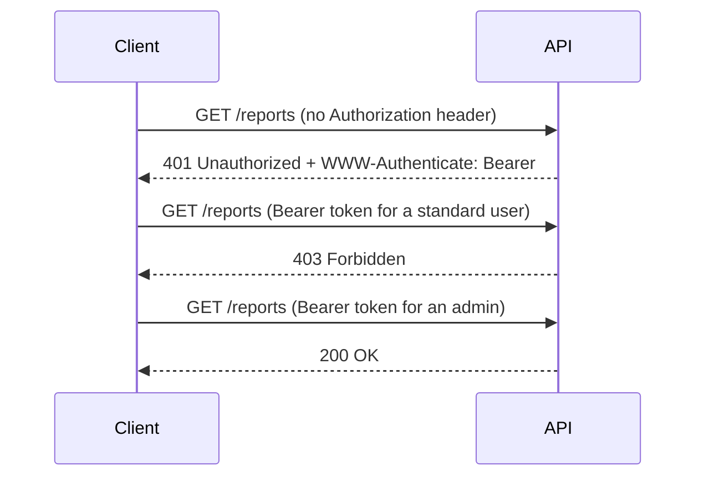

## Beginner-friendly explanation

When you post a parcel, the tracking page shows a short verdict before any detail: "delivered", "address problem", "returned to sender", "depot closed". You can act on that verdict without reading the full report.

**HTTP status codes** are that verdict. Every response starts with a three-digit number that tells the client, in one glance, whether the request worked, whether the client got something wrong, or whether the server failed. Programs, proxies and monitoring dashboards all make decisions based on this number, so getting it right matters as much as getting the data right.

## Technical explanation

RFC 9110 groups status codes into five classes by their first digit:

| Class | Meaning | Examples |
|---|---|---|
| 1xx | Informational, interim response | `100 Continue` |
| 2xx | Successful | `200`, `201`, `202`, `204` |
| 3xx | Redirection, further action needed | `301`, `302`, `304`, `307`, `308` |
| 4xx | Client error | `400`, `401`, `403`, `404`, `405`, `409`, `415`, `422`, `429` |
| 5xx | Server error | `500`, `502`, `503`, `504` |

Clients that don't recognise a specific code must treat it as the `x00` of its class, which is why the class matters.

### Codes testers meet daily

| Code | Use it when | Check also |
|---|---|---|
| 200 OK | Successful request with a body | Body content |
| 201 Created | A new resource was created | `Location` header |
| 202 Accepted | Accepted for asynchronous processing | A status URL to poll |
| 204 No Content | Success with no body (common for DELETE) | Body is empty |
| 304 Not Modified | Conditional GET, cached copy still valid | `ETag` / `If-None-Match` |
| 400 Bad Request | Malformed syntax, e.g. unparseable JSON | Error message is helpful, not a stack trace |
| 401 Unauthorized | Missing or invalid authentication | `WWW-Authenticate` header |
| 403 Forbidden | Authenticated but not permitted | No data leaked |
| 404 Not Found | Target resource not found | — |
| 405 Method Not Allowed | Method not supported for this resource | `Allow` header |
| 409 Conflict | Conflicts with current state (duplicate, stale version) | Explanation in body |
| 415 Unsupported Media Type | Body format not supported | Request `Content-Type` |
| 422 Unprocessable Content | Well-formed but semantically invalid | Field-level errors |
| 429 Too Many Requests | Rate limit exceeded (RFC 6585) | `Retry-After` |
| 500 Internal Server Error | Unexpected server failure | Always a defect to investigate |
| 503 Service Unavailable | Temporarily overloaded or in maintenance | `Retry-After` |

### 401 versus 403



Despite its name, **401 is about authentication** ("we don't know who you are"). **403 is about authorization** ("we know who you are and the answer is no").

### 400, 422 and 409

These three are often confused. **400** is for requests the server cannot or will not process because of a client error such as malformed JSON. **422** (named "Unprocessable Content" in RFC 9110) is for well-formed requests whose content is semantically invalid, such as `"quantity": -3`. **409** is for a conflict with the resource's current state, such as a duplicate username or an update based on an outdated version. Many APIs use 400 for all validation errors; that is acceptable if it is documented and consistent.

## Real-world example

A subscriptions team built an endpoint that wrapped every outcome in `200 OK` with a body such as `{"success": false, "error": "card declined"}`. Dashboards showed a near-zero error rate, so nobody noticed when a configuration change made every renewal fail. The failures were only discovered from customer complaints.

The fix was to return proper status codes (`402` or `422` for declined cards per the team's contract, `503` when the payment provider was down) and to add API tests that asserted the exact code for each scenario.

## Step-by-step walkthrough

1. **List the scenarios** for an endpoint: success, each validation rule, missing auth, wrong permission, missing resource, conflict, rate limit.
2. **Write the expected status for each** from the contract. If the contract is silent, raise a question rather than guessing.
3. **Assert the exact code**, not a range.
4. **Assert the companion headers**: `Location` on 201, `Allow` on 405, `WWW-Authenticate` on 401, `Retry-After` on 429 when documented.
5. **Check error bodies** are consistent in structure and never expose stack traces or SQL.

## Code examples

```bash
# 401: no credentials
curl -i http://localhost:8080/reports

# 405: method not supported on this resource
curl -i -X DELETE http://localhost:8080/reports

# 422: valid JSON, invalid value
curl -i -X POST http://localhost:8080/orders \
  -H "Content-Type: application/json" \
  -d '{"sku": "BOOK-001", "quantity": -3}'
```

## Expected output

Exact headers depend on the server, but a correct implementation returns:

```text
HTTP/1.1 401 Unauthorized
WWW-Authenticate: Bearer

HTTP/1.1 405 Method Not Allowed
Allow: GET, HEAD

HTTP/1.1 422 Unprocessable Content
Content-Type: application/json
{"errors":[{"field":"quantity","message":"must be at least 1"}]}
```

## Common mistakes

- **Asserting "not 500" or "less than 400".** Ranges hide the exact defect.
- **Swapping 401 and 403** in expectations or bug reports.
- **Accepting 200 for a create.** If the contract says 201 with `Location`, 200 is a defect.
- **Treating every 404 as correct.** A 404 on a route that should exist can mean a routing or deployment fault.
- **Ignoring 5xx on negative tests.** Invalid input must produce a 4xx; a 500 means the server failed to validate.
- **Forgetting headers that give codes their meaning**, such as `Retry-After` on 429.

## Troubleshooting

- **You get 404 for a resource you just created**: check the base URL, path prefix (for example `/api/v1`) and whether creation is asynchronous (`202`).
- **You get 403 when you expected 401**: some gateways reject unauthenticated calls with 403; confirm the documented behaviour and report inconsistency.
- **You get 502 or 504**: a gateway or proxy could not reach the upstream service; check service health before blaming the API logic.

## Key takeaways summary

The status code is the API's headline. Know the classes, pick the exact expected code for every scenario, verify the headers that accompany it, and treat a wrong code as a real defect even when the body looks fine.
