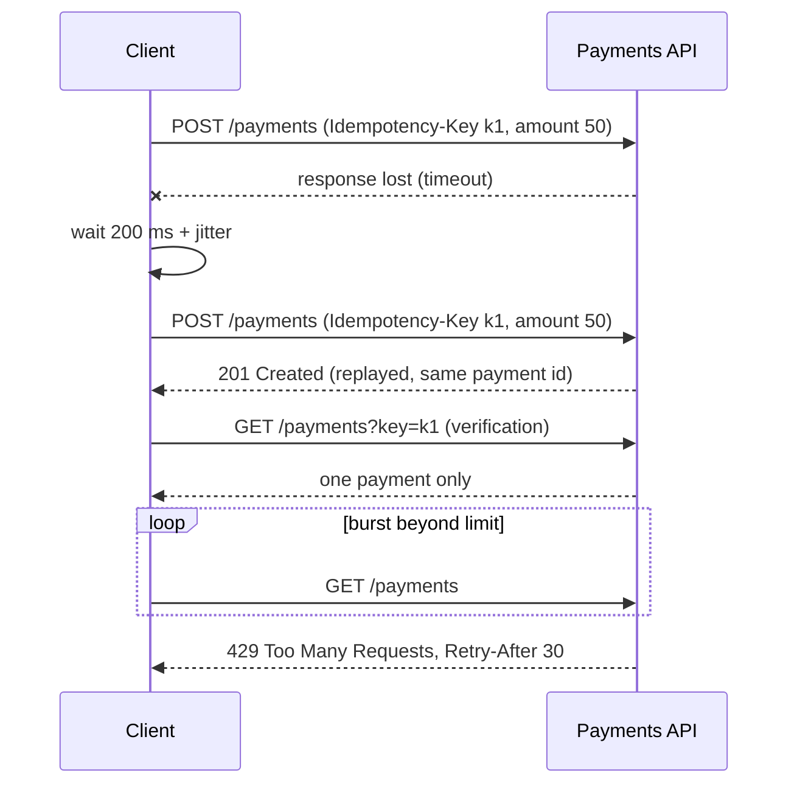

## Beginner-friendly explanation

You press a lift's call button five times. The lift still comes once. Pressing it again has the same effect as pressing it once: that is **idempotency**.

Now imagine a "pay" button that charges your card each time you press it. If the screen freezes and you press again, you pay twice. Networks freeze all the time, and software retries automatically, so APIs need a way to make "pay" behave like the lift button: the **idempotency key**. Separately, services protect themselves from too many requests with **rate limiting**, a polite "slow down, try again in 30 seconds". Testers check all three: safe repeats, sensible retries and fair limits.

## Technical explanation

### Idempotency

RFC 9110 defines a method as idempotent if the intended effect of multiple identical requests equals that of one. GET, HEAD, OPTIONS, TRACE, PUT and DELETE are idempotent; POST and PATCH are not by definition.

For non-idempotent operations, many APIs accept an **idempotency key**: a client-generated unique value (commonly a UUID in an `Idempotency-Key` header). The server stores the key with the request fingerprint and the response. An IETF draft specifies this header, but it was not a published RFC at the time of writing, so behaviour varies between APIs; test against the API's own documentation.

| Case | Expected (typical) |
|---|---|
| Same key, same body, after completion | Original response replayed; no new side effect |
| Same key, same body, while first in progress | One side effect; duplicate waits or gets a conflict (often 409) |
| Same key, different body | Rejected (often 409 or 422) |
| Key expired | Treated as a new request |
| No key | Normal non-idempotent behaviour |

### Retries

Retry only **transient** failures: connection errors, timeouts, 429, 502, 503, 504. Use **exponential backoff** (`base × 2^(attempt−1)`, capped), add **jitter** (randomness) so many clients don't retry in lockstep, cap the number of attempts, and honour `Retry-After` when present.

### Rate limiting

When a client exceeds its allowance the server returns **429 Too Many Requests** (RFC 6585), optionally with `Retry-After` as seconds (`Retry-After: 30`) or an HTTP date. Many APIs also send informational headers (names vary, e.g. `RateLimit-*` or `X-RateLimit-*`). Missing or weak limits are part of OWASP API4:2023 Unrestricted Resource Consumption.



## Real-world example

A ticketing team added automatic retries to its mobile client to cope with flaky connections. "Reserve seats" was a POST without an idempotency key. During a busy on-sale, slow responses caused timeouts, the client retried, and customers ended up holding several reservations each, which made seats appear sold out.

The fix had three parts: an idempotency key on reservation requests, a unique constraint on the key in the database to handle concurrent duplicates, and a retry policy with jittered backoff. The test suite gained cases for replay, concurrent duplicates and key reuse with a different body.

## Step-by-step walkthrough

1. **Classify each endpoint**: idempotent by method, idempotent by key, or neither.
2. **Replay test**: send the same keyed request twice; check one side effect (verify in the database or via GET) and identical responses.
3. **Conflict test**: same key, different body.
4. **Concurrency test**: fire duplicates in parallel.
5. **Expiry test**: if the window is documented and short in a test environment, reuse the key after it.
6. **Retry policy test**: use a mock that fails N times; check attempts, delays and that non-retryable codes aren't retried.
7. **Rate-limit test** (authorized environment only): just under and just over the limit; check 429, `Retry-After`, reset, per-client scope and no side effects.

## Code examples

Testing concurrent duplicates with RestAssured and a thread pool:

```java
@Test
void concurrentDuplicatesCreateOnePayment() throws Exception {
    String key = UUID.randomUUID().toString();
    Map<String, Object> body = Map.of("orderId", orderId, "amount", 5000, "currency", "EUR");

    ExecutorService pool = Executors.newFixedThreadPool(5);
    List<Future<Integer>> results = new ArrayList<>();
    for (int i = 0; i < 5; i++) {
        results.add(pool.submit(() -> given().spec(req)
                .header("Idempotency-Key", key).body(body)
                .post("/payments").statusCode()));
    }
    pool.shutdown();
    for (Future<Integer> f : results) {
        assertTrue(Set.of(200, 201, 409).contains(f.get()));
    }

    given().spec(req).queryParam("orderId", orderId).get("/payments")
           .then().statusCode(200).body("items.size()", equalTo(1));
}
```

A client retry helper with capped exponential backoff and full jitter (Python):

```python
import random, time, requests

RETRYABLE = {429, 502, 503, 504}

def get_with_retry(url, attempts=5, base=0.2, cap=5.0):
    for attempt in range(1, attempts + 1):
        resp = requests.get(url, timeout=5)
        if resp.status_code not in RETRYABLE or attempt == attempts:
            return resp
        retry_after = resp.headers.get("Retry-After")
        if retry_after and retry_after.isdigit():
            delay = int(retry_after)
        else:
            delay = random.uniform(0, min(cap, base * 2 ** (attempt - 1)))
        time.sleep(delay)
```

## Expected output

For the concurrency test against a correct implementation, one call returns `201` and the others return `201` (replayed) or `409`, and the final list contains one payment. The rate-limit check should show:

```text
HTTP/1.1 429 Too Many Requests
Retry-After: 30
Content-Type: application/problem+json
```

## Common mistakes

- **Testing idempotency only sequentially**; most real defects are races.
- **Retrying non-idempotent requests** without a key.
- **Retrying 4xx validation errors**, wasting capacity and hiding bugs.
- **Fixed retry intervals without jitter**, causing synchronised retry storms.
- **Ignoring `Retry-After`.**
- **Load-testing someone else's rate limits.** Only test systems you are authorized to test.

## Troubleshooting

- **Duplicates despite a key**: check the key is actually sent (header name and case), and whether the server scopes keys per user or per endpoint.
- **No 429 even at high rates**: limits may be enforced at a gateway not present in your environment; confirm where limiting lives.
- **429 arrives but requests still take effect**: rate-limited requests must have no side effects; report it.

## Key takeaways summary

Retries are inevitable, so APIs must make repeats harmless. Rely on idempotent methods, require idempotency keys for operations like payments and test them under concurrency, retry only transient failures with jittered backoff, and verify that rate limits return 429 with a sensible `Retry-After` and no side effects.
