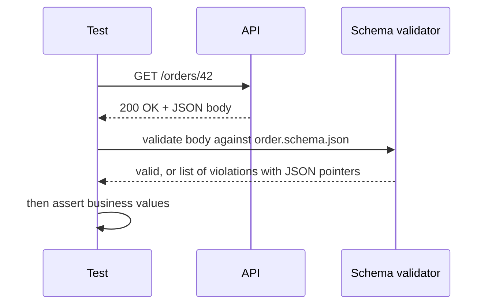

## Beginner-friendly explanation

When you fill in a passport application, the form has rules: date of birth must be a date, nationality must come from a list, photo is required. A clerk checks the **shape** of the form before anyone reads your answers carefully.

**JSON Schema** is that rule sheet for JSON. It says "this response is an object; it must have an `id` that is a whole number, a `status` that is one of open, paid or cancelled, and an `items` list where each item has a `sku`". A validator then checks any response against the rules in one step. If a developer accidentally changes a number into text, or removes a field, the schema check catches it even if no other test looked at that field.

## Technical explanation

JSON Schema is a vocabulary for describing and validating JSON documents, published at json-schema.org. A schema is itself JSON. Several drafts exist (draft-04, draft-07, 2019-09, 2020-12); declare which one you use with `$schema`, and check which drafts your validator supports. RestAssured's `json-schema-validator` module, for example, is based on a library that supports drafts up to draft-04/03, so newer keywords may not be available there; check the version you use.

### Core keywords

| Keyword | Purpose | Example |
|---|---|---|
| `type` | Allowed JSON type(s) | `"integer"`, `["string", "null"]` |
| `properties` | Schemas for named properties | `{"id": {"type": "integer"}}` |
| `required` | Properties that must be present | `["id", "status"]` |
| `additionalProperties` | Whether unlisted properties are allowed | `false` |
| `enum` / `const` | Allowed value(s) | `["open", "paid"]` |
| `minimum`, `maximum` | Numeric bounds | `"minimum": 1` |
| `minLength`, `maxLength`, `pattern` | String rules | `"pattern": "^ord_[a-z0-9]+$"` |
| `format` | Semantic format such as `date-time`, `email`, `uuid` | Assertion behaviour varies by validator |
| `items`, `minItems`, `uniqueItems` | Array rules | `"items": {"$ref": "#/definitions/item"}` |
| `$ref` | Reuse a sub-schema | `"$ref": "#/definitions/money"` |

Remember: `properties` describes properties **if present**; only `required` makes them mandatory. `"type": "integer"` rejects `"42"` (a string). In newer drafts `format` is annotation-only by default unless the validator is configured to assert it.

### What schema validation does and doesn't cover

| Covered | Not covered |
|---|---|
| Types, presence, enums, ranges, patterns | Whether values are correct for this request |
| Array length and item shape | Cross-field rules like total = sum of items |
| Unexpected properties (with `additionalProperties: false`) | Authorization, state transitions |



## Real-world example

A customer-profile endpoint was refactored to return the database entity directly instead of a response object. All functional tests passed, because the fields they checked were still there. But the response now also contained `passwordHash` and `internalRiskScore`.

The API team's response schema had `additionalProperties: false`. The schema test failed on the first build with "object instance has properties which are not allowed by the schema", and the leak never reached an environment anyone else could access.

## Step-by-step walkthrough

1. **Start from the contract** (OpenAPI document or agreed example), not from whatever the API currently returns.
2. **Declare `$schema`** for the draft your validator supports.
3. **Describe each property's type**, using `["string", "null"]` where null is allowed.
4. **List required properties.**
5. **Constrain values**: enums for statuses, `minimum` for quantities, `pattern` for ids.
6. **Describe arrays** with `items` and `minItems` where an empty list would be wrong.
7. **Choose `additionalProperties`** deliberately.
8. **Validate a known-good and a known-bad document** to prove the schema can fail.
9. **Store schemas in version control** next to the tests (`src/test/resources/schemas`).

## Code examples

`src/test/resources/schemas/order.schema.json`:

```json
{
  "$schema": "http://json-schema.org/draft-04/schema#",
  "type": "object",
  "required": ["id", "status", "items", "createdAt"],
  "additionalProperties": false,
  "properties": {
    "id": { "type": "string", "pattern": "^ord_[a-z0-9]+$" },
    "status": { "enum": ["open", "paid", "cancelled"] },
    "createdAt": { "type": "string", "format": "date-time" },
    "items": {
      "type": "array",
      "minItems": 1,
      "items": {
        "type": "object",
        "required": ["sku", "quantity"],
        "properties": {
          "sku": { "type": "string", "minLength": 1 },
          "quantity": { "type": "integer", "minimum": 1 }
        }
      }
    }
  }
}
```

The `$schema` value is a JSON Schema meta-schema identifier, not a reference link. RestAssured test (requires the `io.rest-assured:json-schema-validator` dependency):

```java
import static io.restassured.module.jsv.JsonSchemaValidator.matchesJsonSchemaInClasspath;

@Test
void orderMatchesSchema() {
    given().spec(req)
    .when().get("/orders/{id}", existingOrderId)
    .then().statusCode(200)
           .body(matchesJsonSchemaInClasspath("schemas/order.schema.json"));
}
```

The equivalent Postman check:

```javascript
const schema = JSON.parse(pm.collectionVariables.get("orderSchema"));
pm.test("Order matches schema", () => pm.response.to.have.jsonSchema(schema));
```

## Expected output

If `quantity` comes back as `"1"`, RestAssured reports something like:

```text
java.lang.AssertionError: 1 expectation failed.
Response body doesn't match expectation.
Expected: The content to match the given JSON schema.
error: instance type (string) does not match any allowed primitive type (allowed: ["integer"])
    level: "error"
    schema: {"loadingURI":"classpath:/schemas/order.schema.json#","pointer":"/properties/items/items/properties/quantity"}
    instance: {"pointer":"/items/0/quantity"}
```

The two pointers tell you which schema rule failed and where in the response.

## Common mistakes

- **Generating the schema from the current response** and committing it unchecked; you encode today's bugs as the contract.
- **Forgetting `required`**, so a schema with perfect `properties` accepts `{}`.
- **Being strict where tolerance is right**, such as consumer-side `additionalProperties: false`.
- **Assuming `format` is enforced**; it depends on the validator and draft.
- **Using keywords from a newer draft** than the validator supports; they may be silently ignored.
- **Treating a passing schema as a passing test**; values still need checking.

## Troubleshooting

- **Schema not found**: `matchesJsonSchemaInClasspath` paths are relative to the classpath root, e.g. `schemas/order.schema.json` under `src/test/resources`.
- **Schema never fails**: test it with a deliberately invalid document; check `required` and keyword spelling.
- **Unexpected "not allowed" errors**: a new field was added; decide whether it is a defect or a contract update.

## Key takeaways summary

JSON Schema checks the shape of every response in one assertion, catching type changes, missing fields and data leaks that field assertions miss. Write schemas from the contract, use `required` and `additionalProperties` deliberately, know your validator's draft, and pair schema checks with value assertions.
