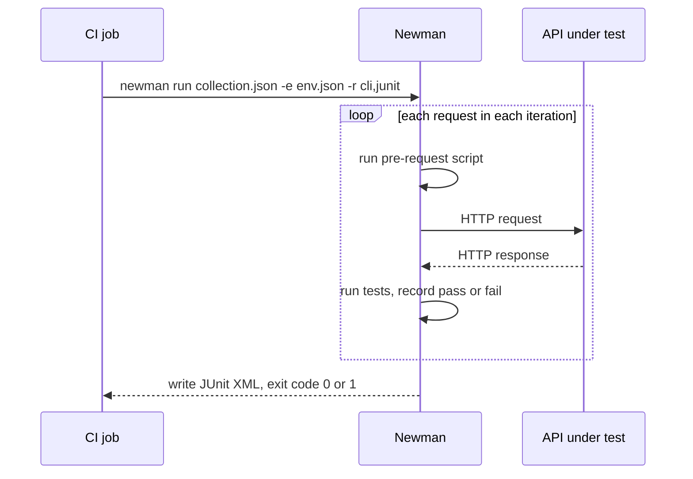

## Beginner-friendly explanation

If Postman is a music player you click through by hand, **Newman** is the same playlist played by a machine on a schedule, with a printed report afterwards. No screen, no clicking: you give it the playlist (the collection) and the settings (the environment), it plays everything and tells you what went wrong.

That matters because tests that only run when someone remembers to click "Run" don't protect anyone. Newman lets the build server run your API checks automatically on every change.

## Technical explanation

Newman is an open-source Node.js command-line runner for Postman collections, installed from npm:

```bash
npm install -g newman        # or as a project dev dependency
newman --version
```

### The core command

```bash
newman run collection.json -e env.json -r cli,junit \
  --reporter-junit-export results/newman-junit.xml
```

`newman run` accepts a collection file path or URL. Commonly used options:

| Option | Purpose |
|---|---|
| `-e, --environment <file>` | Environment file |
| `-g, --globals <file>` | Globals file |
| `-d, --iteration-data <file>` | CSV or JSON data; one iteration per row |
| `-n, --iteration-count <n>` | Number of iterations |
| `--folder <name>` | Run only a folder (repeatable) |
| `--env-var "key=value"` | Set or override an environment variable |
| `-r, --reporters <list>` | Reporters, e.g. `cli,junit,json` |
| `--reporter-junit-export <path>` | Where to write the JUnit XML |
| `--timeout-request <ms>` | Per-request timeout |
| `--delay-request <ms>` | Delay between requests |
| `--bail` | Stop on the first failure |
| `-k, --insecure` | Skip TLS verification (lab use only) |

Built-in reporters include `cli`, `json`, `junit` and `progress`. Additional reporters, such as HTML ones, are separate community npm packages installed alongside Newman.

### Exit codes

Newman exits with **0** when every request and assertion succeeds and **non-zero** when any fails. CI systems treat a non-zero exit as a failed step, which is what turns a collection into a quality gate.



## Real-world example

A team ran Newman nightly with `|| true` appended to the command because a flaky third-party sandbox occasionally failed. That made the step always green. For three weeks a real regression in their own refund endpoint went unnoticed, because nobody read the nightly log when the job was green.

They removed `|| true`, split the third-party checks into a separate, clearly-labelled folder run with `--folder`, and published the JUnit report so failures showed up in the CI test tab.

## Step-by-step walkthrough

1. **Export** the collection (v2.1) and environment from Postman, or keep them as JSON files in the repository.
2. **Check the environment export** contains shared values for everything non-secret, and empty placeholders for secrets.
3. **Run locally**: `newman run collection.json -e env.json`.
4. **Add reporters**: `-r cli,junit --reporter-junit-export results/junit.xml`.
5. **Add data**: `-d orders.csv` for data-driven iterations.
6. **Inject secrets** with `--env-var` from shell or CI variables.
7. **Check the exit code** with `echo $?` (bash) to confirm failures are detectable.

## Code examples

A data file and a data-driven run:

```text
sku,quantity,expectedStatus
BOOK-001,1,201
BOOK-001,0,422
UNKNOWN,1,422
```

```bash
newman run orders.postman_collection.json \
  -e lab.postman_environment.json \
  -d orders.csv \
  --folder "Create order" \
  --env-var "clientSecret=$CLIENT_SECRET" \
  -r cli,junit --reporter-junit-export results/orders-junit.xml
echo "exit code: $?"
```

In the request body use `{{sku}}` and `{{quantity}}`; in the test use `pm.response.to.have.status(Number(pm.iterationData.get("expectedStatus")))`.

## Expected output

The CLI reporter prints each request and assertion, then a summary table. Abridged, with one failing iteration:

```text
Iteration 3/3
→ Create order
  POST http://localhost:8080/orders [201 Created, 312B, 41ms]
  1. Status matches expectedStatus

┌─────────────────────────┬──────────┬──────────┐
│                         │ executed │   failed │
├─────────────────────────┼──────────┼──────────┤
│              assertions │        3 │        1 │
└─────────────────────────┴──────────┴──────────┘
  #  failure        detail
 1.  AssertionError Status matches expectedStatus
                    expected response to have status code 422 but got 201

exit code: 1
```

## Common mistakes

- **Swallowing the exit code** with `|| true` or `continue-on-error` without a deliberate reason.
- **Relying on current values** that never made it into the exported environment.
- **Committing secrets** in environment files.
- **Using `--insecure` outside a lab**, which hides certificate problems.
- **Running the whole collection when only a smoke folder is needed**, making pipelines slow.
- **Not publishing the JUnit report**, so failures are buried in logs.

## Troubleshooting

- **`ENOENT` for a file**: paths in form-data uploads are relative to the working directory; pass `--working-dir`.
- **`ECONNREFUSED`**: the API is not running or the base URL in the environment points elsewhere.
- **Self-signed certificate errors in a lab**: supply the CA with `--ssl-extra-ca-certs` or, in an isolated lab only, use `-k`.
- **Works in the app, fails in Newman**: compare variable values by logging them in a pre-request script.

## Key takeaways summary

Newman turns a Postman collection into an automated, repeatable check. Learn `newman run` with `-e`, `-d`, `--folder`, `--env-var` and `-r cli,junit`, trust the exit code, keep secrets out of files and publish reports, and your collections become a dependable gate in any pipeline.
