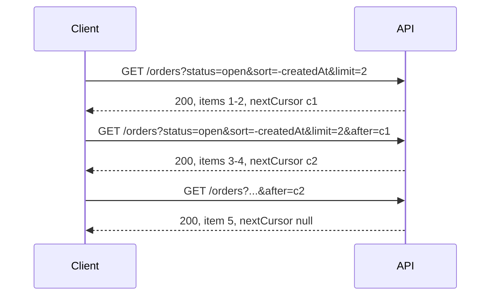

## Beginner-friendly explanation

A library catalogue doesn't print every book on one enormous page. It shows 20 results at a time with "next" and "previous" buttons, lets you sort by title or date, and lets you filter to "only available, only fiction".

Collection APIs do the same. **Pagination** splits big result lists into pages, **sorting** decides the order, and **filtering** narrows the results. Each is simple alone; together they create many ways to lose, duplicate or mis-order data. A tester's job is to make sure that, page after page, you get every matching item exactly once, in the right order.

## Technical explanation

### Pagination styles

| Style | Request | Pros | Cons |
|---|---|---|---|
| Offset/limit | `?offset=40&limit=20` | Simple; jump to any page | Deep offsets are slow; inserts/deletes cause duplicates/skips |
| Page number | `?page=3&size=20` | Familiar to users | Same as offset (it is offset in disguise) |
| Cursor (keyset) | `?limit=20&after=eyJpZCI6...` | Stable under changes; fast at depth | Sequential only; cursor must be opaque and validated |

Responses usually include metadata such as `total`, `hasMore` or a `nextCursor`, or a `Link` header (RFC 8288) with `rel="next"`, `rel="prev"`. Computing `total` can be expensive, so some APIs omit it; check what is documented.

### Sorting

`?sort=createdAt` or `?sort=-createdAt` (descending) or `?sort=price,asc`. Sorting must be **deterministic**: if two items share a sort value, the API must add a unique tiebreaker (usually the primary key). Otherwise the database may return ties in a different order on each query, and items move between pages.

### Filtering

`?status=open&minTotal=50&createdAfter=2026-01-01`. Check that filters combine with AND (or whatever is documented), that pagination applies **after** filtering, and that `total` reflects the filtered set. Unknown sort or filter fields must be rejected or ignored as documented and never inserted into a query unvalidated.



## Real-world example

A reporting integration exported invoices nightly by walking `/invoices?offset=N&limit=500`, sorted by `issuedDate`. Invoices issued on the same day had identical sort values. The database returned ties in different orders on different queries, so some invoices appeared on two pages and others on none. Finance noticed totals that didn't reconcile with the ledger.

The fix was to sort by `(issuedDate, id)` and, later, to move the export to cursor pagination. The regression test seeds many invoices with the same date, walks all pages, and asserts the union equals the expected set with no duplicates.

## Step-by-step walkthrough

1. **Read the contract**: style, default and maximum page size, sort fields, filter fields, metadata.
2. **Seed known data**: more than two pages, including ties on sort keys and records matching and not matching each filter.
3. **Walk all pages** and assert the union equals the expected filtered set, without duplicates.
4. **Check first, last and empty pages**, and requests beyond the end.
5. **Check limit boundaries**: 0, 1, max, max+1, negative, non-numeric, and the default when omitted.
6. **Check sort order** ascending and descending, with ties.
7. **Check filter combinations** and that `total` matches.
8. **Tamper with cursors** (truncate, edit, reuse an expired one) and expect a 4xx.
9. **Change data mid-walk** to observe consistency behaviour.

## Code examples

Walking a cursor-paginated collection with RestAssured and checking completeness and order:

```java
@Test
void allOpenOrdersReturnedOnceInOrder() {
    List<Map<String, Object>> all = new ArrayList<>();
    String cursor = null;
    int pages = 0;

    do {
        var spec = given().spec(req)
                .queryParam("status", "open")
                .queryParam("sort", "-createdAt")
                .queryParam("limit", 10);
        if (cursor != null) spec.queryParam("after", cursor);

        var page = spec.get("/orders").then().statusCode(200).extract().jsonPath();
        all.addAll(page.getList("items"));
        cursor = page.getString("nextCursor");
        assertTrue(++pages < 100, "pagination did not terminate");
    } while (cursor != null);

    List<Object> ids = all.stream().map(o -> o.get("id")).toList();
    assertEquals(new HashSet<>(ids).size(), ids.size(), "duplicates across pages");
    assertEquals(seededOpenOrderIds.size(), ids.size(), "missing items");
    assertTrue(all.stream().allMatch(o -> "open".equals(o.get("status"))));
}
```

## Expected output

For 25 seeded open orders and `limit=10`, a correct implementation returns three pages of 10, 10 and 5 items, the last with `"nextCursor": null`, and the test passes. A missing tiebreaker typically fails like this:

```text
org.opentest4j.AssertionFailedError: duplicates across pages ==> expected: <25> but was: <24>
```

## Common mistakes

- **Testing only page 1.** Most defects live at page boundaries and the last page.
- **Seeding data without ties**, so non-deterministic sorting is never exposed.
- **Ignoring the maximum page size**, which lets clients request millions of rows (OWASP API4:2023 Unrestricted Resource Consumption).
- **Decoding and relying on cursor contents** in tests; cursors are opaque.
- **Not checking that `total` and filters agree.**
- **Forgetting the default** page size and sort when parameters are omitted.

## Troubleshooting

- **Counts differ between runs**: other tests are creating data; filter by a run-specific tag.
- **Last page never ends**: `nextCursor` is returned even when no items remain; guard loops with a page cap, as above.
- **Slow deep pages**: offset pagination at high offsets; raise it as a performance risk.

## Key takeaways summary

Pagination, sorting and filtering must together return every matching item exactly once, in a deterministic order. Know offset versus cursor trade-offs, seed data with ties, walk all pages, test limits and invalid parameters, and verify filters and totals agree.
