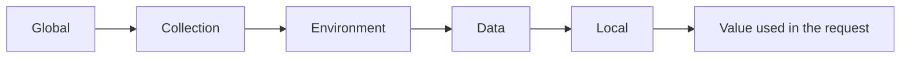

## Beginner-friendly explanation

Imagine a delivery driver's clipboard. It has a fixed list of stops in order (the **collection**) and a sheet saying which city today's route is in (the **environment**). The stops are the same whether the driver works in Pune or Leeds; only the city sheet changes.

**Postman** is a tool for sending and organising API requests. A **collection** is your saved, ordered list of requests. An **environment** is a set of values, such as which server to talk to and which test account to use, that you can swap in one click. Together they let you build requests once and run them anywhere.

## Technical explanation

### Collections

A collection is a container of requests, optionally organised in **folders**. At the collection and folder level you can define:

- **Authorization** settings that requests inherit (e.g. a bearer token variable),
- **Scripts** (pre-request and post-response/test scripts) that run for every request below,
- **Collection variables**,
- documentation for each request.

Collections can be exported as JSON (Collection Format v2.1) and run by the Collection Runner or by [Newman](/learn/api-testing/newman-command-line-runs).

### Environments

An environment is a named set of key-value pairs, for example `Local`, `Lab` and `Staging`. Only one environment is active at a time. Each variable has a value that can be shared with the team when synced (labelled "initial" or "shared" value depending on Postman version) and a **current value** that stays local to your session. Secrets should only ever be stored as current values or in Postman Vault, and variables can be given the *secret* type so they are masked in the UI.

### Variable scopes

Variables are referenced as `{{variableName}}` in URLs, headers, bodies and auth fields, and as `pm.variables.get("variableName")` in scripts.

| Scope (broadest → narrowest) | Lives in | Typical use |
|---|---|---|
| Global | Workspace | Rarely; quick experiments |
| Collection | The collection | Constants for this API, e.g. `apiVersion` |
| Environment | Selected environment | `baseUrl`, test accounts, credentials |
| Data | Iteration data file (CSV/JSON) | Data-driven runs |
| Local | One request or run | Temporary values set in scripts |

If the same name exists at several scopes, **the narrowest scope wins**.



## Real-world example

A QA team kept one collection per environment: "Orders API Local", "Orders API Staging" and so on. Each was a copy with hardcoded hosts. When a new required header was added, it was updated in two copies but not the third, and a release candidate was signed off against a collection that never sent the header.

The team merged everything into one collection using `{{baseUrl}}`, put host and accounts in environments, and set the required header at collection level. One change now applied everywhere.

## Step-by-step walkthrough

1. **Create a collection** named after the API, with folders per resource.
2. **Add a collection variable** `apiVersion` (e.g. `v1`).
3. **Create environments** `Local` and `Lab`, each with `baseUrl`, `username` and `password`.
4. **Write requests using variables**: `{{baseUrl}}/{{apiVersion}}/orders`.
5. **Set auth at collection level** (e.g. Bearer Token `{{accessToken}}`) and let requests inherit it.
6. **Select an environment** from the environment selector and send requests.
7. **Export** the collection and environments for Newman, checking exported environments contain no real secrets.

## Code examples

An excerpt of an exported environment file (Newman can consume this directly):

```json
{
  "name": "Lab",
  "values": [
    { "key": "baseUrl", "value": "http://localhost:8080", "enabled": true },
    { "key": "username", "value": "lab-user", "enabled": true },
    { "key": "password", "value": "", "type": "secret", "enabled": true }
  ]
}
```

A request in the collection then uses:

```text
GET {{baseUrl}}/{{apiVersion}}/orders?status=open
Authorization: Bearer {{accessToken}}
```

## Expected output

With `Lab` selected and `apiVersion` = `v1`, Postman's console (View → Show Postman Console) shows the resolved request:

```text
GET http://localhost:8080/v1/orders?status=open
200 OK
```

An unresolved variable shows up literally, e.g. `GET {{baseUrl}}/v1/orders`, which is the clue that the environment is not selected or the name is misspelt.

## Common mistakes

- **Duplicating collections per environment** instead of using variables.
- **Hardcoding tokens** in request headers, where they get exported and shared.
- **Putting secrets in shared values** that sync to the team workspace.
- **Overusing globals**, which makes runs depend on leftovers from earlier experiments.
- **Forgetting that the narrowest scope wins**, then debugging the wrong variable.
- **Not selecting an environment** before running.

## Troubleshooting

- **Variable highlighted red or sent literally**: it is undefined in every active scope; check spelling and the selected environment.
- **Value differs from what you set**: a narrower scope defines the same name; hover over the variable to see which scope it resolved from.
- **Teammates don't see your value**: you set the current value, which is not shared; update the shared value only if it is not a secret.

## Key takeaways summary

Collections organise requests and shared behaviour; environments hold everything that differs between targets. Learn the five variable scopes and the "narrowest wins" rule, reference values with `{{ }}`, and keep secrets local so the same collection can be shared, versioned and run in CI safely.
