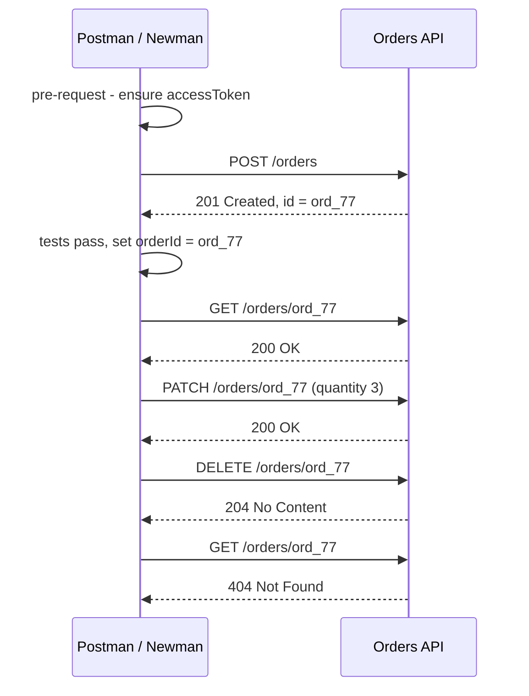

## Beginner-friendly explanation

Think of a relay race. The first runner can't just finish; they have to **hand the baton** to the next runner, who can't start without it. And at each handover a judge checks the baton was passed cleanly.

In API testing, many flows are relays. You **create** an order and get back its id; you need that id to **read**, **update** and **delete** it. Postman lets you write small scripts that act as the judge (checking each response) and as the hand-off (saving the id so the next request can use it). That is **request chaining**.

## Technical explanation

Postman runs JavaScript in a sandbox at two points per request (newer versions group them under a **Scripts** tab):

| Script | When it runs | Typical use |
|---|---|---|
| Pre-request | Before the request is sent | Get tokens, generate data, set timestamps |
| Post-response (Tests) | After the response arrives | Assertions, extract values for the next request |

Scripts can be attached to the collection, folder or request. For each request, Postman runs collection, then folder, then request scripts.

### Assertions

`pm.test(name, fn)` registers a named test. Inside it, `pm.expect(value)` is a Chai BDD assertion, and `pm.response.to...` offers response-specific shortcuts.

```javascript
pm.test("Status is 201", () => pm.response.to.have.status(201));
pm.test("Returns JSON", () => pm.response.to.be.json);
pm.test("Has Location header", () => pm.response.to.have.header("Location"));
pm.test("Responds within 800 ms", () => pm.expect(pm.response.responseTime).to.be.below(800));
```

### Storing values

| Call | Scope | Persists |
|---|---|---|
| `pm.environment.set(k, v)` | Active environment | Yes, in the environment's current value |
| `pm.collectionVariables.set(k, v)` | Collection | Yes, in current value |
| `pm.globals.set(k, v)` | Global | Yes |
| `pm.variables.set(k, v)` | Local | Only during this run |

`pm.variables.get(k)` reads a value using the normal scope resolution (narrowest wins).

### A chained flow



## Real-world example

A support-tools team chained "create ticket" and "close ticket" requests, but the extraction script ran even when creation failed. On a day the create endpoint returned `500`, `ticketId` kept its value from the previous day's run, and "close ticket" closed a real, unrelated test ticket another team was using. The report showed one failure in "create" and a pass in "close", which looked harmless.

The fix was to assert first and extract only if the status was correct, to clear `ticketId` at the start of each run, and to store run-specific ids as collection variables in a dedicated runner environment.

## Step-by-step walkthrough

1. **Add a collection-level pre-request script** to obtain a token if missing.
2. **Create request**: assert `201`, assert the body contains an id, then store it.
3. **Read request**: use `{{orderId}}`; assert `200` and that fields match what was created.
4. **Update request**: assert the change is reflected.
5. **Delete request**: assert `204`.
6. **Verify deletion**: assert `404`.
7. **Clean up variables** at the end with `pm.collectionVariables.unset("orderId")`.
8. **Run the folder** in the Collection Runner to check the chain works in order.

## Code examples

Post-response script on `POST /orders`, guarded so a failure can't leak a stale id:

```javascript
pm.test("Order created", () => {
    pm.response.to.have.status(201);
});

const body = pm.response.json();

pm.test("Body has an id and status open", () => {
    pm.expect(body.id, "id").to.be.a("string").and.not.empty;
    pm.expect(body.status).to.eql("open");
});

if (pm.response.code === 201 && body.id) {
    pm.collectionVariables.set("orderId", body.id);
} else {
    pm.collectionVariables.unset("orderId");
}
```

Collection-level pre-request script that refreshes a token using `pm.sendRequest`:

```javascript
const token = pm.environment.get("accessToken");
const expiresAt = Number(pm.environment.get("accessTokenExpiresAt") || 0);

if (!token || Date.now() > expiresAt - 30000) {
    pm.sendRequest({
        url: pm.environment.get("baseUrl") + "/oauth/token",
        method: "POST",
        header: { "Content-Type": "application/x-www-form-urlencoded" },
        body: {
            mode: "urlencoded",
            urlencoded: [
                { key: "grant_type", value: "client_credentials" },
                { key: "client_id", value: pm.environment.get("clientId") },
                { key: "client_secret", value: pm.environment.get("clientSecret") }
            ]
        }
    }, (err, res) => {
        if (err) { throw err; }
        const json = res.json();
        pm.environment.set("accessToken", json.access_token);
        pm.environment.set("accessTokenExpiresAt", Date.now() + json.expires_in * 1000);
    });
}
```

## Expected output

In the Collection Runner (or Newman CLI reporter) a healthy chain shows every test passing, for example:

```text
POST Create order      ✓ Order created  ✓ Body has an id and status open
GET  Read order        ✓ Status is 200  ✓ Matches created data
DELETE Delete order    ✓ Status is 204
GET  Verify deleted    ✓ Status is 404
```

## Common mistakes

- **Comparisons without assertions** inside `pm.test`; nothing throws, so nothing fails.
- **Extracting before asserting**, leaving stale or `undefined` ids.
- **Storing run data in globals**, so runs interfere with each other.
- **Assuming the response is JSON**; `pm.response.json()` throws on an HTML error page.
- **Making every request depend on the previous one** when only some need to; long chains make failures cascade.
- **Hardcoding secrets in scripts** instead of reading them from the environment.

## Troubleshooting

- **"JSONError: Unexpected token"**: the response isn't JSON; log `pm.response.text()` to see it.
- **Variable is set but the next request uses an old value**: a narrower scope holds the same name; use one scope consistently.
- **Token script runs but the request is still unauthorised**: check the request inherits auth from the collection and isn't overriding it.

## Key takeaways summary

Postman scripts turn requests into tests and flows. Assert with `pm.test` and `pm.expect`, extract values only after the assertions pass, store them in a deliberate scope, and use pre-request scripts for tokens, so chained requests stay reliable whether you run them in the app or in Newman.
