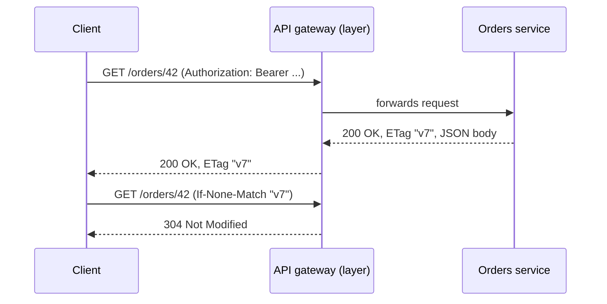

## Beginner-friendly explanation

Imagine a well-run library. Every book has a **shelf address**. You don't shout "fetch-me-the-red-book!"; you go to the address and do something to the thing that lives there: **read** it, **return** it, **reserve** it. The library doesn't remember your previous visit; you bring your library card every time.

**REST** applies that idea to web APIs. Things (customers, orders, invoices) are **resources**, each with an address (a **URI**). You act on them with a small set of standard verbs (HTTP methods), and every request carries everything the server needs, including your "library card" (a token).

## Technical explanation

REST (Representational State Transfer) is an architectural style described by Roy Fielding in chapter 5 of his 2000 doctoral dissertation. It is defined by constraints:

| Constraint | Meaning | What a tester can observe |
|---|---|---|
| Client-server | UI and data storage concerns are separated | API usable by any client |
| Stateless | Each request contains all context needed to process it | Token sent on every call; no hidden session dependence |
| Cacheable | Responses label themselves as cacheable or not | `Cache-Control`, `ETag`, `304 Not Modified` |
| Uniform interface | Standard way to identify and manipulate resources | Consistent URIs, methods, media types, links |
| Layered system | Client can't tell if it talks to the origin or an intermediary | Gateways, proxies, CDNs behave transparently |
| Code-on-demand (optional) | Server may send executable code | Rare in APIs |

The **uniform interface** has four sub-constraints: identification of resources, manipulation through representations, self-descriptive messages, and hypermedia as the engine of application state (HATEOAS).

### Resources, URIs and representations

A **resource** is any named concept; a **representation** is a snapshot of its state in a media type such as `application/json`. Conventional resource-oriented design (common practice, not part of Fielding's text) looks like this:

| Operation | Method and URI | Typical success |
|---|---|---|
| List | `GET /orders` | 200 |
| Read one | `GET /orders/42` | 200 |
| Create | `POST /orders` | 201 + `Location` |
| Replace | `PUT /orders/42` | 200 or 204 |
| Partial update | `PATCH /orders/42` | 200 or 204 |
| Delete | `DELETE /orders/42` | 204 |
| Sub-resource | `GET /orders/42/items` | 200 |

Use plural nouns, keep verbs in the method, and use query parameters for filtering and paging (`/orders?status=open&limit=20`).



## Real-world example

An internal HR platform exposed endpoints such as `GET /employee/delete?id=17`. A link-checking tool that crawled the internal documentation followed every GET link it found, including example links, and deleted test employees in a shared staging environment. The incident was harmless only because it was staging.

A tester reviewing the design would have flagged it immediately: GET must be safe. The team moved to `DELETE /employees/17` with authorization checks and added tests asserting that GET requests never change state.

## Step-by-step walkthrough

1. **Inventory resources.** List every noun the API exposes and its URI pattern.
2. **Check naming consistency.** Plural nouns, consistent casing, no verbs, predictable nesting.
3. **Check method semantics.** GET never changes state; PUT and DELETE are idempotent; POST creates or processes.
4. **Check statelessness.** Send the same request from a fresh client with only the token; it should behave identically.
5. **Check cacheability.** Look for `Cache-Control` and `ETag`, and test conditional requests return `304`.
6. **Check consistency of errors and status codes** across all resources.

## Code examples

A quick statelessness and caching check with `curl`:

```bash
TOKEN="paste-a-test-token-here"

# First read: capture the ETag
curl -i http://localhost:8080/orders/42 -H "Authorization: Bearer $TOKEN"

# Conditional read with the ETag you received
curl -i http://localhost:8080/orders/42 \
  -H "Authorization: Bearer $TOKEN" \
  -H 'If-None-Match: "v7"'
```

## Expected output

If the API supports conditional requests:

```text
HTTP/1.1 200 OK
ETag: "v7"
Cache-Control: private, max-age=0
...JSON body...

HTTP/1.1 304 Not Modified
ETag: "v7"
```

If the second call returns `200` with a full body, the API simply doesn't implement ETags. That is a design gap worth noting, not necessarily a defect.

## Common mistakes

- **Calling any JSON-over-HTTP API "REST".** Many are RPC-style; that is fine, but test them against their own contract.
- **Verbs in URIs** (`/createUser`) and **state changes on GET**.
- **Hidden server sessions** that make test order matter, breaking statelessness.
- **Inconsistent pluralisation and casing** (`/user/1` beside `/orders/1`, `orderId` beside `order_id`).
- **Assuming REST requires JSON.** REST is media-type agnostic.
- **Expecting full HATEOAS everywhere.** Most real APIs don't implement it; test what is documented.

## Troubleshooting

- **Tests pass alone but fail in a suite**: look for server-side session state or shared data; each request should stand alone.
- **Stale data after an update**: check caching headers and any intermediary caches (the layered-system constraint at work).

## Key takeaways summary

REST gives you a vocabulary for judging an API's design: resources with stable URIs, standard methods with known semantics, self-describing messages and stateless requests. Use it to find design defects early, then verify each endpoint behaves as that design promises.
