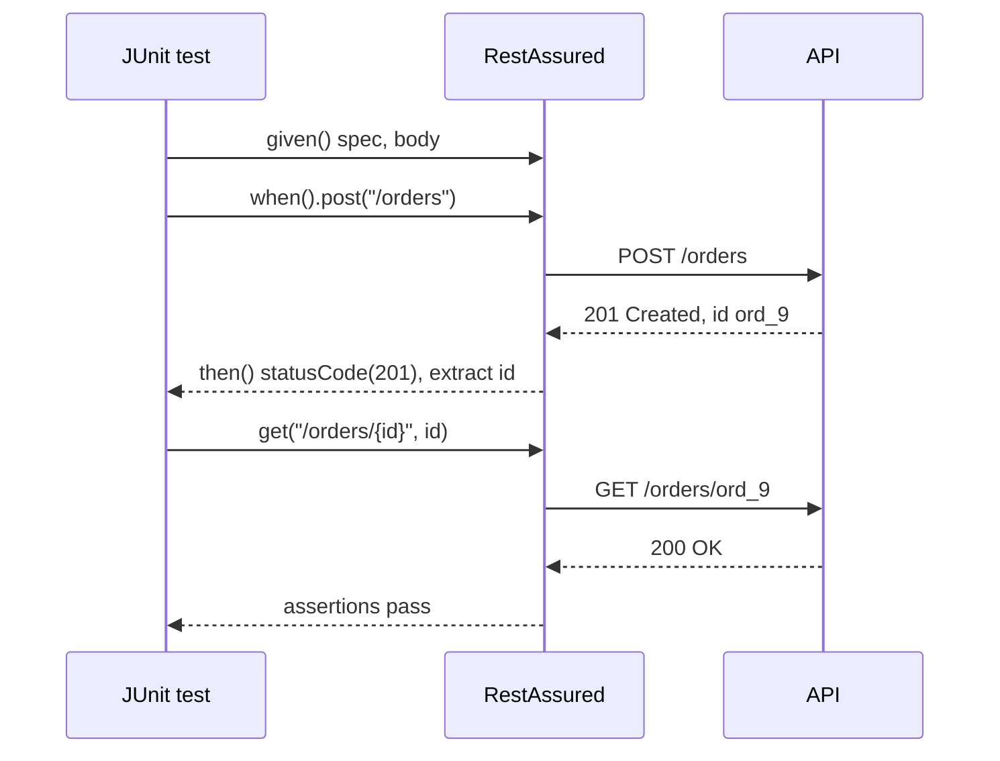

## Beginner-friendly explanation

Writing an API test by hand in Java means opening connections, setting headers, reading streams and parsing JSON before you can check anything. That is like writing a letter by first making your own paper.

**RestAssured** is a library that hands you the paper and an envelope. You describe what you want in near-English: **given** these headers and this body, **when** I POST to `/orders`, **then** the status should be 201 and the id should not be null. The library does the plumbing so your test reads like the requirement it checks.

## Technical explanation

RestAssured is an open-source Java DSL for testing HTTP APIs. It integrates with any test runner (JUnit 5, TestNG) and uses Hamcrest matchers for assertions. Add it with Maven:

```xml
<dependency>
  <groupId>io.rest-assured</groupId>
  <artifactId>rest-assured</artifactId>
  <version>5.5.0</version>
  <scope>test</scope>
</dependency>
```

Check the official site for the current version; the API shown here is stable across 5.x.

### The three parts

| Part | Returns | Typical calls |
|---|---|---|
| `given()` | `RequestSpecification` | `baseUri`, `header`, `contentType`, `auth`, `queryParam`, `pathParam`, `body`, `spec`, `log` |
| `when()` | request sender | `get`, `post`, `put`, `patch`, `delete` |
| `then()` | `ValidatableResponse` | `statusCode`, `header`, `contentType`, `body`, `time`, `spec`, `extract` |

### Body assertions

`body(path, matcher)` evaluates a **GPath** expression (Groovy's path syntax) against the parsed JSON or XML, then applies a Hamcrest matcher:

```java
.body("id", notNullValue())
.body("status", equalTo("open"))
.body("items.sku", hasItems("BOOK-001"))
.body("items.size()", equalTo(2))
.body("items.find { it.sku == 'BOOK-001' }.quantity", equalTo(1))
```

### Extraction

`then().extract()` pulls values out: `.path("id")` for one value, `.as(Order.class)` to deserialise (needs Jackson or Gson on the classpath), or `.response()` for the whole response.



## Real-world example

A logistics team had 120 RestAssured tests, each starting with a copied block that set the base URI, content type and a bearer token. When the API moved behind a gateway that required a new `X-Client-Id` header, half the tests were updated and the rest failed in confusing ways for a week.

Introducing one `RequestSpecification` built in a base class, and one `ResponseSpecification` asserting JSON content type and a response-time ceiling, reduced each test to its unique parts. The next header change was a one-line edit.

## Step-by-step walkthrough

1. **Add dependencies**: `rest-assured`, a test runner, and `json-schema-validator` if you will validate schemas.
2. **Use static imports** for `io.restassured.RestAssured.*` and `org.hamcrest.Matchers.*`.
3. **Build a request spec** with base URI, content type, auth and failure logging.
4. **Build a response spec** for checks every response must pass.
5. **Write one test per behaviour**: status, then headers, then body.
6. **Extract and chain** only after asserting.
7. **Run** with `mvn test` and read the report.

## Code examples

```java
import static io.restassured.RestAssured.given;
import static org.hamcrest.Matchers.*;

import io.restassured.builder.RequestSpecBuilder;
import io.restassured.builder.ResponseSpecBuilder;
import io.restassured.filter.log.LogDetail;
import io.restassured.http.ContentType;
import io.restassured.specification.RequestSpecification;
import io.restassured.specification.ResponseSpecification;
import org.junit.jupiter.api.BeforeAll;
import org.junit.jupiter.api.Test;
import java.util.Map;

class OrdersApiTest {

    static RequestSpecification req;
    static ResponseSpecification json;

    @BeforeAll
    static void setUp() {
        req = new RequestSpecBuilder()
                .setBaseUri(System.getProperty("baseUri", "http://localhost:8080"))
                .setContentType(ContentType.JSON)
                .addHeader("Authorization", "Bearer " + System.getenv("API_TOKEN"))
                .log(LogDetail.ALL)
                .build();
        json = new ResponseSpecBuilder()
                .expectContentType(ContentType.JSON)
                .expectResponseTime(lessThan(2000L))
                .build();
    }

    @Test
    void createdOrderCanBeReadBack() {
        String id =
            given().spec(req).body(Map.of("sku", "BOOK-001", "quantity", 1))
            .when().post("/orders")
            .then().spec(json).statusCode(201)
                   .header("Location", containsString("/orders/"))
                   .body("id", notNullValue())
                   .extract().path("id");

        given().spec(req)
        .when().get("/orders/{id}", id)
        .then().spec(json).statusCode(200)
               .body("id", equalTo(id))
               .body("sku", equalTo("BOOK-001"))
               .body("quantity", equalTo(1));
    }
}
```

`LogDetail.ALL` in a spec logs every request; in a large suite prefer `RestAssured.enableLoggingOfRequestAndResponseIfValidationFails()` and add `Authorization` to the blacklisted headers via `LogConfig`.

## Expected output

`mvn test` against a correct API prints a Surefire summary like:

```text
[INFO] Tests run: 1, Failures: 0, Errors: 0, Skipped: 0
[INFO] BUILD SUCCESS
```

If the read returns the wrong quantity, the failure is precise:

```text
java.lang.AssertionError: 1 expectation failed.
JSON path quantity doesn't match.
Expected: <1>
  Actual: <2>
```

## Common mistakes

- **Extracting without asserting**, so failures surface in a later call.
- **Copying setup into every test** instead of using specifications.
- **Asserting floats with `equalTo(19.99)`** when RestAssured returns a `Float`; use `19.99f`, a tolerance, or configure `BigDecimal`.
- **Logging everything always**, which floods CI and can leak tokens.
- **Hardcoding base URIs and tokens**; read them from system properties or environment variables.
- **One giant test** that checks every field of every endpoint, making failures hard to read.

## Troubleshooting

- **`Connection refused`**: wrong base URI or port, or the service isn't running.
- **`Cannot deserialize`**: add Jackson or Gson to the classpath, or match field names.
- **Matcher type mismatch** (`Expected: <1L>, Actual: <1>`): JSON integers are returned as `Integer`; match the type.
- **Path returns null**: the response is wrapped (e.g. in `data`) or the field name differs in case.

## Key takeaways summary

RestAssured makes Java API tests read like specifications: given a request, when it is sent, then the response must match. Use GPath with Hamcrest for precise body checks, assert before extracting, and centralise configuration in request and response specifications so the suite stays readable as it grows.
