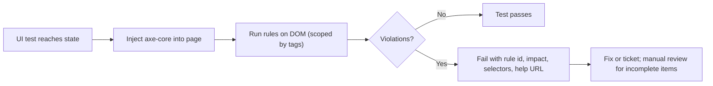

## Beginner-friendly explanation

A building inspector carries tools: a tape measure for door widths, a level for ramp slopes. These tools quickly prove some rules are broken. But no tape measure can tell whether the signs make sense to a visitor or whether a wheelchair user can actually find the lift. The inspector still has to walk through the building.

**Accessibility automation** gives your tests a tape measure for websites. A tool like **axe-core** scans the page and flags problems such as text that is too faint, buttons with no name for screen readers, or form fields with no label. It is fast and runs on every build. But it cannot judge everything, so people still test with a keyboard and a screen reader.

## Technical explanation

### Standards

The **Web Content Accessibility Guidelines (WCAG)**, published by the W3C, define testable success criteria at levels A, AA and AAA. WCAG 2.2 is the current W3C Recommendation; many laws and policies reference level AA.

### axe-core

**axe-core** is an open-source JavaScript rules engine by Deque. It runs inside the page, inspects the DOM and computed styles, and returns:

- `violations`: rules that failed, each with `id`, `impact`, `help`, `helpUrl`, `tags` and `nodes` (target selectors and HTML).
- `passes`, `incomplete` (needs human review) and `inapplicable`.

Rules are tagged, for example `wcag2a`, `wcag2aa`, `wcag21aa`, `wcag22aa` and `best-practice`, so you can scope scans.

### Integrations

| Tool | Package |
|---|---|
| Playwright | `@axe-core/playwright` (`AxeBuilder`) |
| Selenium (Java) | `com.deque.html.axe-core:selenium` (`AxeBuilder`) |
| WebdriverIO | `@axe-core/webdriverio` |
| Cypress | community plugin `cypress-axe` (`cy.injectAxe`, `cy.checkA11y`) |
| Command line / CI | `@axe-core/cli`, Lighthouse accessibility audit |



## Real-world example

A public-sector services portal had to meet WCAG AA. The team added axe scans to Playwright tests for its ten most-used pages, scoped to WCAG A and AA tags. The first run reported mostly contrast problems in the design system's grey text and unlabeled icon buttons. Fixing those in shared components cleared the violations on every page at once. Monthly manual audits with keyboard and screen readers continued, and found issues like a confusing focus order in a multi-step form that no automated rule could flag.

## Step-by-step walkthrough

1. Choose critical pages and states: home, login, forms, checkout, open dialogs.
2. Install the axe integration for your framework.
3. Scan after the page reaches the state you care about.
4. Scope to the WCAG level your organisation targets.
5. Print violations in a readable format and fail the test if any exist.
6. For known issues, exclude a specific selector or rule with a ticket reference, never globally.
7. Review `incomplete` results manually and schedule keyboard and screen reader testing.

## Code examples

Playwright with TypeScript:

```typescript
import { test, expect } from '@playwright/test';
import AxeBuilder from '@axe-core/playwright';

test('login page has no WCAG A/AA violations', async ({ page }) => {
  await page.goto('/login');
  await expect(page.getByRole('heading', { name: 'Sign in' })).toBeVisible();

  const results = await new AxeBuilder({ page })
    .withTags(['wcag2a', 'wcag2aa', 'wcag21a', 'wcag21aa'])
    .analyze();

  expect(results.violations).toEqual([]);
});

test('account menu is accessible when open', async ({ page }) => {
  await page.goto('/home');
  await page.getByRole('button', { name: 'Account' }).click();

  const results = await new AxeBuilder({ page })
    .include('#account-menu')
    .analyze();

  expect(results.violations).toEqual([]);
});
```

Cypress with `cypress-axe`:

```javascript
// cypress/support/e2e.js
import 'cypress-axe';

// cypress/e2e/a11y.cy.js
it('home page has no detectable a11y violations', () => {
  cy.visit('/');
  cy.injectAxe();
  cy.checkA11y(null, { runOnly: { type: 'tag', values: ['wcag2a', 'wcag2aa'] } });
});
```

Selenium Java with `axe-core/selenium`:

```java
Results results = new AxeBuilder()
    .withTags(List.of("wcag2a", "wcag2aa"))
    .analyze(driver);
Assert.assertTrue(results.violationFree(), results.getViolations().toString());
```

## Expected output

A failing Playwright assertion shows each violation, for example (shortened):

```text
- Expected  - 0
+ Received  + 12

+   Object {
+     "id": "color-contrast",
+     "impact": "serious",
+     "help": "Elements must meet minimum color contrast ratio thresholds",
+     "nodes": Array [ { "target": Array [ ".hint-text" ] } ],
+   },
```

## Common mistakes

- **Treating zero violations as "accessible"**.
- **Scanning only on page load**, missing modals, menus and error messages.
- **Disabling rules globally** to make the build green.
- **Including `best-practice` rules** in a hard gate without agreeing on them.
- **Ignoring `incomplete` results**, which need a human decision.
- **Fixing symptoms page by page** instead of in shared components.

## Troubleshooting

- **Too many violations to fix at once**: gate on new violations or on `critical` and `serious` impact first, and track the backlog.
- **Contrast false positives on gradients or images**: axe reports these as incomplete when it cannot compute; check manually.
- **Scan results differ between runs**: the page was still loading; wait for a stable state before scanning.
- **Iframes not scanned**: confirm your integration supports frames and that they are same-origin or allowed.

## Key takeaways summary

Automated accessibility checks are cheap, fast and catch a valuable share of WCAG issues on every build. Scan meaningful states with axe-core, scope to your WCAG level, fix problems in shared components, and keep manual keyboard and screen reader testing as part of the definition of done.
