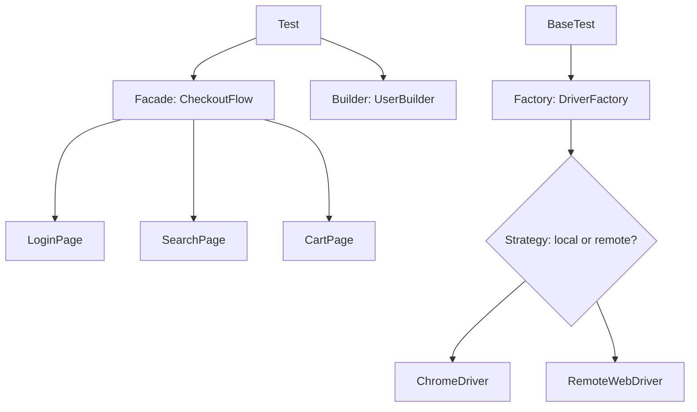

## Beginner-friendly explanation

Builders do not invent a new way to make a door every time. They use well-known designs: hinged doors, sliding doors, revolving doors. Each design solves a known problem, and anyone on the team understands it by name.

**Design patterns** are the same for code: named, proven solutions to problems that keep coming back. In test automation the recurring problems are "how do I create the right browser?", "how do I build test data without 20-argument constructors?", and "how do I stop tests repeating the same ten steps?". Knowing the patterns lets you solve these cleanly and explain your framework in interviews.

## Technical explanation

| Pattern | Problem in test code | Typical use |
|---|---|---|
| Page Object | UI locators duplicated across tests | One class per page or component |
| Factory | Choosing which object to create | `DriverFactory.create("firefox")` |
| Builder | Objects with many optional fields | Test data such as users and orders |
| Singleton | Exactly one instance of something | Read-only config; avoid for drivers |
| Strategy | Swapping an algorithm at runtime | Local vs remote execution, wait policies |
| Facade | Many steps for one business action | `CheckoutFlow.placeOrder(...)` |
| Decorator | Adding behaviour around calls | Logging every click |
| Screenplay | Large suites with many roles | Actors, abilities, tasks, questions |

Selenium supports the decorator idea natively with `WebDriverListener` and `EventFiringDecorator` in Selenium 4.



### Screenplay in brief

An **Actor** has **Abilities** (BrowseTheWeb, CallAnApi), performs **Tasks** made of **Interactions**, and asks **Questions**. Serenity BDD provides an implementation for Java; Playwright and other ecosystems have community versions.

## Real-world example

An insurance team's framework had a 600-line `BaseTest` with `if (browser.equals("chrome"))` blocks, and tests built quote data through constructors with twelve positional arguments. They introduced a `DriverFactory`, a `QuoteBuilder` with defaults, and a `QuoteFlow` facade. New tests shrank to a few lines, and adding Edge support meant one new case in the factory rather than editing every base class.

## Step-by-step walkthrough

1. Find duplication or painful change points in your framework.
2. Name the problem: creation, configuration, repeated flow, data construction.
3. Pick the simplest pattern that addresses it.
4. Refactor one area and keep tests green.
5. Document the pattern in the framework README so new members recognise it.

## Code examples

```java
public final class DriverFactory {
    public static WebDriver create(String browser, String gridUrl) {
        boolean remote = gridUrl != null && !gridUrl.isBlank();
        switch (browser.toLowerCase()) {
            case "firefox": {
                FirefoxOptions o = new FirefoxOptions();
                return remote ? remote(gridUrl, o) : new FirefoxDriver(o);
            }
            case "chrome":
            default: {
                ChromeOptions o = new ChromeOptions();
                return remote ? remote(gridUrl, o) : new ChromeDriver(o);
            }
        }
    }

    private static WebDriver remote(String url, Capabilities caps) {
        try {
            return new RemoteWebDriver(new URL(url), caps);
        } catch (MalformedURLException e) {
            throw new IllegalArgumentException("Bad grid URL", e);
        }
    }
}
```

```java
public record User(String name, String email, String country) {}

public class UserBuilder {
    private String name = "Test User";
    private String email = "user+" + UUID.randomUUID() + "@example.test";
    private String country = "US";

    public UserBuilder name(String v)    { this.name = v; return this; }
    public UserBuilder country(String v) { this.country = v; return this; }
    public User build() { return new User(name, email, country); }
}
```

```java
public class CheckoutFlow {
    private final WebDriver driver;
    public CheckoutFlow(WebDriver driver) { this.driver = driver; }

    public PaymentPage reachPaymentAs(User user, String product) {
        return new LoginPage(driver).open(Config.BASE_URL)
            .loginAs(user.email(), Secrets.passwordFor(user))
            .search(product)
            .addFirstResultToCart()
            .openCart()
            .checkout();
    }
}
```

## Expected output

A test using these pieces reads like a specification:

```java
User indian = new UserBuilder().country("IN").build();
PaymentPage pay = new CheckoutFlow(driver).reachPaymentAs(indian, "Desk lamp");
Assert.assertTrue(pay.offersMethod("UPI"));
```

## Common mistakes

- **Pattern hunting**: adding patterns with no problem to solve.
- **Static Singleton driver**, breaking parallel execution.
- **Facades that assert**, hiding expectations from tests.
- **Builders without defaults**, which are just constructors with extra steps.
- **Deep inheritance** chains instead of composition.
- **Utility classes full of static methods** that quietly hold state.

## Troubleshooting

- **Factory keeps growing `if` branches**: move options into configuration or separate small factories per platform.
- **Hard to tell where a step lives**: keep a consistent layering: tests call flows, flows call pages, pages call WebDriver.
- **Screenplay feels heavy**: it may be more structure than the suite needs; page objects plus facades are fine.

## Key takeaways summary

Design patterns give names to good structure. Factory and Strategy tame driver creation, Builder makes data readable, Facade removes repeated flows, and Page Object or Screenplay organise UI interactions. Choose patterns because they solve a real problem, and keep them parallel-safe.
