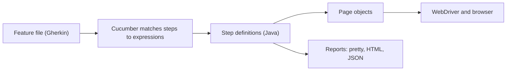

## Beginner-friendly explanation

Imagine three friends planning a holiday. If one says "somewhere warm", another hears "Goa" and the third hears "Dubai". They only agree once someone gives **concrete examples**: "a beach, under 30 °C, a direct flight under four hours".

Software teams have the same problem with requirements. **Behaviour-Driven Development (BDD)** asks the business person, the developer and the tester to agree on concrete examples *before* building — for example, "Given Asha has ₹500 in her wallet, when she buys a ₹200 ticket, then her balance is ₹300".

**Cucumber** is a tool that takes those examples, written in a plain-English format called **Gherkin**, and runs them as automated tests. The examples become living documentation that is checked on every build.

## Technical explanation

### Gherkin

A `.feature` file contains a `Feature`, optional `Background` steps, and `Scenario`s made of steps that start with `Given`, `When`, `Then`, `And` or `But`. Other elements:

- **Scenario Outline** with an **Examples** table, for data-driven scenarios.
- **Tags** (`@smoke`, `@checkout`) for selection and hooks.
- **Data tables** and **doc strings** for structured step arguments.
- `Rule` (Gherkin 6+) to group scenarios under a business rule.

Keywords do not affect matching; they exist for readability.

### Cucumber JVM 7

- **Step definitions** are methods annotated with `io.cucumber.java.en.Given`, `When`, `Then`.
- **Cucumber expressions** match steps with parameter types: `{string}` (quoted text), `{int}`, `{float}`, `{word}`; regular expressions are also supported.
- **Hooks**: `io.cucumber.java.Before` and `After` (optionally filtered by tag), `BeforeStep`, `AfterStep`. An `@After` hook receiving a `Scenario` can attach a screenshot with `scenario.attach(bytes, "image/png", name)`.
- **Dependency injection** with `cucumber-picocontainer` (or Spring, Guice) shares a per-scenario context across step classes.
- **Runners**: extend `AbstractTestNGCucumberTests` with `@CucumberOptions`, or use the JUnit Platform engine (`cucumber-junit-platform-engine`) with `@Suite`.



## Real-world example

An insurance claims team adopted Cucumber but wrote steps such as "When I click the element with id btnNext". Product owners stopped reading the features within weeks, and every UI change broke dozens of steps. In a reset, the team held short example-mapping sessions per story, rewrote scenarios declaratively ("When Ravi submits a claim for a cracked windscreen"), and moved all UI detail into page objects. Features became short enough for the product owner to approve during refinement, and the step library shrank because declarative steps were reusable.

## Step-by-step walkthrough

1. **Discuss the story** with business and development; capture rules and concrete examples.
2. **Write scenarios** in business language, one behaviour each.
3. **Add dependencies**: `cucumber-java`, a runner (`cucumber-testng` or `cucumber-junit-platform-engine`) and `cucumber-picocontainer`.
4. **Run once** to see undefined steps and suggested snippets.
5. **Implement step definitions** that delegate to page objects.
6. **Add hooks** for driver lifecycle and screenshots on failure.
7. **Tag and run** subsets in CI.

## Code examples

```gherkin
@checkout
Feature: Applying coupons at checkout

  Background:
    Given Asha has a "Notebook" priced at 500 in her cart

  @smoke
  Scenario: A valid coupon reduces the total
    When she applies the coupon "SAVE10"
    Then the order total is 450

  Scenario Outline: Coupons that cannot be used
    When she applies the coupon "<code>"
    Then she sees the message "<message>"

    Examples:
      | code     | message                  |
      | EXPIRED5 | This coupon has expired  |
      | BOGUS    | This coupon is not valid |
```

```java
import io.cucumber.java.After;
import io.cucumber.java.Scenario;
import io.cucumber.java.en.Given;
import io.cucumber.java.en.Then;
import io.cucumber.java.en.When;
import org.openqa.selenium.OutputType;
import org.openqa.selenium.TakesScreenshot;
import static org.testng.Assert.assertEquals;

public class CheckoutSteps {
    private final TestContext context;   // injected by PicoContainer, one per scenario

    public CheckoutSteps(TestContext context) { this.context = context; }

    @Given("Asha has a {string} priced at {int} in her cart")
    public void cartContains(String product, int price) {
        context.api().seedCart("asha", product, price);
        context.cartPage().open();
    }

    @When("she applies the coupon {string}")
    public void appliesCoupon(String code) {
        context.lastMessage(context.cartPage().applyCoupon(code));
    }

    @Then("the order total is {int}")
    public void totalIs(int expected) {
        assertEquals(context.cartPage().total(), expected);
    }

    @Then("she sees the message {string}")
    public void seesMessage(String expected) {
        assertEquals(context.lastMessage(), expected);
    }

    @After
    public void screenshotOnFailure(Scenario scenario) {
        if (scenario.isFailed()) {
            byte[] png = ((TakesScreenshot) context.driver()).getScreenshotAs(OutputType.BYTES);
            scenario.attach(png, "image/png", scenario.getName());
        }
        context.quitDriver();
    }
}
```

```java
import io.cucumber.testng.AbstractTestNGCucumberTests;
import io.cucumber.testng.CucumberOptions;

@CucumberOptions(
    features = "src/test/resources/features",
    glue = "com.shop.steps",
    tags = "@checkout and not @wip",
    plugin = {"pretty", "html:target/cucumber-report.html"})
public class RunCucumberTest extends AbstractTestNGCucumberTests { }
```

## Expected output

Illustrative `pretty` plugin output (abbreviated):

```text
Scenario: A valid coupon reduces the total   # features/checkout.feature:8
  Given Asha has a "Notebook" priced at 500 in her cart
  When she applies the coupon "SAVE10"
  Then the order total is 450

3 Scenarios (3 passed)
9 Steps (9 passed)
0m21.448s
```

## Common mistakes

- **Treating Cucumber as BDD** without any collaboration on examples.
- **Imperative, UI-level steps** with locators, clicks and waits.
- **Very long scenarios** that test many behaviours at once.
- **Static state** shared between step classes, which leaks across scenarios and breaks parallel runs.
- **Duplicated step definitions** with slightly different wording; Cucumber reports ambiguous matches.
- **Using Cucumber for purely technical tests** that no business reader will ever look at.

## Troubleshooting

- **Undefined steps**: wrong `glue` package, or the expression does not match (quoted versus unquoted parameters).
- **`AmbiguousStepDefinitionsException`**: two expressions match one step; make them distinct.
- **Hooks not running**: imported from the wrong package; use `io.cucumber.java.Before`, not JUnit's or TestNG's.
- **No scenarios found**: check the `features` path and tag expression syntax.

## Key takeaways summary

BDD is a conversation that produces examples; Cucumber turns those examples into executable specifications. Keep Gherkin declarative, push UI mechanics into page objects, share state through dependency injection, and use tags and hooks for control. Done this way, feature files stay readable for the business and cheap to maintain for engineers.
