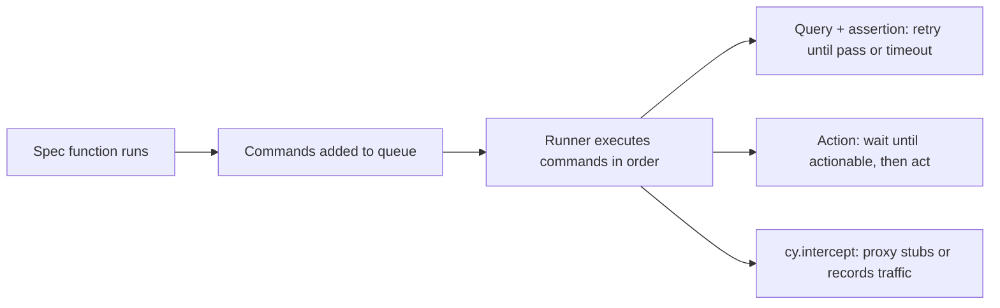

## Beginner-friendly explanation

Most automation tools are like a remote control: they sit outside the TV and send button presses through a cable. **Cypress** is more like someone sitting inside the TV, right next to the picture. Because it runs inside the browser alongside your web app, it can see everything immediately, record each step, and let you "rewind" to see what the page looked like at any moment.

There is one surprising rule for beginners: when you write a Cypress command, it does not happen straight away. Cypress writes it on a to-do list, then works through the list in order. Once you understand that, the rest of Cypress feels natural.

## Technical explanation

### Architecture

The Cypress app launches a browser and runs your spec code in the same run loop as the application under test, with a Node.js process behind it for tasks such as file access and network proxying. Supported browsers are Chrome-family (Chrome, Chromium, Edge, Electron), Firefox, and experimental WebKit.

### The command queue

`cy.*` calls enqueue commands and return a **chainable**, not a value. Commands run serially after the test function returns. Use `.then()` to work with yielded values, and aliases (`.as('name')`) to reuse them.

### Retry-ability

**Queries** (`get`, `find`, `contains`, `its`, ...) re-run with their chained `.should()` assertions until they pass or `defaultCommandTimeout` (4 seconds) expires. **Actions** (`click`, `type`) wait for actionability but are not themselves retried. **Non-query commands** like `cy.request` are not retried.

### Network control

`cy.intercept()` spies on or stubs HTTP requests made by the app. Combined with `cy.wait('@alias')`, it waits for a specific request rather than for an arbitrary time.



## Real-world example

A front-end team building a single-page booking app wanted developers to write UI tests themselves. Cypress fitted because the team already worked in JavaScript, the interactive runner showed each step with snapshots, and `cy.intercept` let them test error states like "no rooms available" without seeding a database. They kept a small suite of separate API tests for back-end behaviour and used Cypress for UI flows only.

## Step-by-step walkthrough

1. In a Node.js project run `npm install cypress --save-dev`.
2. Run `npx cypress open`, choose E2E Testing, and let Cypress scaffold `cypress.config.js` and a support folder.
3. Set `baseUrl` in the config.
4. Add `data-cy` attributes to the elements your tests use.
5. Write a spec in `cypress/e2e/`.
6. Run headlessly in CI with `npx cypress run`.

## Code examples

```javascript
// cypress.config.js
const { defineConfig } = require('cypress');

module.exports = defineConfig({
  e2e: {
    baseUrl: 'http://localhost:3000',
  },
});
```

```javascript
// cypress/e2e/login.cy.js
describe('login', () => {
  beforeEach(() => {
    cy.visit('/login');
  });

  it('valid user reaches the dashboard', () => {
    cy.get('[data-cy=email]').type('demo@example.test');
    cy.get('[data-cy=password]').type(Cypress.env('DEMO_PASSWORD'), { log: false });
    cy.get('[data-cy=submit]').click();

    cy.location('pathname').should('eq', '/dashboard');
    cy.contains('h1', 'Welcome').should('be.visible');
  });

  it('shows an empty state when there are no orders', () => {
    cy.intercept('GET', '/api/orders', { statusCode: 200, body: [] }).as('orders');
    cy.visit('/orders');
    cy.wait('@orders');
    cy.get('[data-cy=empty-orders]').should('have.text', 'No orders yet');
  });
});
```

Working with a value through `.then()`:

```javascript
cy.get('[data-cy=total]').invoke('text').then((text) => {
  const amount = Number(text.replace(/[^0-9.]/g, ''));
  expect(amount).to.be.greaterThan(0);
});
```

A reusable custom command in `cypress/support/commands.js`:

```javascript
Cypress.Commands.add('login', (email, password) => {
  cy.session([email], () => {
    cy.visit('/login');
    cy.get('[data-cy=email]').type(email);
    cy.get('[data-cy=password]').type(password, { log: false });
    cy.get('[data-cy=submit]').click();
    cy.location('pathname').should('eq', '/dashboard');
  });
});
```

`cy.session` caches and restores the login between tests, which speeds suites up.

## Expected output

`npx cypress run` prints a table per spec:

```text
  login
    ✓ valid user reaches the dashboard
    ✓ shows an empty state when there are no orders

  2 passing
```

## Common mistakes

- **Treating commands as synchronous**, for example assigning `cy.get()` results to variables.
- **Using `cy.wait(3000)`** instead of waiting on an aliased request or an assertion.
- **Brittle selectors** based on classes or DOM position.
- **Logging in through the UI in every test** instead of `cy.session` or an API login.
- **Mixing `async/await` with cy commands**; Cypress chains are not promises.
- **Expecting multi-tab support**; remove `target="_blank"` or assert the link instead.

## Troubleshooting

- **"Timed out retrying after 4000ms"**: the element never matched; check the selector in the runner's selector playground or increase the timeout for that query only.
- **Cross-origin error**: use `cy.origin()` for steps on another domain.
- **Element detached from DOM**: the app re-rendered; re-query rather than storing elements.
- **Environment variables undefined**: pass with `--env` or `CYPRESS_` prefixed variables and read with `Cypress.env()`.

## Key takeaways summary

Cypress runs inside the browser with a queued, retrying command model. Learn the queue, rely on retry-ability and `cy.intercept` instead of waits, use dedicated `data-cy` selectors, and weigh its single-tab, JavaScript-only design against your project's needs.
