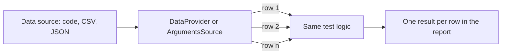

## Beginner-friendly explanation

Think of a cake mould. You pour in chocolate batter, then vanilla, then lemon: same mould, different cakes. You do not build a new mould for each flavour.

**Data-driven testing** is a test mould. You write the steps once — "enter the coupon, click Apply, check the result" — then pour in different data: a valid coupon, an expired one, an empty one. Each run is reported as its own test, so you can see exactly which flavour failed.

## Technical explanation

Data-driven testing separates **test logic** from **test data**. The framework runs the logic once per data row and reports each invocation individually.

### Choosing the data

Rows should come from test design techniques, not guesswork:

| Source technique | Example rows for "age 18 to 60" |
|---|---|
| [Boundary value analysis](/learn/manual-testing/boundary-value-analysis) | 17, 18, 60, 61 |
| [Equivalence partitioning](/learn/manual-testing/equivalence-partitioning) | 10 (invalid low), 35 (valid), 75 (invalid high) |
| Decision tables | Combinations of member/non-member and coupon/no coupon |

### TestNG

- `@DataProvider(name = "x")` returns `Object[][]` or `Iterator<Object[]>`.
- `@Test(dataProvider = "x")` receives one row per invocation; parameter count and types must match.
- `dataProviderClass` lets you keep providers in a separate class.
- `@DataProvider(parallel = true)` runs rows concurrently; the suite attribute `data-provider-thread-count` controls the pool (default 10).
- `@Parameters` is different: it reads single values from testng.xml, typically environment settings such as browser.

### JUnit 5

`@ParameterizedTest` with `@ValueSource`, `@CsvSource`, `@CsvFileSource` or `@MethodSource`. The `name` attribute customises how each invocation is displayed.

### BDD

Cucumber expresses the same idea with **Scenario Outline** and **Examples** tables (see [Cucumber and BDD](/learn/automation/cucumber-bdd)).



## Real-world example

A tax-filing product had to validate dozens of identifier formats across regions. The team first wrote one test per format, copying the same steps each time; a change to the form's submit button meant editing every copy. They replaced them with a single data-driven test fed from a CSV maintained jointly with the business analyst, with columns for region, input, expected result and a human-readable description. Adding a new rule became a one-line data change that the analyst could review, and failures named the exact rule that broke.

## Step-by-step walkthrough

1. **Confirm the steps are identical** for every case; only data and expected result vary.
2. **Derive rows** from BVA, EP or decision tables.
3. **Add a description column** so reports name the case.
4. **Choose the source**: inline for small, rule-documenting sets; files for larger or business-owned sets.
5. **Implement the provider** and match parameter types exactly.
6. **Keep rows independent**; generate unique data (such as emails) when tests create records.
7. **Run and read** the per-row results.

## Code examples

A TestNG DataProvider reading a CSV with a header row:

```java
import java.io.IOException;
import java.io.UncheckedIOException;
import java.nio.file.Files;
import java.nio.file.Path;
import java.util.List;
import org.testng.Assert;
import org.testng.annotations.DataProvider;
import org.testng.annotations.Test;

public class CouponTests extends BaseTest {

    // src/test/resources/coupons.csv
    // description,code,expectedMessage
    // valid ten percent,SAVE10,Coupon applied
    // expired coupon,EXPIRED5,This coupon has expired
    // empty input,,Enter a coupon code

    @DataProvider(name = "coupons")
    public Object[][] coupons() {
        try {
            List<String> lines = Files.readAllLines(Path.of("src/test/resources/coupons.csv"));
            return lines.stream()
                    .skip(1)                                   // header
                    .map(line -> (Object[]) line.split(",", -1)) // -1 keeps the empty code
                    .toArray(Object[][]::new);
        } catch (IOException e) {
            throw new UncheckedIOException("Cannot read coupons.csv", e);
        }
    }

    @Test(dataProvider = "coupons")
    public void couponShowsExpectedMessage(String description, String code, String expectedMessage) {
        String message = new CartPage(driver).open(Config.BASE_URL).applyCoupon(code);
        Assert.assertEquals(message, expectedMessage, description);
    }
}
```

The JUnit 5 equivalent uses `@ParameterizedTest(name = "{0}")` and `@CsvFileSource(resources = "/coupons.csv", numLinesToSkip = 1)` on a method with the same three parameters.

## Expected output

Illustrative TestNG output when the expired-coupon row fails; the description column makes the failure self-explanatory:

```text
PASSED: couponShowsExpectedMessage("valid ten percent", "SAVE10", "Coupon applied")
PASSED: couponShowsExpectedMessage("empty input", "", "Enter a coupon code")
FAILED: couponShowsExpectedMessage("expired coupon", "EXPIRED5", "This coupon has expired")
java.lang.AssertionError: expired coupon expected [This coupon has expired] but found [Coupon applied]
```

## Common mistakes

- **Random or arbitrary data** that does not target any boundary or partition.
- **Conditionals in the test** (`if (row == 3) ...`) to handle special rows; they need their own test.
- **Rows that depend on each other**, such as row 2 using the account row 1 created.
- **Hardcoded unique values** like a fixed email that only works on the first run.
- **No description**, so failures read as a list of anonymous values.
- **Naive CSV parsing** with `split(",")` when values may contain commas; use a CSV library for real data.

## Troubleshooting

- **"data provider mismatch"**: row length or types do not match the method signature.
- **File not found in CI**: resolve paths from the classpath (`getResourceAsStream`) or the project root consistently.
- **Rows interfere in parallel**: they share an account or record; give each row its own data.
- **Reports show only one result**: the method is not linked to the provider name, or the provider returned a single row.

## Key takeaways summary

Data-driven testing removes duplication when only the data changes. Pick rows with test design techniques, label every row, keep rows independent, and choose inline or external data based on who maintains it. When steps start to differ between rows, split the test instead.
