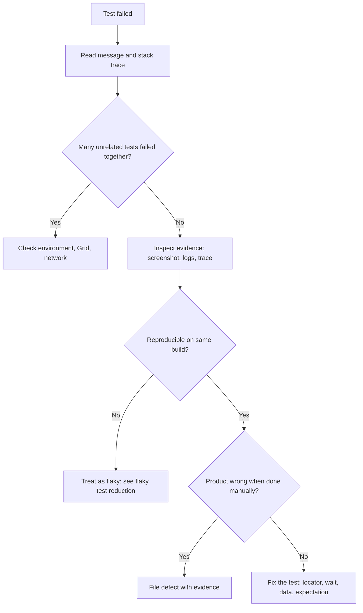

## Beginner-friendly explanation

When a car will not start, a good mechanic does not replace parts at random. They ask questions in order: is the battery dead? Is there fuel? Does the starter click? Each answer narrows the search.

**Debugging a failing test** is the same disciplined questioning. The red result only says "something is wrong". Your job is to find out *what* and *where*: is the product broken, is the test wrong, or was the environment having a bad day? Following the same steps every time makes you fast and keeps you from "fixing" a test that was correctly catching a real bug.

## Technical explanation

### Three possible culprits

| Culprit | Typical signals |
|---|---|
| Product bug | Assertion failure; reproducible manually; recent product change |
| Test bug | `NoSuchElementException`, stale element, wrong expected value, bad data; product works manually |
| Environment | Many unrelated failures at once; timeouts; 502/503 responses; Grid or database down |

### Reading a stack trace

The top line is the exception type and message. Below are frames, most recent call first. Skip framework frames (`org.openqa.selenium`, `org.testng`) and find the first frame in **your** package.

### Tools

- **Evidence**: screenshots, page source, logs, videos, Playwright traces.
- **Breakpoints**: run the test in debug mode in your IDE, pause before the failing line and inspect variables and the live browser.
- **Browser DevTools**: check the element, console errors and network calls in the paused browser.
- **Bisecting**: compare a passing and failing build, or comment out steps until the failure disappears.



## Real-world example

A test for applying a discount code started failing with `expected [90.00] but found [100.00]`. The screenshot showed the code accepted but the total unchanged. Doing it manually gave the same result, and the API response showed the discount missing from the cart total. The tester filed a defect with the screenshot, API response and build number; developers traced it to a rounding refactor merged the day before. The test was correct, and "fixing" it by changing the expected value would have shipped the bug.

## Step-by-step walkthrough

1. **Read the failure**: exception type, message, failing line in your code.
2. **Look at the scope**: one test, one class, or many unrelated tests?
3. **Check the evidence**: screenshot, page source, logs, trace, environment, build version.
4. **Reproduce** on the same build locally or against the same environment.
5. **Narrow down** with breakpoints, extra logging or running steps manually.
6. **Classify**: product, test or environment.
7. **Act**: file a defect, fix the test, or escalate the environment.
8. **Prevent**: improve evidence, add a wait, tighten a locator, or add a unit test.

## Code examples

A typical stack trace (trimmed):

```text
org.openqa.selenium.NoSuchElementException: no such element: Unable to locate element:
  {"method":"css selector","selector":"[data-testid='apply-coupon']"}
    at org.openqa.selenium.remote.RemoteWebDriver.findElement(RemoteWebDriver.java:...)
    at com.example.pages.CartPage.applyCoupon(CartPage.java:42)
    at com.example.tests.CouponTests.tenPercentCoupon(CouponTests.java:27)
```

The first frame in our code is `CartPage.java:42`: the coupon button was not found. Next questions: did the locator change, or had the cart not loaded yet?

Adding diagnostic logging temporarily:

```java
log.debug("URL before apply: {}", driver.getCurrentUrl());
log.debug("Buttons on page: {}", driver.findElements(By.tagName("button")).size());
```

Recording and opening a Playwright trace:

```bash
npx playwright test tests/cart.spec.ts --trace on
npx playwright show-trace test-results/<test-folder>/trace.zip
```

The trace viewer shows each action, DOM snapshots before and after, console and network.

## Expected output

After classifying, you should be able to write one sentence such as: "Test bug: the cart loads asynchronously and `applyCoupon` clicked before the button rendered; fixed by waiting for the button to be clickable." If you cannot write that sentence, you have not finished debugging.

## Common mistakes

- **Changing the expected value** to match the actual result without checking the product.
- **Rerunning until green** and moving on.
- **Reading only the last line** of the stack trace.
- **Debugging on a different build** from the one that failed.
- **Leaving debug code** such as sleeps or extra prints in the final fix.
- **Not sharing findings**, so the next person repeats the investigation.

## Troubleshooting

- **Cannot reproduce locally**: match browser version, screen size, headless mode, test data and environment URL with CI.
- **Breakpoint never hit**: you are running in Run, not Debug mode, or a different test is executing.
- **Element exists in DevTools but not found**: check for iframes, shadow DOM or a new window.
- **Passes in debug mode only**: pausing gives the page time to load, a strong sign of a missing wait.

## Key takeaways summary

Debugging is a method, not a talent. Read the evidence, check the scope, reproduce, narrow down, classify and then act. Protect the product by never adjusting a test just to make it green, and leave the framework better at explaining the next failure.
