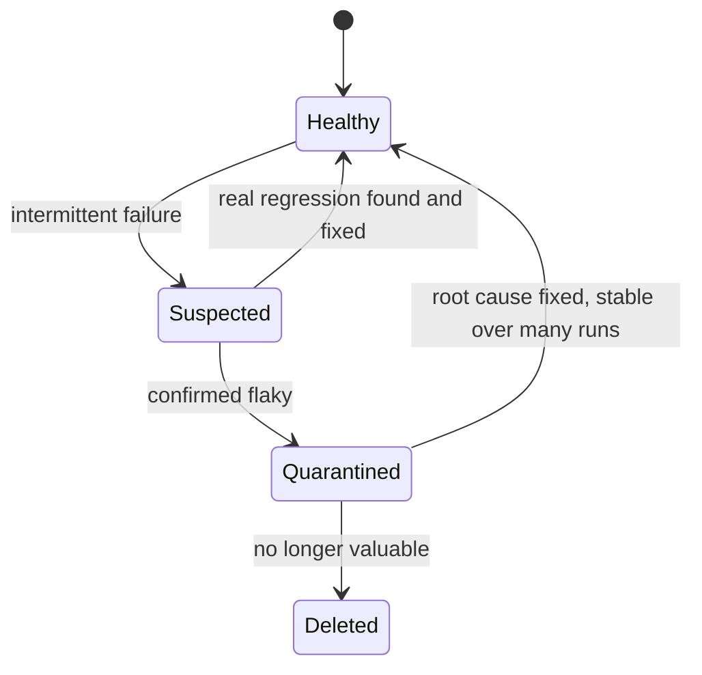

## Beginner-friendly explanation

Imagine a smoke alarm that sometimes beeps when there is no fire. After a few false alarms, people start ignoring it. Then one day there is a real fire, and nobody reacts.

A **flaky test** is that alarm. It passes, then fails, then passes again, with no change to the code. The real damage is not one red build; it is that the team learns to shrug at failures and click "rerun". Once that habit forms, real bugs slip through. Reducing flakiness is about restoring trust, so red means "something is actually wrong".

## Technical explanation

A test is **flaky** when it produces different outcomes for the same code and configuration. It is non-deterministic.

### Root causes

| Category | Example | Typical fix |
|---|---|---|
| Timing / async | Clicking before a button is enabled | Explicit waits on conditions; auto-waiting tools |
| Shared state | Two tests edit the same account | Unique data per test |
| Order dependency | Test B needs data from test A | Each test sets up its own preconditions |
| Environment | Slow shared staging, third-party outage | Stable environments, stubs for external services |
| Randomness / time | Dates near midnight, random data hitting edge cases | Fixed clocks, seeded randomness, logged seeds |
| Brittle locators | Index-based XPath on dynamic lists | Stable attributes such as `data-testid` |
| Resource limits | Too many parallel browsers | Fewer threads or more capacity |
| Product race condition | Double-submit creates two orders | File a bug; this is a real defect |

### Detecting

- **Rerun on the same commit**: if results differ, it is flaky.
- **History**: CI dashboards and Allure history show tests flipping state.
- **Stress runs**: execute one test many times in a loop.
- **Retry reporting**: Playwright Test marks tests that fail then pass on retry as "flaky".

### Quarantine

Move confirmed flaky tests out of the blocking gate into a separate, still-running job, with an owner, a ticket and a time limit.



## Real-world example

A logistics team's pipeline was rerun on most merges "because the UI tests are flaky". They tagged every failure with a signature for two weeks. Most came from three causes: a spinner overlay not waited for, a shared "admin" account whose settings tests changed, and a test that assumed today's date was a weekday. Fixing those three removed most of the noise. One remaining intermittent failure turned out to be a real double-submit bug in the order form.

## Step-by-step walkthrough

1. **Collect evidence**: screenshot, logs, timings, environment, for every failure.
2. **Confirm flakiness**: rerun on the same build several times.
3. **Classify the cause** using the table above.
4. **Quarantine** if it blocks others, with an owner and deadline.
5. **Reproduce** locally with a loop, throttled network or CPU, or parallel load.
6. **Fix the root cause**, not the symptom.
7. **Verify** with many consecutive passes before returning it to the gate.

## Code examples

Replacing a sleep with a condition:

```java
// Before: flaky and slow
Thread.sleep(3000);
driver.findElement(By.id("confirm")).click();

// After: waits only as long as needed, for the real condition
WebDriverWait wait = new WebDriverWait(driver, Duration.ofSeconds(10));
wait.until(ExpectedConditions.invisibilityOfElementLocated(By.cssSelector(".spinner")));
wait.until(ExpectedConditions.elementToBeClickable(By.id("confirm"))).click();
```

Unique data per test:

```java
String email = "user+" + UUID.randomUUID() + "@example.test";
api.createUser(email, "Passw0rd!");
```

Stress-running one Playwright test to measure flakiness:

```bash
npx playwright test tests/checkout.spec.ts --repeat-each=50 --workers=4
```

TestNG can repeat a method with `@Test(invocationCount = 50)` while you investigate.

## Expected output

Playwright summarises outcomes such as:

```text
  48 passed
  2 failed
```

A pass rate below 100 percent on unchanged code confirms flakiness. With retries enabled, tests that fail then pass appear under a separate "flaky" count.

## Common mistakes

- **Adding `Thread.sleep`** to make the failure "go away".
- **Blind global retries** with no reporting of which tests needed them.
- **Deleting the test** without understanding the cause.
- **Quarantine forever**: quarantined tests with no owner never return.
- **Blaming the environment** without evidence.
- **Ignoring product races** that are real bugs.

## Troubleshooting

- **Only fails in CI**: CI machines are often slower; run locally with CPU or network throttling and headless mode.
- **Only fails in parallel**: look for shared data or static state.
- **Only fails at certain times**: check time zones, date boundaries and scheduled jobs.
- **Fails after a specific other test**: run the pair in that order to confirm an order dependency.

## Key takeaways summary

Flaky tests erode trust faster than they waste time. Treat each one as a bug in the test or the product: gather evidence, classify the cause, quarantine with ownership if needed, and fix the root cause. Sleeps and blind retries only postpone the problem.
