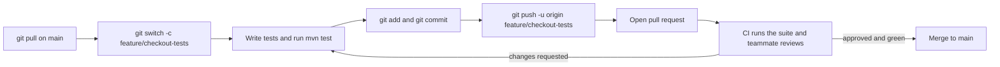

## Beginner-friendly explanation

Have you ever saved files called `report_final.docx`, `report_final_v2.docx`, `report_REAL_final.docx`? Git solves that problem properly. It keeps a complete history of every saved version (a **commit**), lets several people work on separate copies at the same time (**branches**), and helps combine their work safely.

For testers, Git matters because **automated tests are code**. They live in the same kind of repository as the application, get reviewed the same way, and run automatically whenever someone pushes a change. Git also gives you a time machine for investigating defects: you can find exactly when a behaviour changed.

## Technical explanation

### Core concepts

| Concept | Meaning |
|---|---|
| Repository | The project folder plus its full history (`.git`) |
| Working tree | The files you are editing now |
| Staging area (index) | Changes selected for the next commit (`git add`) |
| Commit | An immutable snapshot with author, message and parent |
| Branch | A movable pointer to a commit; `main` is the usual default |
| Remote | A shared copy, usually called `origin` |
| `HEAD` | What you currently have checked out |

### Everyday commands

- `git clone <url>`: copy a remote repository
- `git switch -c feature/x`: create and switch to a branch (`git checkout -b` is the older form)
- `git status`, `git diff`: see what changed
- `git add <file>`, `git commit -m "message"`: record a snapshot
- `git pull`: fetch and integrate remote changes; `git push`: publish yours
- `git log --oneline --graph`: view history
- `git stash`: shelve uncommitted work temporarily

### Feature-branch workflow with pull requests



Pull requests (or merge requests) are a feature of hosting platforms rather than of Git itself, but they are where review and CI meet.

### Conflicts

When two branches change the same lines, Git marks the file with `<<<<<<<`, `=======` and `>>>>>>>` sections. You edit the file to the correct final content, `git add` it and complete the merge or rebase. Always re-run the tests after resolving.

### .gitignore

Exclude generated and sensitive files: `target/`, `test-output/`, screenshots, logs, IDE folders (`.idea/`), and `.env` files with credentials.

## Real-world example

A testing team noticed that a discount was applied twice at checkout in the staging environment, but nobody knew when it started. A tester took a commit from two weeks earlier where the automated checkout test passed, and the current failing commit, then ran `git bisect` with the test as the oracle. In a handful of steps Git pointed at a single commit that refactored the price calculation. The defect report included the commit, which made the fix fast and the conversation factual rather than speculative.

## Step-by-step walkthrough

1. **Configure your identity once**: `git config --global user.name` and `user.email`.
2. **Clone and update**: `git clone`, then `git pull` on `main` before starting.
3. **Branch** per task with a descriptive name.
4. **Commit small and often**, with messages that explain why ("Add boundary tests for coupon expiry").
5. **Push and open a pull request**; let CI run.
6. **Respond to review** with new commits; keep the branch up to date with `main`.
7. **After merge**, delete the branch and pull `main` again.

## Code examples

Investigating a regression with `git bisect run`, using a Maven command as the automated check:

```bash
git bisect start
git bisect bad HEAD                 # current commit shows the bug
git bisect good 4f2a9c1             # an older commit where the test passed
git bisect run mvn -q test -Dtest=CheckoutTests#discountAppliedOnce
git bisect reset                    # return to where you started
```

`git bisect run` treats exit code 0 as good and non-zero (except 125, which means skip) as bad, which matches how Maven reports test success and failure.

A starter `.gitignore` for a Java test project:

```text
target/
test-output/
screenshots/
logs/
.idea/
*.iml
.env
```

## Expected output

Illustrative final output of the bisect run (hashes and names are made up for the example):

```text
a71c3e2b9d0f4e8c1a2b3c4d5e6f7a8b9c0d1e2f is the first bad commit
commit a71c3e2b9d0f4e8c1a2b3c4d5e6f7a8b9c0d1e2f
Author: Dev Example <dev@example.test>

    Refactor price calculation into PricingService

 src/main/java/com/shop/PricingService.java | 42 +++++++++++++++++++-------
 1 file changed, 30 insertions(+), 12 deletions(-)
bisect found first bad commit
```

## Common mistakes

- **Committing directly to `main`** instead of using a branch and pull request.
- **Huge commits** mixing unrelated changes, which are hard to review and revert.
- **Vague messages** like "fix" or "update tests".
- **Committing secrets** such as passwords or API tokens; removing them later does not remove them from history, so rotate the secret.
- **Resolving conflicts by blindly choosing "mine" or "theirs"** without understanding both changes.
- **Force-pushing shared branches.**

## Troubleshooting

- **"rejected: non-fast-forward" on push**: the remote has commits you lack; `git pull` (or `git pull --rebase` on your own branch) and push again.
- **Accidentally committed to `main` locally**: create a branch at that commit, then reset `main` to `origin/main` before pushing anything.
- **Lost work after a reset**: `git reflog` lists where `HEAD` has been, so you can recover the commit.
- **Line-ending noise on Windows**: configure `core.autocrlf` or a `.gitattributes` file consistently for the team.

## Key takeaways summary

Git is how test code is shared, reviewed and trusted. Work on branches, commit small and meaningful changes, keep generated files and secrets out, and use pull requests with CI as the gate. Beyond collaboration, Git's history is a powerful debugging tool: `git bisect` can pinpoint the change that broke a behaviour.
