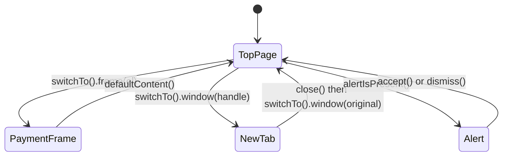

## Beginner-friendly explanation

Think of a shopping centre. You can only shop in one store at a time. To buy something in a different store you have to **walk into it**, and to get back to the main hall you have to **walk out**.

Selenium behaves the same way. An **iframe** is a page embedded inside another page, like a store inside the centre. A new **tab or window** is a different building. An **alert** is a security guard stopping you with a question you must answer before doing anything else. Selenium only "sees" the place it is currently standing in, so you must tell it explicitly where to go — and where to come back to.

## Technical explanation

Every WebDriver command runs in the **current browsing context**. The `switchTo()` API changes that context.

### Frames

An `iframe` contains its own document. Elements inside it are invisible to `findElement` until you switch:

| Call | Effect |
|---|---|
| `switchTo().frame(WebElement)` | Switch by element (most robust) |
| `switchTo().frame("nameOrId")` | Switch by name or id attribute |
| `switchTo().frame(0)` | Switch by index (fragile) |
| `switchTo().parentFrame()` | Up one level |
| `switchTo().defaultContent()` | Back to the top-level document |

`ExpectedConditions.frameToBeAvailableAndSwitchToIt(By)` waits and switches in one step.

### Windows and tabs

Each window or tab has a string **handle**. `getWindowHandle()` returns the current one; `getWindowHandles()` returns a `Set<String>` of all. Selenium 4 adds `switchTo().newWindow(WindowType.TAB)` or `WindowType.WINDOW` to open and switch in one step. Selenium **never** switches automatically when the application opens or closes a window.

### Alerts

JavaScript `alert`, `confirm` and `prompt` dialogs block the page. Use `switchTo().alert()` or `wait.until(ExpectedConditions.alertIsPresent())` to get an `Alert`, then `accept()`, `dismiss()`, `getText()` or `sendKeys()` (prompts only). Interacting with the page while an alert is open raises `UnhandledAlertException` (behaviour depends on the `unhandledPromptBehavior` capability).



## Real-world example

A travel booking team embedded a third-party card payment form in an iframe. Their checkout test passed locally but failed in CI with `NoSuchElementException` on the card number field. Locally, a developer had been running against a mock that rendered the field inline; in the shared test environment the real provider's iframe loaded a moment later. The fix was `frameToBeAvailableAndSwitchToIt` on the payment frame, filling the fields, then `defaultContent()` before clicking **Pay**, all wrapped in a `PaymentFrame` page-object method so no test had to think about frames again.

## Step-by-step walkthrough

1. **Inspect the DOM** for `iframe` ancestors when an element cannot be found.
2. **Switch with a wait** using `frameToBeAvailableAndSwitchToIt`.
3. **Act inside the frame**, then return with `defaultContent()`.
4. **Before opening a new tab**, store `getWindowHandle()`.
5. **Wait for the window count** with `numberOfWindowsToBe(n)` and switch to the new handle.
6. **Close and return** to the original handle when done.
7. **For alerts**, wait for `alertIsPresent()`, read the text if needed, then accept or dismiss.

## Code examples

```java
import java.time.Duration;
import org.openqa.selenium.*;
import org.openqa.selenium.support.ui.ExpectedConditions;
import org.openqa.selenium.support.ui.WebDriverWait;

public class ContextSwitchingDemo {

    static void fillCardInFrame(WebDriver driver, WebDriverWait wait) {
        wait.until(ExpectedConditions.frameToBeAvailableAndSwitchToIt(By.cssSelector("iframe[title='Card payment']")));
        driver.findElement(By.name("cardnumber")).sendKeys("4111111111111111");
        driver.switchTo().defaultContent();
        driver.findElement(By.id("pay")).click();
    }

    static String readHelpTabTitle(WebDriver driver, WebDriverWait wait) {
        String original = driver.getWindowHandle();
        driver.findElement(By.linkText("Help centre")).click();
        wait.until(ExpectedConditions.numberOfWindowsToBe(2));

        for (String handle : driver.getWindowHandles()) {
            if (!handle.equals(original)) {
                driver.switchTo().window(handle);
                break;
            }
        }
        String title = driver.getTitle();
        driver.close();                          // close the help tab
        driver.switchTo().window(original);      // focus does not return automatically
        return title;
    }

    static String dismissDeleteConfirm(WebDriver driver, WebDriverWait wait) {
        driver.findElement(By.id("delete")).click();
        Alert confirm = wait.until(ExpectedConditions.alertIsPresent());
        String message = confirm.getText();
        confirm.dismiss();
        return message;
    }
}
```

A test card number such as `4111111111111111` is a widely used dummy value for payment sandboxes; never use real card data in tests.

## Expected output

Illustrative output from a small test that calls the three helpers and prints their results:

```text
Help tab title: Help Centre
Confirm text: Delete item?
Back on: Checkout
```

## Common mistakes

- **Forgetting to switch back** with `defaultContent()`, so the next step fails to find elements on the main page.
- **Switching frames by index**, which breaks when a new iframe (for example an ad or chat widget) is added.
- **Assuming focus follows new tabs**, or assuming it returns after `close()`.
- **Handling alerts without waiting**, causing `NoAlertPresentException` when the dialog appears slightly later.
- **Trying to automate native OS dialogs** for uploads or downloads instead of using `sendKeys` on the file input and browser download preferences.
- **Confusing custom HTML modals with JavaScript alerts.** A styled modal is normal DOM; locate it like any element.

## Troubleshooting

- **`NoSuchFrameException`**: the frame is not loaded yet or the name is wrong; use the wait-and-switch condition with a CSS locator.
- **`NoSuchWindowException`**: you are focused on a window that was closed; switch to a valid handle.
- **`UnhandledAlertException`**: an unexpected alert appeared; capture its text in the failure report, since it often contains the real error.
- **Nested frames**: switch step by step from the top (`frame(outer)` then `frame(inner)`); use `parentFrame()` to go up one level.

## Key takeaways summary

Selenium acts in exactly one context at a time. Switch deliberately into frames, windows and alerts, wait for them to exist first, and always switch back. Hide that switching inside page-object methods so tests read as business steps, not navigation instructions.
