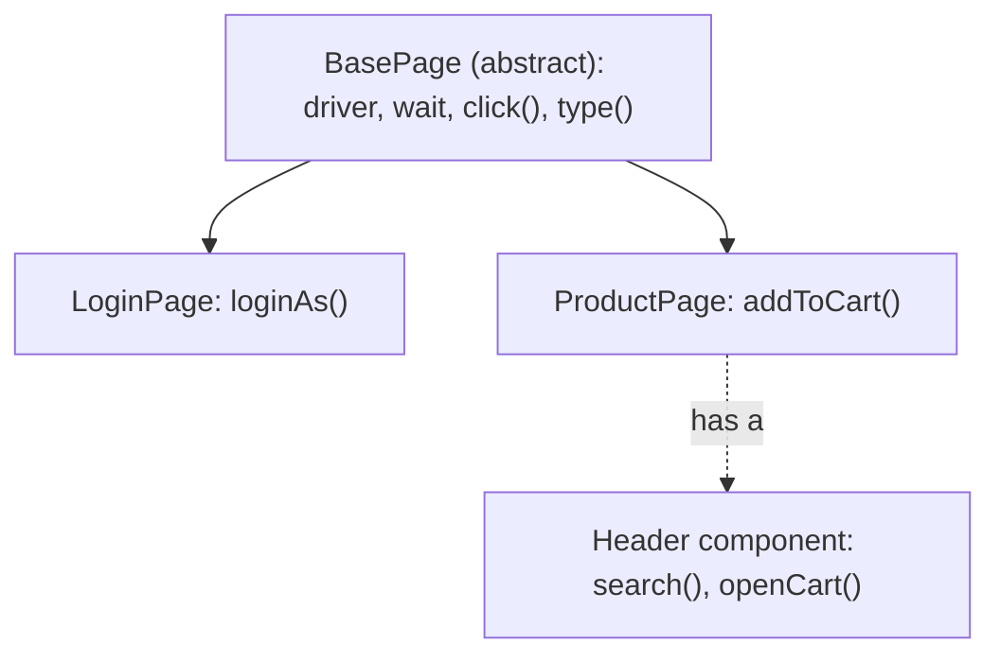

## Beginner-friendly explanation

Imagine a TV remote. You press **Volume up** without knowing anything about the circuits inside. The remote hides the complexity (that is **encapsulation**), every brand's remote has a volume button that behaves the same way from your point of view (**polymorphism**), and a "smart remote" is still a remote with extra buttons (**inheritance**).

Object-oriented programming (OOP) lets you build test code the same way. A `LoginPage` object has buttons like `loginAs(user)`; the test presses them without caring which HTML element sits underneath. When the page changes, you fix the inside of the remote once, and every test that uses it keeps working.

## Technical explanation

### Classes, objects and constructors

A **class** defines fields (state) and methods (behaviour). An **object** is an instance created with `new`. A **constructor** initialises the object; use `this.field = parameter` to assign fields when names clash.

Access modifiers control visibility: `private` (this class only), package-private (no keyword), `protected` (package plus subclasses) and `public`.

### The four principles in automation

| Principle | Meaning | Automation example |
|---|---|---|
| Encapsulation | Hide state, expose behaviour | Private `By` locators, public `loginAs()` |
| Inheritance | A subclass reuses and extends a parent | `LoginPage extends BasePage` sharing the driver and waits |
| Polymorphism | One interface, many implementations; overriding resolves at run time | `WebDriver` implemented by `ChromeDriver`, `FirefoxDriver`, `RemoteWebDriver` |
| Abstraction | Expose *what*, hide *how* | A `DriverFactory` interface; an abstract `BaseTest` |

**Overloading** (same method name, different parameters, chosen at compile time) is different from **overriding** (a subclass replaces a parent method, chosen at run time).

### Interfaces and abstract classes

An **interface** declares capabilities (`WebDriver`, `TakesScreenshot`, `JavascriptExecutor`). A class can implement many interfaces, which is why you can cast a `ChromeDriver` to `TakesScreenshot`. An **abstract class** can hold shared code and state but cannot be instantiated; `BasePage` is often abstract.

### Composition over inheritance

Inheritance is for "is a"; composition is for "has a". A product page *has a* header and a search bar. Model those as component classes the page holds as fields, instead of building tall inheritance chains.



## Real-world example

An insurance team's framework started with every page class extending a `HeaderPage`, which extended a `NavigationPage`, which extended `BasePage`. When the header was redesigned, a single changed method broke forty page classes in different ways. The team refactored the header into a `Header` component held by the pages that actually show it. The next redesign touched one class.

## Step-by-step walkthrough

1. **Create an abstract `BasePage`** holding a `protected final WebDriver driver` and a `WebDriverWait`.
2. **Add small shared helpers** (`click(By)`, `type(By, String)`) that wait before acting.
3. **Create page classes** that extend `BasePage`, keep locators `private`, and expose business actions.
4. **Return the next page object** from navigation actions so tests read as a flow.
5. **Keep assertions in the test class**, using getters such as `errorMessage()`.
6. **Extract repeated widgets** into component classes and compose them.

## Code examples

```java
// BasePage.java and LoginPage.java (shown together; each public class lives in its own file)
import java.time.Duration;
import org.openqa.selenium.By;
import org.openqa.selenium.WebDriver;
import org.openqa.selenium.support.ui.ExpectedConditions;
import org.openqa.selenium.support.ui.WebDriverWait;

public abstract class BasePage {
    protected final WebDriver driver;
    protected final WebDriverWait wait;

    protected BasePage(WebDriver driver) {
        this.driver = driver;
        this.wait = new WebDriverWait(driver, Duration.ofSeconds(10));
    }

    protected void type(By locator, String text) {
        var field = wait.until(ExpectedConditions.visibilityOfElementLocated(locator));
        field.clear();
        field.sendKeys(text);
    }

    protected void click(By locator) {
        wait.until(ExpectedConditions.elementToBeClickable(locator)).click();
    }
}

public class LoginPage extends BasePage {
    private final By username = By.id("username");
    private final By password = By.id("password");
    private final By submit = By.cssSelector("button[type='submit']");

    public LoginPage(WebDriver driver) { super(driver); }

    public DashboardPage loginAs(String user, String pass) {
        type(username, user);
        type(password, pass);
        click(submit);
        return new DashboardPage(driver);
    }
}
```

A test then depends only on the interface and the page API:

```java
WebDriver driver = new ChromeDriver();   // Selenium Manager resolves the driver binary
DashboardPage dashboard = new LoginPage(driver).loginAs("demo", "s3cret");
System.out.println("Logged in as: " + dashboard.userName());
```

## Expected output

Illustrative output from running the snippet against a demo application:

```text
Logged in as: demo
```

If the constructor bug from the quiz were present (`driver = driver;`), the first action would instead fail with `java.lang.NullPointerException: Cannot invoke "org.openqa.selenium.WebDriver.findElement(...)" because "this.driver" is null`.

## Common mistakes

- **Public locators or `WebElement` fields** that tests poke at directly, defeating encapsulation.
- **Assertions inside page objects**, which makes pages hard to reuse for negative tests.
- **Deep inheritance chains** for things that are really components.
- **Static `WebDriver` fields** shared across all tests, which breaks parallel execution.
- **Confusing overloading with overriding** in interviews and in code reviews.
- **Forgetting `this.`** in constructors and setters.

## Troubleshooting

- **`NullPointerException` on `driver`**: check constructor assignments and that every page receives the driver.
- **`ClassCastException`**: you cast to an interface the object does not implement; check the concrete type.
- **A subclass method is never called**: the signature does not match the parent; add `@Override` so the compiler checks it.

## Key takeaways summary

OOP is what keeps a test framework maintainable. Encapsulate locators behind meaningful page methods, share genuine common behaviour through a base class, compose reusable widgets, and code against interfaces like `WebDriver`. These ideas lead directly into the [Page Object Model](/learn/automation/page-object-model).
