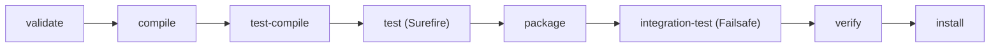

## Beginner-friendly explanation

Imagine cooking a recipe that needs twenty ingredients from different shops, in specific brands and sizes. You could shop by hand every time, or you could hand a shopping list to a service that fetches the exact items and follows the recipe steps in order.

**Maven** is that service for Java projects. You write a shopping list (the `pom.xml`) naming the libraries you need, such as Selenium and TestNG, and Maven downloads them. It also knows the standard recipe steps: compile the code, compile the tests, run the tests, package the result. You type one command and everything happens in the right order, the same way on your laptop and on the CI server.

## Technical explanation

Apache Maven is a build and dependency management tool built around a **Project Object Model**, the `pom.xml` file.

### Coordinates and dependencies

Every artifact is identified by `groupId`, `artifactId` and `version`. Dependencies are downloaded from a repository (Maven Central by default) into your local repository (`~/.m2/repository`). Libraries your dependencies need, called **transitive dependencies**, are downloaded automatically.

The `scope` controls where a dependency is visible:

| Scope | Compile main | Compile/run tests | Packaged |
|---|---|---|---|
| `compile` (default) | Yes | Yes | Yes |
| `test` | No | Yes | No |
| `provided` | Yes | Yes | No |
| `runtime` | No | Yes (runtime) | Yes |

### Standard layout

```text
my-tests/
  pom.xml
  src/main/java/        framework code (optional in pure test projects)
  src/test/java/        test classes
  src/test/resources/   testng.xml, config files, test data
  target/               build output, including surefire-reports
```

### Lifecycle

The **default lifecycle** includes `validate`, `compile`, `test-compile`, `test`, `package`, `integration-test`, `verify`, `install` and `deploy`. Running a phase runs all earlier ones. `clean` is a separate lifecycle that deletes `target/`.



Plugins do the real work. The **Surefire** plugin runs tests in the `test` phase; by default it includes classes named `Test*`, `*Test`, `*Tests` and `*TestCase`. The **Failsafe** plugin runs `*IT` classes during `integration-test` and fails the build in `verify`.

## Real-world example

A QA team keeps a Selenium suite in its own repository. Developers kept asking "which version of Selenium do I need?" and CI failed because one laptop had an old jar in a `lib/` folder. Moving to Maven fixed this: the `pom.xml` pins Selenium, TestNG and the Surefire version, CI runs `mvn -B clean test -Pstaging`, and the HTML and XML results in `target/surefire-reports` are archived by the pipeline.

## Step-by-step walkthrough

1. Install a JDK and Maven, then check with `mvn -v`.
2. Create the folder layout above and a `pom.xml`.
3. Add test dependencies with `<scope>test</scope>`.
4. Configure Surefire, pinning its version and pointing it to `testng.xml` if you use one.
5. Write a test under `src/test/java` and run `mvn test`.
6. Add profiles or `-D` properties for environments.

## Code examples

```xml
<project xmlns="http://maven.apache.org/POM/4.0.0">
  <modelVersion>4.0.0</modelVersion>
  <groupId>com.example.qa</groupId>
  <artifactId>web-tests</artifactId>
  <version>1.0.0</version>

  <properties>
    <maven.compiler.release>17</maven.compiler.release>
    <project.build.sourceEncoding>UTF-8</project.build.sourceEncoding>
  </properties>

  <dependencies>
    <dependency>
      <groupId>org.seleniumhq.selenium</groupId>
      <artifactId>selenium-java</artifactId>
      <version>4.25.0</version>
      <scope>test</scope>
    </dependency>
    <dependency>
      <groupId>org.testng</groupId>
      <artifactId>testng</artifactId>
      <version>7.10.2</version>
      <scope>test</scope>
    </dependency>
  </dependencies>

  <build>
    <plugins>
      <plugin>
        <groupId>org.apache.maven.plugins</groupId>
        <artifactId>maven-surefire-plugin</artifactId>
        <version>3.5.2</version>
        <configuration>
          <suiteXmlFiles>
            <suiteXmlFile>src/test/resources/testng.xml</suiteXmlFile>
          </suiteXmlFiles>
        </configuration>
      </plugin>
    </plugins>
  </build>

  <profiles>
    <profile>
      <id>staging</id>
      <properties>
        <baseUrl>https://staging.example.test</baseUrl>
      </properties>
    </profile>
  </profiles>
</project>
```

Versions above are examples; check Maven Central for the current release. A profile property is not automatically a JVM system property; pass it to tests through Surefire's `systemPropertyVariables` (for example `<baseUrl>${baseUrl}</baseUrl>`) or use `-DbaseUrl=...` directly.

```java
public class Config {
    public static final String BASE_URL =
        System.getProperty("baseUrl", "http://localhost:8080");
}
```

Everyday commands:

```bash
mvn clean test                          # fresh build and run all tests
mvn test -Dtest=LoginTests              # one class
mvn test -Dtest=LoginTests#validUser    # one method
mvn test -DbaseUrl=https://qa.example.test
mvn -B verify -Pstaging                 # batch mode, profile, integration tests
mvn dependency:tree                     # who brought in which library
```

## Expected output

```text
[INFO] -------------------------------------------------------
[INFO]  T E S T S
[INFO] -------------------------------------------------------
[INFO] Running com.example.qa.LoginTests
[INFO] Tests run: 2, Failures: 0, Errors: 0, Skipped: 0
[INFO] BUILD SUCCESS
```

## Common mistakes

- **Forgetting `scope`**, so test libraries leak into the packaged artifact.
- **Not pinning plugin versions**, letting builds change behaviour silently.
- **Expecting `mvn test` to run `*IT` classes**; those need Failsafe and `mvn verify`.
- **Hardcoding URLs and credentials** instead of using properties or environment variables.
- **Committing `target/`** or jars into the repository.
- **Mixing JUnit 4, JUnit 5 and TestNG** without understanding which Surefire provider runs which tests.

## Troubleshooting

- **"Tests run: 0"**: check class naming against include patterns, the framework dependency and its scope.
- **Dependency conflict (`NoSuchMethodError`)**: run `mvn dependency:tree` and exclude or align the conflicting version.
- **Corporate network blocks downloads**: configure a mirror or proxy in `~/.m2/settings.xml`.
- **Stale build output**: run `mvn clean test`.

## Key takeaways summary

Maven turns a folder of test code into a reproducible build. The `pom.xml` declares what you need; the lifecycle decides the order; Surefire and Failsafe run your tests and write reports CI can read. Master a handful of commands and properties, and your suite runs identically everywhere.
