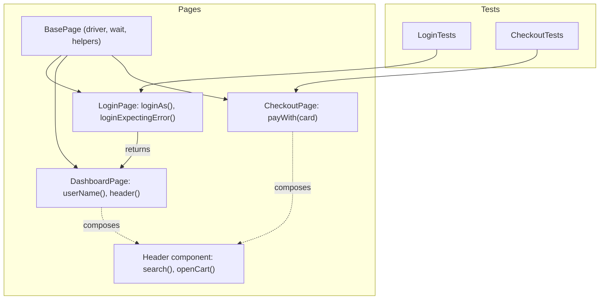

## Beginner-friendly explanation

Imagine writing instructions for a new employee: "Go to the third drawer of the grey cabinet, take the blue form, fill in boxes 4 and 7, and put it in the tray by the window." If the office is rearranged, you have to rewrite every instruction sheet.

A better approach is a single "Office guide" that says how to do things — "Submit expense form" — and instruction sheets that just say "Submit expense form for ₹2,000". When the office changes, you update the guide once.

The **Page Object Model (POM)** is that guide for a web application. Each page gets a class that knows *where* things are and *how* to use them. Tests only say *what* the user does and *what* should happen.

## Technical explanation

A **page object** is a class that wraps a page or a significant component and exposes its **services**. Rules of thumb from the Selenium documentation and common practice:

- **Locators are private.** Tests never see `By` or `WebElement`.
- **Public methods describe user intent**: `loginAs(user, pass)`, `searchFor(term)`, `addToCart(product)`.
- **Navigation methods return page objects**: `loginAs` returns `DashboardPage`; `loginExpectingError` returns the error text.
- **Waits live inside page methods**, so tests stay free of synchronization code.
- **Assertions live in tests**, so page methods are reusable for positive and negative cases.
- **Components** (header, date picker, cart drawer) are their own classes, composed into pages.



### PageFactory

Selenium's support package includes `PageFactory` and `@FindBy`, which create lazy element proxies. It is still available but optional; many teams prefer explicit `By` fields and waits, which avoid hidden lookups and stale proxies.

### Variations

- **Fluent page objects**: methods return `this` or the next page so steps chain.
- **Page component objects**: smaller classes for repeated widgets.
- **Screenplay pattern**: models actors, tasks and questions instead of pages, for very large suites (see [automation design patterns](/learn/automation/automation-design-patterns)).

## Real-world example

An e-commerce team had 300 UI tests, each with its own `driver.findElement(By.xpath(...))` calls for the checkout form. A redesign renamed several fields, and fixing the suite took two engineers most of a sprint. After introducing page objects for the checkout flow and a shared address-form component, the next redesign of that form was absorbed by updating one component class; the tests themselves did not change.

## Step-by-step walkthrough

1. **List the user journeys** your tests need, and the pages and components they touch.
2. **Create `BasePage`** with the driver, a `WebDriverWait` and small helpers.
3. **Create one class per page** with private `By` locators.
4. **Add methods for services**, waiting inside them before acting.
5. **Return the next page object** from methods that navigate.
6. **Expose state through getters** (`errorMessage()`, `itemCount()`) for tests to assert.
7. **Extract repeated widgets** into component classes.

## Code examples

```java
// LoginPage.java
public class LoginPage extends BasePage {
    private final By username = By.id("username");
    private final By password = By.id("password");
    private final By submit   = By.cssSelector("[data-testid='login-submit']");
    private final By error    = By.cssSelector("[role='alert']");

    public LoginPage(WebDriver driver) { super(driver); }

    public LoginPage open(String baseUrl) {
        driver.get(baseUrl + "/login");
        return this;
    }

    public DashboardPage loginAs(String user, String pass) {
        submitCredentials(user, pass);
        return new DashboardPage(driver);
    }

    public String loginExpectingError(String user, String pass) {
        submitCredentials(user, pass);
        return wait.until(ExpectedConditions.visibilityOfElementLocated(error)).getText();
    }

    private void submitCredentials(String user, String pass) {
        type(username, user);
        type(password, pass);
        click(submit);
    }
}

// LoginTests.java
public class LoginTests extends BaseTest {

    @Test
    public void validUserSeesTheirName() {
        DashboardPage dashboard = new LoginPage(driver).open(Config.BASE_URL).loginAs("demo", "s3cret");
        Assert.assertEquals(dashboard.userName(), "Demo User");
    }

    @Test
    public void wrongPasswordIsRejected() {
        String error = new LoginPage(driver).open(Config.BASE_URL).loginExpectingError("demo", "nope");
        Assert.assertEquals(error, "Invalid username or password");
    }
}
```

`BasePage` (with `type`, `click` and `wait`) is shown in [OOP for test automation](/learn/automation/java-oop-for-test-automation).

## Expected output

Illustrative TestNG summary after a successful run:

```text
===============================================
Default Suite
Total tests run: 2, Passes: 2, Failures: 0, Skips: 0
===============================================
```

## Common mistakes

- **Assertions inside page objects**, making methods unusable for negative tests.
- **Public `WebElement` fields or getters** that let tests bypass the page API.
- **"God" page objects** with hundreds of methods; split into components.
- **Static drivers** in base pages, breaking [parallel execution](/learn/automation/parallel-execution).
- **Methods named after UI mechanics** (`clickButton3`) rather than intent (`submitOrder`).
- **Deep inheritance** (`CheckoutPage extends CartPage extends HeaderPage`) instead of composition.

## Troubleshooting

- **`StaleElementReferenceException` with PageFactory**: the proxy refers to an element that re-rendered; switch to `By` fields and find after waiting.
- **Tests still contain `driver.findElement`**: a missing page method; add it rather than reaching around the page.
- **Page constructors fail on slow loads**: if you verify the page in the constructor, wait for a unique element there rather than checking immediately.

## Key takeaways summary

The Page Object Model separates intent from mechanics. Tests describe journeys and expectations; page and component classes own locators, waits and interactions. Done well, UI changes stay cheap and tests stay readable — which is the whole point of a maintainable framework.
