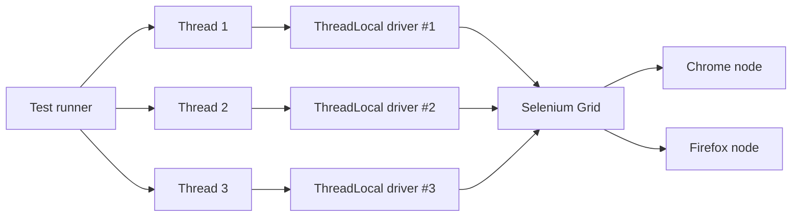

## Beginner-friendly explanation

A supermarket with one checkout lane and 100 customers has a long queue. Open four lanes and the queue moves about four times faster, as long as each cashier has their own till. If two cashiers shared one till drawer, they would keep miscounting each other's money.

**Parallel execution** opens more lanes for your tests. Instead of running 200 tests one after another, you run several at the same time. The "own till" rule is the important part: each test needs its own browser and its own data, or tests interfere with each other.

## Technical explanation

Test runners create a pool of **worker threads** (or separate processes) and hand tests to free workers.

### TestNG

Set `parallel` and `thread-count` on the `<suite>` in `testng.xml`. Values for `parallel` are `methods`, `classes`, `tests` and `instances`. Data providers can run in parallel with `@DataProvider(parallel = true)`, sized by `data-provider-thread-count`.

### JUnit 5

Parallelism is opt-in through configuration parameters, typically in `src/test/resources/junit-platform.properties`. `@Execution(ExecutionMode.SAME_THREAD)` and `@ResourceLock` let you exclude or guard specific tests.

### Thread-safe drivers

Each thread needs its own `WebDriver`. A `ThreadLocal<WebDriver>` stores one value per thread.



### Scaling with Grid

Locally, each browser consumes CPU and memory, so a laptop may manage only a few. **Selenium Grid** distributes sessions across nodes (often Docker containers); cloud device farms do the same at larger scale.

### Sharding

CI systems can also split the suite across several machines (sharding), each running its own parallel threads.

## Real-world example

A banking web team's regression suite grew to 90 minutes, so it ran only nightly. They introduced a `DriverManager` with `ThreadLocal`, made every test create its own customer through an API, and ran classes in parallel against a Docker-based Grid with six Chrome nodes. The suite ran in about 20 minutes, short enough to run on each merge to main. Around a dozen tests failed at first; every one revealed hidden shared data or order dependencies, which were fixed before the change was adopted.

## Step-by-step walkthrough

1. Remove ordering dependencies (`dependsOnMethods` chains, shared state between tests).
2. Replace static drivers with a `ThreadLocal` driver manager.
3. Make test data unique per test, for example with a timestamp or UUID suffix.
4. Enable parallelism with a small thread count (2 to 4).
5. Run the suite several times and fix any new intermittent failures.
6. Increase threads or add Grid nodes while watching duration and stability.

## Code examples

```java
public final class DriverManager {
    private static final ThreadLocal<WebDriver> DRIVER = new ThreadLocal<>();

    public static void start() { DRIVER.set(new ChromeDriver()); }
    public static WebDriver get() { return DRIVER.get(); }

    public static void stop() {
        WebDriver d = DRIVER.get();
        if (d != null) { d.quit(); }
        DRIVER.remove();               // avoid leaks on pooled threads
    }
}

public class BaseTest {
    @BeforeMethod public void setUp()    { DriverManager.start(); }
    @AfterMethod(alwaysRun = true) public void tearDown() { DriverManager.stop(); }
}
```

```xml
<!DOCTYPE suite SYSTEM "https://testng.org/testng-1.0.dtd">
<suite name="Regression" parallel="classes" thread-count="4">
  <test name="Web">
    <packages><package name="com.example.tests"/></packages>
  </test>
</suite>
```

```properties
# src/test/resources/junit-platform.properties
junit.jupiter.execution.parallel.enabled = true
junit.jupiter.execution.parallel.mode.default = concurrent
junit.jupiter.execution.parallel.config.strategy = fixed
junit.jupiter.execution.parallel.config.fixed.parallelism = 4
```

Remote driver for Grid:

```java
WebDriver driver = new RemoteWebDriver(new URL("http://localhost:4444"), new ChromeOptions());
```

## Expected output

Logging the thread id shows tests interleaving:

```text
[TestNG-PoolService-0] LoginTests.validUser started
[TestNG-PoolService-1] CartTests.addItem started
[TestNG-PoolService-2] SearchTests.byName started
Total tests run: 3, Passes: 3, Failures: 0, Skips: 0
```

Thread names vary by TestNG version.

## Common mistakes

- **Static `WebDriver`** or static page objects shared between threads.
- **Shared accounts and records** that tests modify.
- **Order dependencies** such as "test B uses the order created by test A".
- **Forgetting `ThreadLocal.remove()`**, leaving drivers attached to reused threads.
- **Too many threads** for the machine, causing timeouts that look like product bugs.
- **Non-thread-safe utilities**, such as a shared `SimpleDateFormat` or a static counter without synchronisation.

## Troubleshooting

- **Failures only in parallel**: run the failing test alone; if it passes, look for shared state.
- **Timeouts grow with thread count**: the machine or Grid is saturated; lower threads or add nodes.
- **Reports mix logs from tests**: include thread or test name in log lines and use per-test log context.
- **Grid queues sessions**: the number of node slots limits concurrency, not the thread count.

## Key takeaways summary

Parallel execution is the cheapest way to make a large suite fast, but it amplifies any design weakness. Independent tests, one driver per thread and unique data are the price of entry; pay it, and adding threads or Grid nodes turns hours into minutes.
