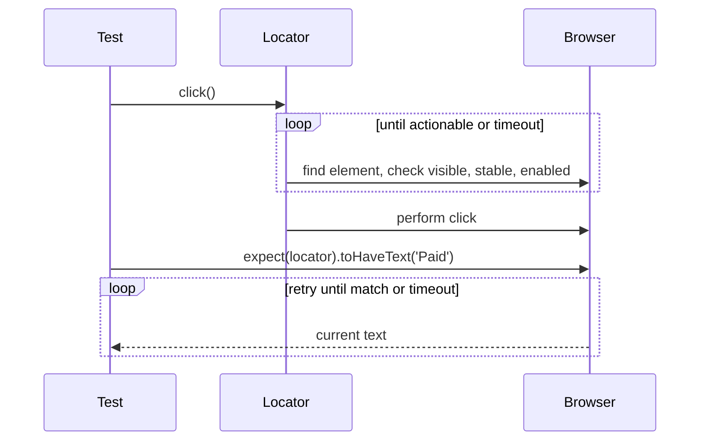

## Beginner-friendly explanation

Think of a very patient robot assistant who uses a website for you. You tell it "click the Sign in button" and it does not panic if the button is still loading; it waits until the button is really there and clickable, then clicks. When you ask "does the page say Paid?", it keeps looking for a few seconds before giving up.

**Playwright** is that robot. It drives real browsers, Chrome-like (Chromium), Firefox and Safari's engine (WebKit), and comes with its own test runner. **TypeScript** is JavaScript with types, which helps your editor catch mistakes before you run anything.

## Technical explanation

Playwright Test (`@playwright/test`) bundles the runner, assertions, fixtures and browser automation.

- **Browser, context, page**: one browser process; each test gets a new **browser context** (like a fresh incognito profile), and a **page** is a tab. This isolates cookies and storage between tests.
- **Fixtures**: tests receive objects such as `page`, `context` and `request` as arguments; the runner creates and cleans them up.
- **Locators**: lazy descriptions of how to find elements, resolved at action time. Recommended: `getByRole`, `getByLabel`, `getByPlaceholder`, `getByText`, `getByTestId`.
- **Actionability**: before `click`, Playwright checks the element is visible, stable, enabled and receives events.
- **Web-first assertions**: `await expect(locator).toBeVisible()` retries until it passes or times out (5 seconds by default).
- **Projects**: run the same tests in several browsers or device emulations.



## Real-world example

A SaaS team building a React dashboard had a Selenium suite with many explicit waits and frequent timing failures. They piloted Playwright on the login and billing flows, using role-based locators and web-first assertions. The pilot tests needed no custom wait code, ran in Chromium, Firefox and WebKit through projects, and failures in CI came with a trace file that showed DOM snapshots and network calls for every step. Based on the pilot, they wrote all new UI tests in Playwright while keeping the stable Selenium tests.

## Step-by-step walkthrough

1. Install Node.js (an active LTS release).
2. In an empty folder run `npm init playwright@latest` and accept TypeScript.
3. Look at `playwright.config.ts`, `tests/example.spec.ts` and the installed browsers.
4. Write a test using `getByRole` and `getByLabel` locators.
5. Run `npx playwright test`, then open the HTML report with `npx playwright show-report`.
6. Debug with `npx playwright test --ui` or `--debug`.
7. Record new steps with `npx playwright codegen <url>` and then clean up the generated code.

## Code examples

```typescript
// playwright.config.ts
import { defineConfig, devices } from '@playwright/test';

export default defineConfig({
  testDir: './tests',
  fullyParallel: true,
  retries: process.env.CI ? 2 : 0,
  reporter: 'html',
  use: {
    baseURL: 'http://localhost:3000',
    trace: 'on-first-retry',
  },
  projects: [
    { name: 'chromium', use: { ...devices['Desktop Chrome'] } },
    { name: 'firefox',  use: { ...devices['Desktop Firefox'] } },
    { name: 'webkit',   use: { ...devices['Desktop Safari'] } },
  ],
});
```

```typescript
// tests/login.spec.ts
import { test, expect } from '@playwright/test';

test.describe('login', () => {
  test.beforeEach(async ({ page }) => {
    await page.goto('/login');
  });

  test('valid user reaches the dashboard', async ({ page }) => {
    await page.getByLabel('Email').fill('demo@example.test');
    await page.getByLabel('Password').fill(process.env.DEMO_PASSWORD ?? '');
    await page.getByRole('button', { name: 'Sign in' }).click();

    await expect(page).toHaveURL(/\/dashboard/);
    await expect(page.getByRole('heading', { name: 'Welcome' })).toBeVisible();
  });

  test('wrong password shows an error', async ({ page }) => {
    await page.getByLabel('Email').fill('demo@example.test');
    await page.getByLabel('Password').fill('wrong');
    await page.getByRole('button', { name: 'Sign in' }).click();

    await expect(page.getByRole('alert')).toHaveText('Invalid email or password');
  });
});
```

Useful commands:

```bash
npx playwright test                       # all tests, all projects
npx playwright test --project=chromium    # one browser
npx playwright test login.spec.ts --headed
npx playwright test --ui                  # interactive UI mode
npx playwright show-report
```

## Expected output

```text
Running 6 tests using 3 workers
  6 passed (8.4s)

To open last HTML report run:
  npx playwright show-report
```

Two tests times three projects gives six runs. Timings vary.

## Common mistakes

- **Forgetting `await`**, so actions and assertions run out of order or never run.
- **Asserting on extracted values** (`textContent()` then `toBe`) instead of web-first assertions.
- **Using `page.waitForTimeout`** as a sleep; it is meant for debugging only.
- **CSS and XPath tied to layout** when a role or label locator exists.
- **Sharing state between tests** through module-level variables.
- **Committing secrets** in tests instead of reading environment variables.

## Troubleshooting

- **"Executable doesn't exist"**: run `npx playwright install` to download browsers (and `--with-deps` on Linux CI).
- **Strict mode violation**: the locator matched several elements; make it more specific or use `.first()` deliberately.
- **Timeout waiting for locator**: check the trace to see what the page looked like; the name or role may differ from what you expected.
- **Works headed, fails headless**: check viewport size and any features that differ in headless mode.

## Key takeaways summary

Playwright with TypeScript gives you fast, isolated, cross-browser tests with little waiting code. Use user-facing locators, web-first assertions and fresh contexts, and lean on UI mode and traces when something fails.
